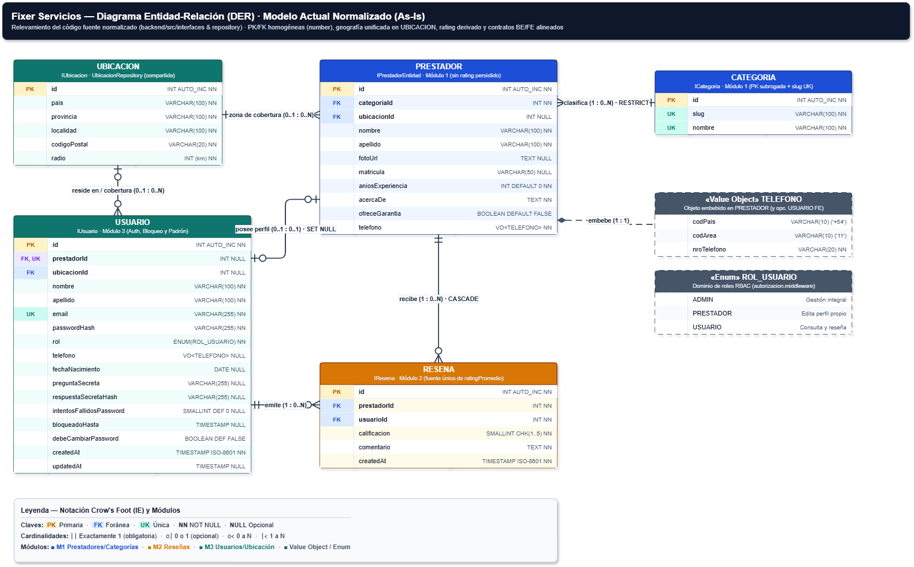

# Fixer Servicios 🛠️ — Plataforma de Gestión de Servicios Profesionales para el Hogar

**Trabajo Final Integrador — Universidad Tecnológica Nacional (UTN)**

**Fixer Servicios** es una aplicación web *Full-Stack* desarrollada con **Node.js, Express y TypeScript** en el Backend y **React 18, Vite y TypeScript** en el Frontend, contenerizada mediante **Docker Multi-Stage** y orquestada con **Docker Compose**. La plataforma conecta usuarios con profesionales calificados del hogar (plomería, electricidad, gas, carpintería, albañilería, entre otros), permitiendo gestionar el catálogo de prestadores y rubros, administrar reseñas y calificaciones verificadas, y gestionar el padrón de usuarios, ubicaciones y acceso.

---

## 👥 Integrantes del Grupo y Asignación de Módulos

El desarrollo se estructuró verticalmente en **3 módulos autónomos** a lo largo de **5 fases evolutivas**, donde cada integrante asumió la responsabilidad de extremo a extremo (*Infraestructura/Setup, Backend, Frontend, Exportación de Reportes, Mejoras Transversales UX/Seguridad y Suite de Pruebas Unitarias, de Integración, E2E y Postman*):

| Integrante | Módulo Asignado | Alcance Técnico Principal | Rama de Desarrollo |
| :--- | :--- | :--- | :--- |
| **Alejandro Lucas Baldres** | **Módulo 1: Prestadores, Categorías, Mapa y Seguridad Profesional** (`Prestador`, `Categoria`, `Ubicacion`, `Email`) | Base de Docker/Compose, configuración unificada de ESLint y TypeScript, normalización del modelo de datos en 3FN (claves numéricas homogéneas, `UbicacionRepository` compartido, `CATEGORIA` con clave subrogada + `slug` y `ON DELETE RESTRICT`, `ratingPromedio` derivado dinámicamente desde `RESENA`), API REST CRUD con foto de perfil (`fotoUrl`), alta por `ADMIN` con email obligatorio, generación criptográfica de contraseña temporal y envío por correo (`EmailService`), primer ingreso obligatorio exigiendo nueva contraseña + pregunta y respuesta secreta de recuperación, cambio de clave desde *"Mi Ficha Profesional"* con bloqueo de cuenta y edición por 30 minutos tras 3 intentos fallidos (`423 Locked`), geocodificación resiliente para Argentina (`Córdoba Capital`, capitales provinciales y `CABA`) con mapa `Leaflet`, vista Home (`/`), catálogo público (`/prestadores/catalogo`), tabla paginada (`/prestadores`, `/prestadores/:id`), exportación `.pdf`/`.xlsx` (`ExcelJS`) y suite completa de pruebas (Unit, Integration, E2E y Postman). | `feat/baldres-prestadores` |
| **Marianela Belardinelli Beker** | **Módulo 2: Reseñas, Calificaciones y Arquitectura UX/UI Global** (`Reseña`, `Puntuación`, `Comentario`, `UI Institucional`) | Configuración de Vitest, Supertest y fixtures, API REST CRUD de reseñas (`/api/v1/resenas`) con cálculo automático de promedio de estrellas, UI contextual de opiniones y formulario reactivo de alta/edición integrado en fichas profesionales, exportación de valoraciones y métricas en `.pdf` (`jsPDF`) y `.xlsx` (`ExcelJS`), sistema de diseño global (`variables.css`), navegación responsive (`Header` y `Footer`), páginas institucionales (`/como-funciona`, `/garantia`, `/panel-pro`) y suite de pruebas (Unit, Integration, E2E y Postman). | `feat/belardinelli-resena` |
| **Julieta Dabús** | **Módulo 3: Usuarios, Autenticación, Onboarding y Cobertura** (`Usuario`, `Ubicacion`, `CodigoPostal`) | Configuración de Playwright, middleware global de manejo de errores HTTP, API REST de autenticación y usuarios (`/api/v1/auth/*`, `/api/v1/usuarios`) con filtro universal y radio de cobertura, onboarding dual Usuario/Prestador con redirección inteligente por rol, vistas compactas en `100vh` sin scroll de Login, Registro en 2 columnas y Recuperación de clave, padrón paginado y perfil de usuario con mapa cartográfico de radio de cobertura (`RadioMapa` con `Leaflet` + `Nominatim`), exportación en `.xlsx`, documentación del Diagrama Entidad-Relación (`DER-Fixer-Servicios.png`) y suite de pruebas (Unit, Integration, E2E y Postman). | `feat/dabus-usuarios-auth` |

---

## 🏗️ Arquitectura y Estructura del Proyecto

El repositorio está organizado como un **Monorepo Lógico** con separación estricta entre el servidor de API REST (`backend/`), el cliente SPA (`frontend/`), las colecciones de prueba HTTP (`postman/`) y la documentación de ingeniería (`docs/`):

```text
fixerServicios/
├── compose.yml                                # Orquestación Docker Compose (Backend + Frontend)
├── .gitignore                                 # Reglas globales de exclusión de Git
├── README.md                                  # Documentación general y guía de reproducibilidad
│
├── backend/                                   # Servidor API REST (Node.js 20 + Express + TypeScript)
│   ├── Dockerfile                             # Build Multi-Stage (base -> builder -> production)
│   ├── .env.example                           # Plantilla de variables de entorno del Backend
│   ├── eslint.config.mjs                      # Configuración ESLint Flat Config (v9/v10)
│   ├── package.json                           # Manifiesto de dependencias y scripts del Backend
│   ├── pnpm-lock.yaml                         # Lockfile determinista de pnpm
│   ├── tsconfig.json                          # Configuración estricta de TypeScript (Node/CommonJS)
│   ├── vitest.config.mts                      # Configuración del runner de pruebas Vitest
│   └── src/
│       ├── app.ts                             # Punto de entrada de la aplicación
│       ├── core/
│       │   └── Servidor.ts                    # Configuración de Express, CORS, rutas y middlewares
│       ├── interfaces/                        # Contratos TypeScript normalizados (IPrestador, ICategoria, IResena, IUsuario, IUbicacion, RespuestaApi)
│       ├── repository/                        # Persistencia en memoria normalizada (prestador, categoria, ubicacion, resena, usuario)
│       ├── service/                           # Lógica de negocio, geocobertura, rating derivado, bloqueo de cuentas y EmailService
│       ├── controller/                        # Controladores HTTP, validación de payloads y envío de credenciales temporales
│       ├── route/                             # Definición de rutas REST (/prestadores, /categorias, /resenas, /usuarios, /auth)
│       ├── middlewares/                       # Manejo centralizado de errores (errorHandler.ts) y autorización/bloqueo por roles (autorizacion.middleware.ts)
│       └── __test__/                          # Pruebas Unitarias (*.unit.test.ts), Integración (*.integration.test.ts) y E2E (*.e2e.test.ts)
│           ├── fixtures/                      # Fábricas de datos de prueba (prestadores y reseñas)
│           └── helpers/                       # Instanciación de aplicación Express en memoria (crearApp.ts)
│
├── frontend/                                  # Cliente SPA (React 18 + Vite 5 + TypeScript)
│   ├── Dockerfile                             # Build Multi-Stage (dev -> builder -> Nginx production)
│   ├── .env.example                           # Plantilla de variables de entorno del Frontend
│   ├── eslint.config.js                       # Configuración ESLint con plugins React Hooks y React Refresh
│   ├── index.html                             # Plantilla HTML raíz
│   ├── package.json                           # Manifiesto de dependencias y scripts del Frontend
│   ├── playwright.config.ts                   # Configuración de pruebas E2E de navegador con Playwright
│   ├── pnpm-lock.yaml                         # Lockfile determinista de pnpm
│   ├── tsconfig.json                          # Configuración estricta de TypeScript (Bundler/DOM/JSX)
│   ├── vite.config.ts                         # Configuración de Vite y proxy reverso automático (/api -> Backend)
│   ├── vitest.config.ts                       # Configuración de Vitest para pruebas unitarias y de integración en cliente
│   ├── assets/
│   │   ├── fixer-logo.png                     # Logotipo institucional de Fixer Servicios
│   │   └── silueta-persona.svg                # Recurso vectorial de silueta por defecto para prestadores sin foto
│   ├── styles/
│   │   └── variables.css                      # Sistema de diseño y tokens CSS globales
│   ├── interfaces/                            # Contratos de datos alineados con Backend (prestador, resena, usuario)
│   ├── services/                              # Clientes HTTP, sesión/roles, geocoding Nominatim, cambio de clave/pregunta secreta y exportación (.pdf / .xlsx)
│   ├── components/
│   │   ├── header/                            # Barra de navegación global responsive y control de sesión por rol
│   │   ├── footer/                            # Pie institucional (con variante compacta sin scroll en vistas de autenticación)
│   │   ├── layout/                            # Layout general, compuerta de primer ingreso obligatorio y modo .layout-container--auth
│   │   ├── mapa/                              # RadioMapa (mapa interactivo Leaflet con círculo de cobertura)
│   │   ├── prestadores/                       # AvatarPrestador, CatalogoPrestadoresUsuario, TarjetaCatalogoPrestador, ListadoPrestadores, FormularioPrestador, FormularioCambioPassword
│   │   └── resenas/                           # ListadoResenas, FormularioResena, TarjetaResena, Estrellas y estilos
│   ├── pages/                                 # HomePage, PrestadoresPage, PrestadorDetallePage, ResenaPage, UsuariosPage, UsuarioDetallePage, LoginPage, RegistroPage, RecuperarPasswordPage, ComoFuncionaPage, GarantiaPage, PanelProPage
│   ├── src/
│   │   ├── main.tsx                           # Punto de montaje React DOM
│   │   ├── App.tsx                            # Definición de rutas con React Router v6
│   │   └── __test__/                          # Pruebas unitarias y de integración del Frontend (prestador, geocoding, cambioPassword, authLayout)
│   └── e2e/                                   # Especificaciones End-to-End con Playwright (layout, prestadores, resenas, seguridad-flujo)
│
├── postman/                                   # Colecciones Postman v2.1 para pruebas manuales y automatizadas de API
│   ├── Fixer_Coleccion.json                   # Colección unificada de Postman del proyecto Fixer Servicios
│   ├── prestadores (baldres)/                 # Colección Postman Módulo 1 (Prestadores y Categorías)
│   ├── resenas (belardinelli)/                # Colección Postman Módulo 2 (Reseñas y Calificaciones)
│   └── usuarios (dabus)/                      # Colección Postman Módulo 3 (Usuarios y Autenticación)
│
└── docs/                                      # Diagrama DER y Documentación Técnica de Ingeniería por Fase e Integrante
    ├── DER-Fixer-Servicios.png                # Diagrama Entidad-Relación normalizado (3FN)
    ├── fase1-baldres-infraestructura.md
    ├── fase1-belardinelli-testing.md
    ├── fase1-dabus-frontend-playwright.md
    ├── fase2-baldres-prestadores.md
    ├── fase2-belardinelli-resenas.md
    ├── fase2-dabus-usuarios-auth.md
    ├── fase3-baldres-prestadores.md
    ├── fase3-belardinelli-resenas.md
    ├── fase3-dabus-usuarios-auth.md
    ├── fase4-baldres-testing-postman.md
    ├── fase4-belardinelli-testing-postman.md
    ├── fase4-dabus-testing-postman.md
    ├── fase5-baldres-arquitectura-normalizacion-seguridad.md
    ├── fase5-belardinelli-ux-navegacion-exportacion.md
    └── fase5-dabus-onboarding-mapa-cobertura-der.md
```

---

## 📦 Requerimientos y Dependencias del Proyecto

### 1. Requisitos del Sistema
Para ejecutar el proyecto de manera reproducible se requiere contar con **una** de las siguientes configuraciones:

- **Opción A — Ejecución con Contenedores (Recomendada):**
  - **Docker Engine** `>= 24.0`
  - **Docker Compose** `v2.x` (`docker compose`)
- **Opción B — Ejecución Local en Sistema Anfitrión:**
  - **Node.js** `>= 20.x LTS` (imagen base de referencia: `node:20-alpine`)
  - **pnpm** `>= 9.x / 10.x` (habilitado de forma nativa mediante `corepack enable`)

---

### 2. Dependencias del Backend ([`backend/package.json`](./backend/package.json))

| Paquete | Versión | Tipo | Propósito en el Proyecto |
| :--- | :---: | :---: | :--- |
| `express` | `^4.19.2` | Producción | Framework HTTP para la construcción de la API REST (`/api/v1`). |
| `cors` | `^2.8.5` | Producción | Middleware de control de acceso entre orígenes (CORS). |
| `dotenv` | `^16.4.5` | Producción | Carga de variables de entorno desde archivo `.env`. |
| `typescript` | `^5.5.4` | Desarrollo | Compilador y verificador estático de tipos (`strict: true`). |
| `tsx` | `^4.19.0` | Desarrollo | Ejecución directa de TypeScript en desarrollo con recarga en caliente (`tsx watch`). |
| `vitest` | `^5.0.5` | Desarrollo | Runner de pruebas unitarias, de integración y E2E. |
| `supertest` | `^7.3.1` | Desarrollo | Pruebas de integración HTTP sobre la instancia de Express en memoria. |
| `eslint` / `typescript-eslint` | `^10.14.0` / `^8.2.0` | Desarrollo | Análisis estático de código bajo estándar Flat Config. |

---

### 3. Dependencias del Frontend ([`frontend/package.json`](./frontend/package.json))

| Paquete | Versión | Tipo | Propósito en el Proyecto |
| :--- | :---: | :---: | :--- |
| `react` / `react-dom` | `^18.3.1` | Producción | Biblioteca principal para la construcción de la interfaz de usuario reactiva. |
| `react-router-dom` | `^6.26.1` | Producción | Enrutamiento declarativo SPA (`/`, `/prestadores`, `/prestadores/catalogo`, `/prestadores/:id`, `/usuarios`, `/usuarios/:id`, `/login`, `/registro`, `/recuperar-password`, `/como-funciona`, `/garantia`, `/panel-pro`). |
| `exceljs` | `^4.4.0` | Producción | Generación de reportes y catálogos en formato binario OpenXML `.xlsx` (Prestadores y Reseñas). |
| `jspdf` / `jspdf-autotable` | `^4.2.1` / `^5.0.9` | Producción | Generación de reportes tabulares en formato `.pdf`. |
| `xlsx` | `^0.18.5` | Producción | Exportación de padrón de usuarios a hoja de cálculo `.xlsx`. |
| `leaflet` / `react-leaflet` | `1.9.4` / `4.2.1` | Producción | Mapa interactivo de zona y radio de cobertura profesional (`RadioMapa`). |
| `lucide-react` / `react-icons` | `^1.70.0` / `^5.7.0` | Producción | Iconografía vectorial de interfaz de usuario. |
| `vite` / `@vitejs/plugin-react` | `^5.4.1` / `^4.3.1` | Desarrollo | Servidor de desarrollo con HMR, proxy reverso `/api` y empaquetador de producción. |
| `@playwright/test` | `^1.64.1` | Desarrollo | Automatización de pruebas End-to-End (E2E) en navegador real (Chromium). |
| `typescript` / `eslint` | `^5.5.4` / `^10.14.0` | Desarrollo | Verificación de tipos (`tsc -b`) y linting de componentes React (`.ts`, `.tsx`). |

---

## 🚀 Guía de Instalación y Ejecución (Paso a Paso)

### Paso 1: Clonar el repositorio

```bash
git clone <URL_DEL_REPOSITORIO>
cd fixerServicios
```

### Paso 2: Configurar las variables de entorno (`.env`)

El proyecto incluye plantillas `.env.example` tanto en `backend/` como en `frontend/`. Creá los archivos `.env` a partir de las plantillas:

```bash
cp backend/.env.example backend/.env
cp frontend/.env.example frontend/.env
```

Para entorno de **desarrollo local o Docker Compose**, verificá que los archivos contengan los siguientes valores:

**`backend/.env`:**
```ini
PORT=3000
NODE_ENV=development
CORS_ORIGIN=http://localhost:5173
# Opcional: webhook HTTP para envío externo de correos de credenciales temporales
# Si no se configura, EmailService opera en modo simulado registrando el correo en consola
# EMAIL_WEBHOOK_URL=https://tu-relay-email.ejemplo/send
```

**`frontend/.env`:**
```ini
VITE_API_URL=http://localhost:3000/api/v1
```

---

### Paso 3 (Opción A — Recomendada): Levantar el proyecto con Docker Compose

Asegurate de que los puertos `3000` y `5173` estén libres en tu equipo y ejecutá desde la raíz del proyecto:

```bash
docker compose up --build
```

> **Nota para reconstrucción limpia:** Si se actualizaron dependencias en `package.json`, recreá los contenedores y sus volúmenes anónimos de `node_modules` ejecutando:
> ```bash
> docker compose down -v && docker compose up --build
> ```

Una vez iniciados los contenedores:
- **Frontend (SPA React):** [http://localhost:5173](http://localhost:5173)
- **Backend (Healthcheck API):** [http://localhost:3000/api/v1/health](http://localhost:3000/api/v1/health)

Para detener los servicios:
```bash
docker compose down
```

---

### Paso 4 (Opción B — Alternativa): Ejecución Local sin Docker (Node.js + pnpm)

Si preferís correr ambos servicios directamente en tu sistema operativo:

1. **Habilitar `pnpm` mediante Corepack e instalar dependencias de manera determinista:**
   ```bash
   corepack enable

   # Instalar dependencias del Backend
   cd backend
   pnpm install --frozen-lockfile

   # Instalar dependencias del Frontend
   cd ../frontend
   pnpm install --frozen-lockfile
   ```

2. **Iniciar el servidor Backend (Terminal 1):**
   ```bash
   cd backend
   pnpm run dev
   ```
   *(El servidor quedará escuchando en `http://localhost:3000`).*

3. **Iniciar el servidor Frontend (Terminal 2):**
   ```bash
   cd frontend
   pnpm run dev
   ```
   *(La aplicación estará disponible en `http://localhost:5173`).*

---

## 🧪 Ejecución de Pruebas Automatizadas y Calidad de Código

### 1. Pruebas del Backend (`backend/` — 14 suites / 125 tests)

Desde el directorio `backend/`:

```bash
cd backend

# Ejecutar toda la suite (Unitarias + Integración + E2E)
pnpm test

# Ejecutar únicamente pruebas unitarias (*.unit.test.ts)
pnpm run test:unit

# Ejecutar únicamente pruebas de integración con Supertest (*.integration.test.ts)
pnpm run test:integration

# Ejecutar únicamente pruebas E2E de API (*.e2e.test.ts)
pnpm run test:e2e

# Verificar calidad estática de código (ESLint) y compilación TypeScript
pnpm run lint
pnpm run build
```

### 2. Pruebas del Frontend (`frontend/` — 5 suites Vitest / 34 tests + 4 suites E2E Playwright)

Desde el directorio `frontend/`:

```bash
cd frontend

# Ejecutar pruebas unitarias y de integración del cliente (Vitest)
pnpm test
pnpm run test:unit
pnpm run test:integration

# Ejecutar pruebas End-to-End en navegador Chromium (Playwright)
# (Si es la primera vez en el equipo, instalar el navegador con: npx playwright install chromium)
pnpm run test:e2e

# Verificar linter y build de producción
pnpm run lint
pnpm run build
```

---

## 🔐 Modelo de Datos Normalizado y Políticas de Seguridad

### Diagrama Entidad-Relación (3FN)



### Reglas de Integridad, Onboarding y Seguridad

- **Normalización e Integridad Referencial (3FN):**
  - Claves primarias y foráneas numéricas homogéneas (`number`) en `USUARIO`, `UBICACION`, `CATEGORIA`, `PRESTADOR` y `RESENA`.
  - Geografía centralizada en [`UbicacionRepository`](./backend/src/repository/ubicacion.repository.ts) (`ubicacionId` compartido por `USUARIO` y `PRESTADOR`).
  - `CATEGORIA` con clave subrogada inmutable (`id`), `slug` único y protección `ON DELETE RESTRICT` (`409 Conflict` si hay prestadores asociados).
  - `ratingPromedio` derivado dinámicamente desde `RESENA`; la baja de un prestador ejecuta `ON DELETE CASCADE` sobre sus reseñas y `ON DELETE SET NULL` sobre `USUARIO.prestadorId`.
- **Alta de Prestadores por `ADMIN` y Configuración Obligatoria en el Primer Ingreso:**
  - Desde el panel administrador (`+ Nuevo Prestador`), se exige el correo electrónico del prestador; el backend genera una contraseña aleatoria criptográficamente segura (`crypto.randomInt`, 12 caracteres), crea la cuenta vinculada (`debeCambiarPassword: true`) y envía las credenciales vía [`EmailService`](./backend/src/service/email.service.ts).
  - Al iniciar sesión con esa clave temporal, el sistema despliega una pantalla obligatoria donde el prestador debe **definir su nueva contraseña por duplicado y configurar su pregunta y respuesta secreta de recuperación** antes de habilitar la navegación o la edición de *"Mi Ficha Profesional"*, dejando operativo el flujo de recuperación de cuenta.
- **Cambio de Contraseña en *"Mi Ficha Profesional"* y Bloqueo por 30 Minutos:**
  - Disponible mediante `PATCH /api/v1/usuarios/:id/password` y [`FormularioCambioPassword`](./frontend/components/prestadores/FormularioCambioPassword.tsx).
  - Solicita contraseña actual y nueva contraseña por duplicado. Tras **3 intentos fallidos** de contraseña actual, bloquea la cuenta por **30 minutos (`HTTP 423 Locked`)**, impidiendo el inicio de sesión, nuevos intentos de cambio y la edición de los datos en *"Mi Ficha Profesional"* hasta el vencimiento del plazo.
- **Experiencia de Autenticación sin Scroll (`100vh`) y Geocobertura Resiliente:**
  - Las vistas `/login`, `/registro` (organizada en 2 columnas responsive con alta dual Cliente/Prestador) y `/recuperar-password` activan `.layout-container--auth` para mostrar `Header + Formulario + Footer` completos en pantalla sin necesidad de scrollear.
  - [`geocoding.service.ts`](./frontend/services/geocoding.service.ts) y [`RadioMapa`](./frontend/components/mapa/RadioMapa.tsx) resuelven localidades argentinas (`Córdoba Capital`, capitales provinciales y `CABA`) con cadena de respaldo automática sobre Nominatim y caché en memoria.

---

## 📡 Resumen de Endpoints de la API REST (`/api/v1`)

| Módulo | Método | Endpoint | Descripción |
| :--- | :---: | :--- | :--- |
| **Sistema** | `GET` | `/api/v1/health` | Verificación de estado del servidor (`{ code: 200, msg: 'Ok', data: { status: 'up' } }`). |
| **Módulo 1: Prestadores** | `GET` | `/api/v1/prestadores` | Listado paginado con soporte para `?page=1&limit=10&rubro=Plomería&provincia=...&localidad=Córdoba%20Capital&search=...&sortBy=nombre&order=asc` (incluye `categoriaNombre`, geografía proyectada y `ratingPromedio` calculado dinámicamente). |
| **Módulo 1: Prestadores** | `GET` | `/api/v1/prestadores/:id` | Obtiene la ficha técnica detallada de un prestador por su ID. |
| **Módulo 1: Prestadores** | `POST` | `/api/v1/prestadores` | Registra un nuevo prestador (`fotoUrl`, `ubicacionId` o `provincia`/`localidad`/`radio`). Con rol `ADMIN` exige `email`, crea la cuenta `PRESTADOR` (`debeCambiarPassword: true`), genera contraseña segura aleatoria y la envía por correo (`409` si el email ya existe). |
| **Módulo 1: Prestadores** | `PUT` | `/api/v1/prestadores/:id` | Actualiza parcial o totalmente los datos y/o foto de perfil (`fotoUrl: ""` restaura la silueta). Rechaza con `403` si el prestador debe completar su configuración inicial de contraseña/pregunta secreta o con `423 Locked` si la cuenta está bloqueada. |
| **Módulo 1: Prestadores** | `DELETE` | `/api/v1/prestadores/:id` | Elimina un prestador aplicando `ON DELETE CASCADE` en reseñas y `ON DELETE SET NULL` en `USUARIO.prestadorId`. |
| **Módulo 1: Categorías** | `GET` | `/api/v1/categorias` | Lista los rubros profesionales (`{ id, slug, nombre }`) ordenados alfabéticamente (soporta `?search=`). |
| **Módulo 1: Categorías** | `POST` / `PUT` / `DELETE` | `/api/v1/categorias` | Alta, modificación y baja de categorías con unicidad de `slug`/`nombre` y `ON DELETE RESTRICT` (`409 Conflict` si posee prestadores asociados). |
| **Módulo 2: Reseñas** | `GET` | `/api/v1/resenas` | Lista reseñas paginadas por profesional (`?prestadorId=1&page=1&limit=5`) incluyendo el promedio calculado en `meta.promedio`. |
| **Módulo 2: Reseñas** | `GET` | `/api/v1/resenas/:id` | Obtiene el detalle de una reseña específica. |
| **Módulo 2: Reseñas** | `POST` / `PUT` / `DELETE` | `/api/v1/resenas/:id` | Creación, edición y eliminación de reseñas con validación de FKs (`prestadorId`, `usuarioId`), puntaje entero (`1..5`) y comentario obligatorio. |
| **Módulo 3: Auth y Usuarios** | `POST` | `/api/v1/auth/login` | Autenticación de usuarios registrados (retorna `debeCambiarPassword`; responde `423 Locked` si la cuenta está bloqueada). |
| **Módulo 3: Auth y Usuarios** | `POST` | `/api/v1/auth/pregunta-secreta` / `recuperar-password` / `cambiar-password` | Flujo de recuperación de contraseña en 3 pasos mediante pregunta y respuesta secreta. |
| **Módulo 3: Auth y Usuarios** | `GET` / `POST` / `PATCH` | `/api/v1/usuarios` | Listado paginado con búsqueda universal (sin exponer hashes), registro dual Cliente/Prestador y actualización normalizada de perfil/ubicación. |
| **Módulo 3: Seguridad** | `PATCH` | `/api/v1/usuarios/:id/password` | Cambio de contraseña autenticado con verificación de clave actual, doble confirmación de clave nueva, exigencia de `preguntaSecreta` + `respuestaSecreta` cuando `debeCambiarPassword` está activo, y bloqueo de 30 minutos (`423 Locked`) tras 3 intentos fallidos. |

---

## 📬 Colección Postman (`postman/`)

El repositorio incluye en el directorio [`postman/`](./postman) las colecciones listas para importar en **Postman** (`v2.1`):

- [`postman/Fixer_Coleccion.json`](./postman/Fixer_Coleccion.json): Colección integrada del proyecto Fixer Servicios con variable `{{baseUrl}}` preconfigurada en `http://localhost:3000/api/v1`.
- [`postman/prestadores (baldres)/prestadores_baldres.postman_collection.json`](./postman/prestadores%20%28baldres%29/prestadores_baldres.postman_collection.json): Colección del **Módulo 1 (Prestadores y Categorías)** con peticiones `GET`, `POST`, `PUT` y `DELETE`, aserciones automáticas (`200`, `201`, `400`, `404`) y respuestas de ejemplo.
- [`postman/resenas (belardinelli)/resenas_belardinelli.postman_collection.json`](./postman/resenas%20%28belardinelli%29/resenas_belardinelli.postman_collection.json): Colección del **Módulo 2 (Reseñas y Calificaciones)** con consultas filtradas/paginadas, cálculo de `meta.promedio`, alta, edición y eliminación con scripts de validación.
- [`postman/usuarios (dabus)/usuarios_dabus.postman_collection.json`](./postman/usuarios%20%28dabus%29/usuarios_dabus.postman_collection.json): Colección del **Módulo 3 (Usuarios y Autenticación)** cubriendo login, registro, recuperación por pregunta secreta, listado paginado y actualización de perfil.

---

## 📚 Documentación Técnica Adicional (`/docs`)

En el directorio [`docs/`](./docs) se encuentran el Diagrama Entidad-Relación y los **15 informes técnicos** detallados por fase e integrante:

- **Modelo de Datos:**
  - [Diagrama Entidad-Relación Normalizado (`DER-Fixer-Servicios.png`)](./docs/DER-Fixer-Servicios.png)
- **Fase 1 — Infraestructura, Testing Base y Setup E2E:**
  - [Fase 1 — Infraestructura, Docker y Base de Código (Alejandro L. Baldres)](./docs/fase1-baldres-infraestructura.md)
  - [Fase 1 — Infraestructura de Testing con Vitest y Supertest (Marianela Belardinelli Beker)](./docs/fase1-belardinelli-testing.md)
  - [Fase 1 — Infraestructura Frontend, Enrutador y Playwright (Julieta Dabús)](./docs/fase1-dabus-frontend-playwright.md)
- **Fase 2 — Desarrollo Backend y Capas de Dominio:**
  - [Fase 2 — Desarrollo Backend: Módulo Prestadores (Alejandro L. Baldres)](./docs/fase2-baldres-prestadores.md)
  - [Fase 2 — Desarrollo Backend: Módulo Reseñas y Calificaciones (Marianela Belardinelli Beker)](./docs/fase2-belardinelli-resenas.md)
  - [Fase 2 — Desarrollo Backend: Módulo Usuarios, Autenticación y Middleware Global (Julieta Dabús)](./docs/fase2-dabus-usuarios-auth.md)
- **Fase 3 — Desarrollo Frontend, UI y Exportación de Reportes:**
  - [Fase 3 — Desarrollo Frontend, Catálogo, Exportación y Seguridad por Roles: Módulo Prestadores (Alejandro L. Baldres)](./docs/fase3-baldres-prestadores.md)
  - [Fase 3 — Desarrollo Frontend, Feed de Opiniones y Exportación de Valoraciones: Módulo Reseñas (Marianela Belardinelli Beker)](./docs/fase3-belardinelli-resenas.md)
  - [Fase 3 — Desarrollo Frontend, Autenticación, Directorio, Cobertura y Exportación: Módulo Usuarios (Julieta Dabús)](./docs/fase3-dabus-usuarios-auth.md)
- **Fase 4 — Estrategia Integral de Testing y Colecciones Postman:**
  - [Fase 4 — Estrategia Integral de Testing (Unit, Integration, E2E) y Colección Postman: Módulo Prestadores (Alejandro L. Baldres)](./docs/fase4-baldres-testing-postman.md)
  - [Fase 4 — Estrategia Integral de Testing (Unit, Integration, E2E) y Colección Postman: Módulo Reseñas (Marianela Belardinelli Beker)](./docs/fase4-belardinelli-testing-postman.md)
  - [Fase 4 — Estrategia Integral de Testing (Unit, Integration, E2E) y Colección Postman: Módulo Usuarios y Autenticación (Julieta Dabús)](./docs/fase4-dabus-testing-postman.md)
- **Fase 5 — Arquitectura Transversal, Normalización, UX/UI, Mapas y Seguridad:**
  - [Fase 5 — Normalización 3FN, Geocodificación Resiliente y Seguridad de Cuentas (Alejandro L. Baldres)](./docs/fase5-baldres-arquitectura-normalizacion-seguridad.md)
  - [Fase 5 — Arquitectura UX/UI Global, Navegación Responsive, Páginas Institucionales y Exportación Integral (Marianela Belardinelli Beker)](./docs/fase5-belardinelli-ux-navegacion-exportacion.md)
  - [Fase 5 — Onboarding Dual Usuario/Prestador, Mapa de Cobertura con Geocodificación Dinámica y DER Actualizado (Julieta Dabús)](./docs/fase5-dabus-onboarding-mapa-cobertura-der.md)
