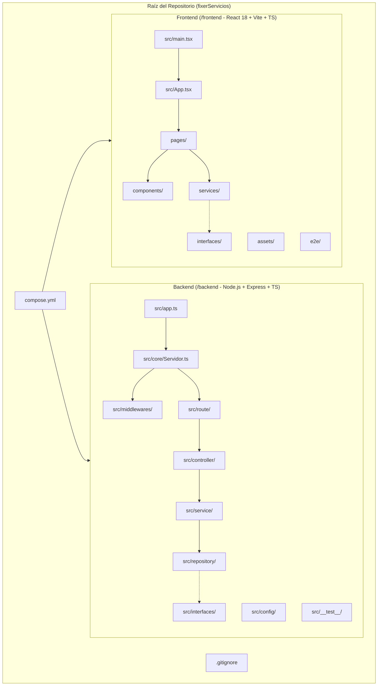
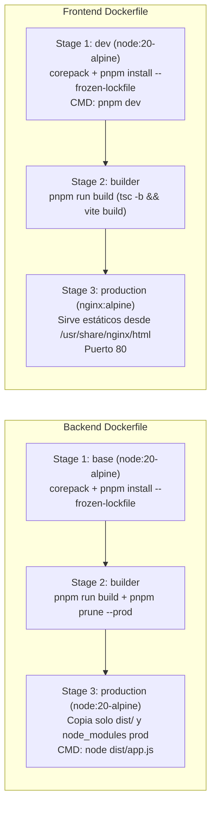

# Documento Técnico de Ingeniería: Fase 1 — Configuración de Infraestructura y Base de Código (FX-24)

**Proyecto:** Fixer Servicios (`fixerServicios`)  
**Responsable:** Alejandro L. Baldres — *Base Core y Docker*  
**Estado:** Implementado / Línea Base de Arquitectura (`Baseline`)

---

## 1. Resumen Ejecutivo y Objetivos de Arquitectura

El propósito de la **Fase 1** a cargo de **Alejandro L. Baldres** consiste en establecer los cimientos arquitectónicos, de infraestructura inmutable y de estandarización estática del código (`Developer Experience` y `Quality Gates`) para el ecosistema **Fixer Servicios**.

Las decisiones técnicas tomadas en esta etapa garantizan:
1. **Desacoplamiento y Escalabilidad Modular:** Separación estricta de responsabilidades bajo una arquitectura en capas (*Layered Architecture*) en el Backend y una arquitectura orientada a componentes/servicios en el Frontend.
2. **Paridad de Entornos (Dev/Prod Parity):** Uso de contenedores OCI mediante **Docker Multi-Stage Builds** y orquestación local con **Docker Compose**, utilizando **pnpm** (vía `Corepack`) para asegurar determinismo en el árbol de dependencias.
3. **Seguridad de Tipos y Calidad Estática:** Configuración estricta de **TypeScript (`strict: true`)** adaptada al entorno de ejecución (`Node.js` vs `Bundler/DOM`) y adopción del estándar moderno **ESLint v9/v10 Flat Config (`eslint.config.js`)**.

---

## 2. Arquitectura del Repositorio y Estructura Modular

El repositorio se organiza bajo un esquema **Multi-Proyecto / Monorepo Lógico** que separa claramente el servidor de aplicaciones ([`backend`](../backend)) del cliente SPA ([`frontend`](../frontend)), gobernados en su raíz por el orquestador [`compose.yml`](../compose.yml) y políticas globales de exclusión en [`.gitignore`](../.gitignore).



### 2.1. Estructura Modular del Backend (`/backend`)

El backend implementa una **Arquitectura en Capas (N-Tier)** encapsulada por la clase [`Servidor`](../backend/src/core/Servidor.ts) e inicializada en el punto de entrada [`app.ts`](../backend/src/app.ts). Esta separación facilita la inyección de dependencias y el aislamiento en pruebas unitarias, de integración y E2E:

| Directorio / Archivo | Responsabilidad Arquitectónica |
| :--- | :--- |
| [`src/app.ts`](../backend/src/app.ts) | Punto de entrada (`Entrypoint`). Carga variables de entorno (`dotenv`) e instancia [`Servidor`](../backend/src/core/Servidor.ts). |
| [`src/core/Servidor.ts`](../backend/src/core/Servidor.ts) | Núcleo HTTP Express. Registra middlewares globales (`CORS`, `express.json()`), expone el endpoint base `/api/v1/health` y monta los enrutadores de dominio. Expone `obtenerApp()` para facilitar pruebas con Supertest sin abrir sockets innecesarios. |
| `src/route/` | Definición de endpoints REST y mapeo hacia los métodos del controlador correspondiente. |
| `src/controller/` | Capa de transporte HTTP: desestructura `Request`, invoca la capa de servicio y formatea el `Response` bajo el contrato estandarizado de la API. |
| `src/service/` | Capa de lógica de negocio pura, desacoplada de Express y del mecanismo de persistencia. |
| `src/repository/` | Capa de acceso a datos (`Data Access Layer`), responsable de abstraer el almacenamiento (en memoria o base de datos) frente a los servicios. |
| `src/interfaces/` | Contratos de dominio y DTOs en TypeScript (`IRespuestaApi`, entidades de negocio y filtros). |
| `src/middlewares/` | Interceptores transversales (autenticación, validación de esquemas, manejo centralizado de errores). |
| `src/config/` | Módulos de configuración parametrizada del sistema. |
| `src/__test__/` | Suite de pruebas automatizadas (Unitarias, Integración y E2E) junto con `fixtures/` y `helpers/`. |

### 2.2. Estructura Modular del Frontend (`/frontend`)

El frontend está construido sobre **React 18**, **Vite 5** y **TypeScript**, siguiendo una estructura modular escalable:

| Directorio / Archivo | Responsabilidad Arquitectónica |
| :--- | :--- |
| [`index.html`](../frontend/index.html) & [`src/main.tsx`](../frontend/src/main.tsx) | Punto de montaje del DOM (`#root`) y bootstrapping de React en `StrictMode`. |
| [`src/App.tsx`](../frontend/src/App.tsx) | Configuración del enrutador declarativo (`react-router-dom`) y composición de vistas. |
| `components/` | Componentes UI reutilizables y layouts estructurales (ej. [`Layout.tsx`](../frontend/components/layout/Layout.tsx)). |
| `pages/` | Vistas de nivel superior asociadas a rutas específicas de la aplicación. |
| `services/` | Clientes HTTP y adaptadores de comunicación con la API REST del Backend (`VITE_API_URL`). |
| `interfaces/` | Definiciones de modelos de datos y contratos compartidos en el cliente. |
| `assets/` | Recursos estáticos (imágenes, íconos, hojas de estilo base). |
| `e2e/` | Especificaciones de pruebas End-to-End automatizadas con **Playwright**. |

---

## 3. Infraestructura de Contenedores y Orquestación (Docker)

### 3.1. Estrategia Multi-Stage en Dockerfiles

Se diseñaron `Dockerfile` multi-etapa tanto para Backend como para Frontend con el objetivo de:
- Aprovechar el **caching de capas de Docker** copiando primero los manifiestos de dependencias (`package.json`, `pnpm-lock.yaml`, `.npmrc`, `pnpm-workspace.yaml`) antes del código fuente.
- Utilizar **Corepack** sobre imágenes ligeras `node:20-alpine` para garantizar la versión exacta de `pnpm` e instalar dependencias de manera determinista con `--frozen-lockfile`.
- Reducir drásticamente la superficie de ataque y el peso de las imágenes de producción eliminando código fuente TypeScript y `devDependencies`.



#### Análisis de [`backend/Dockerfile`](../backend/Dockerfile)
1. **Etapa `base`:** Configura `PNPM_HOME`, habilita `corepack`, instala todas las dependencias con `--frozen-lockfile` y copia el contexto de trabajo (filtrando `node_modules`, `dist`, `.git` y `.env` mediante [`backend/.dockerignore`](../backend/.dockerignore)). Es el `target` utilizado en desarrollo.
2. **Etapa `builder`:** Transpila el código TypeScript a JavaScript (`pnpm run build` -> `./dist`) y ejecuta `pnpm prune --prod` para purgar librerías de desarrollo (`vitest`, `eslint`, `typescript`, `tsx`).
3. **Etapa `production`:** Imagen limpia `node:20-alpine` con `NODE_ENV=production` que recibe únicamente `package.json`, `node_modules` de producción y el compilado `dist/`, exponiendo el puerto `3000` y ejecutando `node dist/app.js`.

#### Análisis de [`frontend/Dockerfile`](../frontend/Dockerfile)
1. **Etapa `dev`:** Prepara el entorno con `node:20-alpine` y `pnpm`, expone el puerto `5173` para el servidor de desarrollo de Vite con Hot Module Replacement (HMR).
2. **Etapa `builder`:** Ejecuta `pnpm run build`, validando tipos con `tsc -b` y empaquetando los activos optimizados en `/app/dist`.
3. **Etapa `production`:** Utiliza `nginx:alpine` para servir los archivos estáticos compilados desde `/usr/share/nginx/html` en el puerto `80`, sin arrastrar el runtime de Node.js a producción.

### 3.2. Orquestación Local con [`compose.yml`](../compose.yml)

El archivo [`compose.yml`](../compose.yml) orquesta ambos servicios orientados al flujo de desarrollo ágil (`Live Reloading`):
- **Servicio `backend` (`fixer_backend`):** Construye la etapa `target: base`, mapea el puerto `3000:3000`, inyecta `./backend/.env`, monta el bind volume `./backend:/app` para reflejar cambios en tiempo real con `tsx watch`, y preserva `/app/node_modules` mediante un volumen anónimo para evitar colisiones de binarios entre el SO host y el contenedor Alpine.
- **Servicio `frontend` (`fixer_frontend`):** Construye la etapa `target: dev`, mapea `5173:5173`, inyecta `./frontend/.env`, monta `./frontend:/app` con volumen anónimo `/app/node_modules` y ejecuta `pnpm dev` (`vite --host` en [`vite.config.ts`](../frontend/vite.config.ts) para permitir tráfico desde la interfaz de red del contenedor).

---

## 4. Gestión de Configuración y Variables de Entorno (`.env.example`)

Siguiendo la metodología **Twelve-Factor App (Factor III: Config)**, los secretos y parámetros dependientes del entorno están excluidos del control de versiones ([`.gitignore`](../.gitignore) y `.dockerignore`) y documentados mediante plantillas `.env.example`:

### 4.1. Backend ([`backend/.env.example`](../backend/.env.example))
```ini
PORT=3000
NODE_ENV=produccion
CORS_ORIGIN=https://www.fixer.com.ar
```
- `PORT`: Puerto TCP en el que escucha la instancia de [`Servidor`](../backend/src/core/Servidor.ts) (con fallback seguro a `3000` en [`app.ts`](../backend/src/app.ts)).
- `NODE_ENV`: Identificador del entorno de ejecución (`desarrollo`, `test`, `produccion`).
- `CORS_ORIGIN`: Origen permitido en la política CORS configurada en `Servidor.middlewares()`.

### 4.2. Frontend ([`frontend/.env.example`](../frontend/.env.example))
```ini
VITE_API_URL=https://fixerapi.ejemplo.com/api/v1
```
- `VITE_API_URL`: Prefijo `VITE_` obligatorio para que Vite exponga la variable de forma segura en el bundle del navegador a través de `import.meta.env.VITE_API_URL`.

---

## 5. Automatización y Scripts de Ciclo de Vida (`package.json`)

Ambos paquetes definen `"type": "module"` y centralizan las tareas de desarrollo, compilación, calidad y pruebas en `package.json`. Además, incluyen [`.npmrc`](../backend/.npmrc) con `only-built-dependencies=esbuild` para autorizar la compilación nativa de `esbuild` en `pnpm` v10+.

### 5.1. Scripts del Backend ([`backend/package.json`](../backend/package.json))

| Script | Comando | Propósito Técnico |
| :--- | :--- | :--- |
| `dev` | `tsx watch src/app.ts` | Ejecución en caliente para desarrollo usando `tsx` (basado en `esbuild`). |
| `build` | `tsc` | Compilación estática y generación de artefactos JS en `./dist`. |
| `start` | `node dist/app.js` | Inicio del servidor compilado en entorno productivo. |
| `lint` / `lint:fix` | `eslint .` / `eslint . --fix` | Análisis estático de código y corrección automática de formato/reglas. |
| `test` | `vitest run` | Ejecución completa de todas las suites de pruebas en modo CI. |
| `test:unit` | `vitest run unit.test` | Ejecución filtrada únicamente para pruebas unitarias (`*.unit.test.ts`). |
| `test:integration` | `vitest run integration.test` | Ejecución filtrada para pruebas de integración (`*.integration.test.ts`). |
| `test:e2e` | `vitest run e2e.test` | Ejecución filtrada para flujos End-to-End de API (`*.e2e.test.ts`). |
| `test:watch` | `vitest` | Modo interactivo de pruebas durante el desarrollo (TDD). |

### 5.2. Scripts del Frontend ([`frontend/package.json`](../frontend/package.json))

| Script | Comando | Propósito Técnico |
| :--- | :--- | :--- |
| `dev` | `vite --host` | Inicia el servidor de desarrollo Vite exponiendo la interfaz de red para Docker. |
| `build` | `tsc -b && vite build` | Verifica el tipado estático antes de empaquetar los recursos de producción. |
| `preview` | `vite preview` | Sirve localmente el bundle compilado en `dist/` para validación pre-despliegue. |
| `lint` / `lint:fix` | `eslint .` / `eslint . --fix` | Verificación estática sobre archivos `.ts` y `.tsx`. |

---

## 6. Configuración de TypeScript (`tsconfig.json`)

La configuración del compilador se diseñó de forma especializada según las necesidades del runtime de cada capa, manteniendo `strict: true` en ambos proyectos como garantía de seguridad de tipos (`Type Safety`).

### 6.1. Comparativa Arquitectónica de `tsconfig.json`

| Parámetro | Backend ([`backend/tsconfig.json`](../backend/tsconfig.json)) | Frontend ([`frontend/tsconfig.json`](../frontend/tsconfig.json)) | Justificación Técnica |
| :--- | :--- | :--- | :--- |
| `target` | `ES2022` | `ES2020` | Node 20 soporta nativamente características modernas de ES2022; en Frontend se asegura compatibilidad amplia con navegadores. |
| `module` / `moduleResolution` | `CommonJS` / `node` | `ESNext` / `bundler` | El Backend transpila a módulos para Node.js; el Frontend delega el empaquetado de módulos ESM a Vite (`bundler`). |
| `lib` | `["ES2022"]` | `["ES2020", "DOM", "DOM.Iterable"]` | El Backend restringe APIs del navegador (`window`, `document`), mientras el Frontend habilita las APIs del DOM. |
| `outDir` / `noEmit` | `"outDir": "./dist"` | `"noEmit": true` | En Backend `tsc` emite el código JS productivo; en Frontend `tsc` actúa sólo como *type-checker* y Vite realiza el *bundling*. |
| `strict` | `true` | `true` | Activa `strictNullChecks`, `noImplicitAny`, `strictBindCallApply`, etc. |
| Reglas adicionales | `esModuleInterop: true`, `forceConsistentCasingInFileNames: true` | `noUnusedLocals: true`, `noUnusedParameters: true`, `jsx: "react-jsx"` | En Frontend se penalizan variables/parámetros huérfanos en tiempo de compilación y se usa la transformación moderna de JSX de React 17+. |
| `include` / `exclude` | Incluye `src/**/*`; excluye `node_modules`, `dist`, `**/*.test.ts` | Incluye `src`, `vite.config.ts`, `playwright.config.ts` | El Backend excluye los archivos `*.test.ts` del build de producción para no contaminar `./dist`. |

---

## 7. Estandarización de Calidad con Linter Unificado (`eslint.config.js`)

Ambos proyectos adoptan la nueva arquitectura **Flat Config (`eslint.config.js`)** de **ESLint v9/v10** combinada con `typescript-eslint` v8, eliminando la obsolescencia de `.eslintrc.*` y unificando el criterio de análisis estático.

### 7.1. Reglas y Estructura en Backend ([`backend/eslint.config.js`](../backend/eslint.config.js))
- **Presets Base:** Combina `@eslint/js` (`js.configs.recommended`) y `typescript-eslint` (`...tseslint.configs.recommended`).
- **Políticas Personalizadas:**
  - `"no-console": "off"`: Permitido para trazabilidad de arranque y logs de infraestructura en Node.js.
  - `"@typescript-eslint/no-explicit-any": "warn"`: Alerta temprana sobre el uso de `any` sin bloquear prototipado, visibilizando deuda técnica de tipado.
  - `"@typescript-eslint/explicit-function-return-type": "off"`: Aprovecha la inferencia de tipos nativa de TypeScript en controladores y middlewares.
- **Exclusiones Globales:** Ignora artefactos compilados (`dist/`) y dependencias (`node_modules/`).

### 7.2. Reglas y Estructura en Frontend ([`frontend/eslint.config.js`](../frontend/eslint.config.js))
- **Presets Base:** Extiende `js.configs.recommended` y `...tseslint.configs.recommended` utilizando el helper tipado `tseslint.config(...)` sobre archivos `**/*.{ts,tsx}`.
- **Entorno y Plugins de React:**
  - Declara `globals.browser` y `ecmaVersion: 2020`.
  - **`eslint-plugin-react-hooks`:** Aplica las reglas recomendadas (`rules-of-hooks` y `exhaustive-deps`) para prevenir bugs de clausuras obsoletas (*stale closures*) y ciclos infinitos en `useEffect`.
  - **`eslint-plugin-react-refresh`:** Configura `'react-refresh/only-export-components': ['warn', { allowConstantExport: true }]` para garantizar que el Fast Refresh (HMR) de Vite funcione sin perder el estado local de los componentes.

---

## 8. Verificación y Criterios de Aceptación (Definition of Done - Fase 1)

| Entregable (Alejandro L. Baldres) | Ubicación en el Proyecto | Estado |
| :--- | :--- | :---: |
| Estructura modular Backend (Capas) | [`/backend/src/{core,route,controller,service,repository,interfaces,middlewares,config}`](../backend/src) | Completado |
| Estructura modular Frontend | [`/frontend/{src,components,pages,services,interfaces,assets,e2e}`](../frontend) | Completado |
| Orquestador Docker Compose | [`/compose.yml`](../compose.yml) | Completado |
| Dockerfile Multi-Stage Backend | [`/backend/Dockerfile`](../backend/Dockerfile) (`base` -> `builder` -> `production`) | Completado |
| Dockerfile Multi-Stage Frontend | [`/frontend/Dockerfile`](../frontend/Dockerfile) (`dev` -> `builder` -> `production` con Nginx) | Completado |
| Plantillas de Variables de Entorno | [`/backend/.env.example`](../backend/.env.example) y [`/frontend/.env.example`](../frontend/.env.example) | Completado |
| Scripts de Ciclo de Vida y Testing | [`/backend/package.json`](../backend/package.json) y [`/frontend/package.json`](../frontend/package.json) | Completado |
| Configuración estricta TypeScript | [`/backend/tsconfig.json`](../backend/tsconfig.json) y [`/frontend/tsconfig.json`](../frontend/tsconfig.json) | Completado |
| Linter Unificado (Flat Config) | [`/backend/eslint.config.js`](../backend/eslint.config.js) y [`/frontend/eslint.config.js`](../frontend/eslint.config.js) | Completado |
