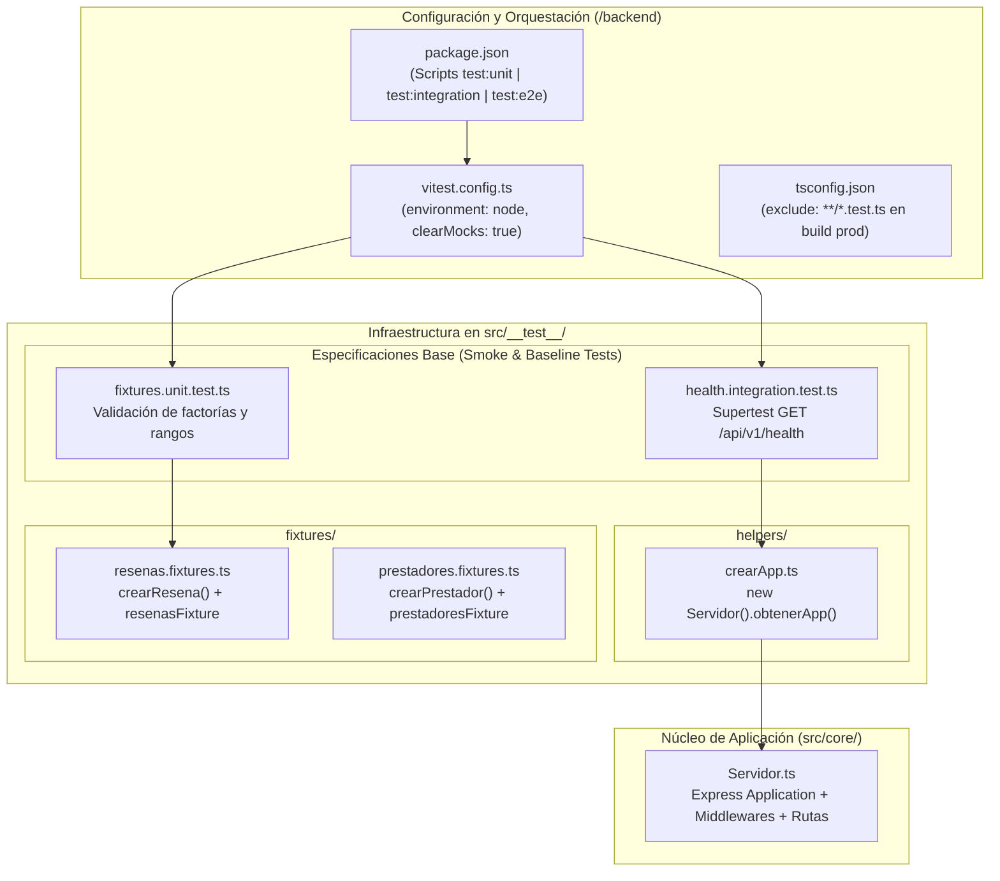
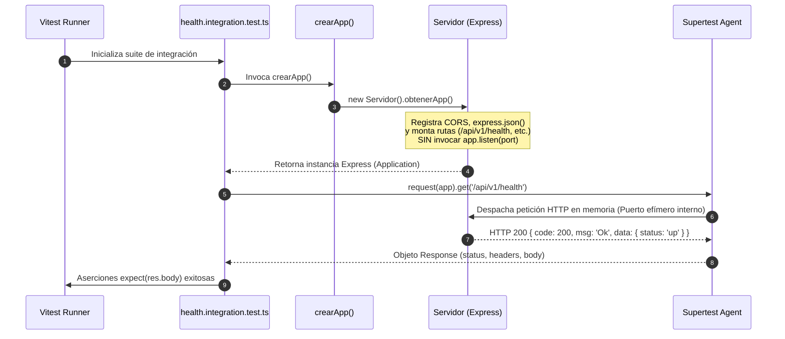

# Documento Técnico de Ingeniería: Fase 1 — Configuración de Infraestructura de Testing (Vitest y Supertest)

**Proyecto:** Fixer Servicios (`fixerServicios`)  
**Responsable:** Marianela Belardinelli — *Infraestructura de Testing*  
**Estado:** Implementado / Línea Base de Calidad (`Testing Baseline`)

---

## 1. Resumen Ejecutivo y Objetivos de Arquitectura

El propósito de la **Fase 1** a cargo de **Marianela Belardinelli** consiste en diseñar e implementar la infraestructura transversal de pruebas automatizadas (`Testing Harness`) para el backend del ecosistema **Fixer Servicios**, permitiendo a los tres módulos del equipo ejecutar pruebas unitarias, de integración y End-to-End de forma aislada, rápida y determinista.

Las decisiones técnicas adoptadas en esta etapa garantizan:
1. **Ejecución Nativa TypeScript/ESM de Baja Latencia:** Adopción de **Vitest** como motor unificado de pruebas (`Test Runner` y librería de aserciones), eliminando configuraciones complejas de transpilación intermedia y asegurando compatibilidad total con módulos ES (`"type": "module"`).
2. **Pruebas HTTP en Memoria sin Dependencias Externas:** Integración de **Supertest** acoplado a la instancia subyacente de Express expuesta por [`Servidor.obtenerApp()`](../backend/src/core/Servidor.ts), permitiendo verificar el pipeline HTTP completo sin abrir sockets TCP persistentes ni depender de motores de bases de datos activos durante la etapa de prototipado.
3. **Estandarización de Datos de Prueba (Patrón *Object Mother* / *Data Factory*):** Construcción de helpers reutilizables ([`crearApp.ts`](../backend/src/__test__/helpers/crearApp.ts)) y factorías de fixtures inmutables ([`resenas.fixtures.ts`](../backend/src/__test__/fixtures/resenas.fixtures.ts)) que previenen el acoplamiento frágil entre suites de prueba.

---

## 2. Arquitectura de la Infraestructura de Pruebas

La arquitectura de testing se aloja de manera centralizada bajo el directorio [`backend/src/__test__/`](../backend/src/__test__) y se articula con el núcleo del servidor HTTP ([`Servidor.ts`](../backend/src/core/Servidor.ts)) y el descriptor de configuración [`vitest.config.ts`](../backend/vitest.config.ts).



### 2.1. Desglose de Componentes de Testing

| Archivo / Directorio | Rol Arquitectónico |
| :--- | :--- |
| [`backend/vitest.config.ts`](../backend/vitest.config.ts) | Configuración declarativa del motor Vitest: entorno de ejecución Node.js, patrón de descubrimiento de archivos y limpieza automática de mocks. |
| [`src/__test__/helpers/crearApp.ts`](../backend/src/__test__/helpers/crearApp.ts) | Helper de factoría que instancia [`Servidor`](../backend/src/core/Servidor.ts) y retorna la aplicación Express pura (`Application`) lista para ser inyectada en `supertest(app)`. |
| [`src/__test__/fixtures/resenas.fixtures.ts`](../backend/src/__test__/fixtures/resenas.fixtures.ts) | Factoría tipada `crearResena(overrides)` y arreglo semilla `resenasFixture` basados en el contrato [`IResena`](../backend/src/interfaces/resena.interface.ts). |
| [`src/__test__/fixtures.unit.test.ts`](../backend/src/__test__/fixtures.unit.test.ts) | Suite unitaria línea base que verifica la capacidad de sobrescritura parcial de los fixtures y las invariantes de dominio (rango de calificación `1` a `5`). |
| [`src/__test__/health.integration.test.ts`](../backend/src/__test__/health.integration.test.ts) | Suite de integración línea base que valida mediante Supertest la disponibilidad y el contrato JSON del endpoint `/api/v1/health`. |
| [`src/core/Servidor.ts`](../backend/src/core/Servidor.ts) | Clase envolvente de Express diseñada con separación entre la configuración del pipeline HTTP (`constructor`) y la apertura del puerto de red (`escuchar(port)`). |

---

## 3. Configuración del Motor de Pruebas (`vitest.config.ts` y `package.json`)

### 3.1. Análisis de [`backend/vitest.config.ts`](../backend/vitest.config.ts)

```typescript
import { defineConfig } from 'vitest/config';

export default defineConfig({
    test: {
        environment: 'node',
        include: ['src/**/*.test.ts'],
        clearMocks: true,
    },
});
```

- **`environment: 'node'`:** Ejecuta las suites directamente sobre el runtime de Node.js, evitando la sobrecarga de memoria y CPU que implicaría inicializar entornos simulados de navegador (`jsdom` o `happy-dom`).
- **`include: ['src/**/*.test.ts']`:** Unifica la localización de pruebas bajo `src/`, permitiendo segmentar el tipo de prueba mediante sufijos semánticos (`*.unit.test.ts`, `*.integration.test.ts`, `*.e2e.test.ts`).
- **`clearMocks: true`:** Garantiza el aislamiento entre casos de prueba limpiando automáticamente el historial de invocaciones (`mock.calls`, `mock.results`) de cualquier espía (`vi.fn()`, `vi.spyOn()`) antes de cada test.

### 3.2. Segmentación de Scripts de Testing en [`backend/package.json`](../backend/package.json)

Se configuraron scripts granulares que permiten ejecutar toda la pirámide de pruebas o filtrar capas específicas durante el desarrollo y la integración continua (CI):

| Script | Comando Ejecutado | Alcance y Propósito |
| :--- | :--- | :--- |
| `pnpm test` | `vitest run` | Ejecuta de forma no interactiva la totalidad de las suites (`unit`, `integration`, `e2e`). |
| `pnpm test:unit` | `vitest run unit.test` | Filtra y ejecuta exclusivamente las pruebas unitarias (`*.unit.test.ts`), validando lógica pura y fixtures en milisegundos. |
| `pnpm test:integration` | `vitest run integration.test` | Filtra y ejecuta únicamente las pruebas de integración (`*.integration.test.ts`) con Supertest en memoria. |
| `pnpm test:e2e` | `vitest run e2e.test` | Filtra y ejecuta las pruebas de flujo completo de API (`*.e2e.test.ts`). |
| `pnpm test:watch` | `vitest` | Inicia el runner en modo observador interactivo (*Watch Mode*) para ciclos ágiles de TDD. |

> [!NOTE]
> En [`backend/tsconfig.json`](../backend/tsconfig.json) se incluyó la regla `"exclude": ["node_modules", "dist", "**/*.test.ts"]` para que el compilador de producción (`tsc`) ignore los archivos de prueba y los fixtures al generar el artefacto `./dist`, manteniendo limpia la imagen productiva de Docker.

---

## 4. Pruebas de Integración en Memoria con Supertest y Desacoplamiento de Red

Uno de los pilares arquitectónicos implementados en la Fase 1 es la capacidad de ejecutar pruebas de integración HTTP reales **en memoria**, sin necesidad de levantar un servidor en un puerto fijo ni contar con una base de datos externa activa.



### 4.1. Diseño Testable de [`Servidor.ts`](../backend/src/core/Servidor.ts) y [`crearApp.ts`](../backend/src/__test__/helpers/crearApp.ts)

En lugar de acoplar la inicialización de Express con la llamada a `app.listen(PORT)` en un único archivo monolítico, se separaron las responsabilidades:
1. **[`src/app.ts`](../backend/src/app.ts):** Es el único responsable de leer `process.env.PORT` e invocar `servidor.escuchar(PORT)` en producción o desarrollo.
2. **[`src/core/Servidor.ts`](../backend/src/core/Servidor.ts):** Construye la instancia de Express, registra middlewares y rutas, y expone el método `obtenerApp(): Application`.
3. **[`src/__test__/helpers/crearApp.ts`](../backend/src/__test__/helpers/crearApp.ts):** Encapsula la creación de una instancia limpia de la aplicación para cada archivo de prueba:
   ```typescript
   import { Servidor } from '../../core/Servidor';

   export const crearApp = () => new Servidor().obtenerApp();
   ```

Esta arquitectura aporta tres ventajas críticas:
- **Cero colisiones de puertos (`EADDRINUSE`):** Múltiples suites de integración pueden ejecutarse en paralelo sin competir por el puerto `3000`.
- **Aislamiento de estado en memoria:** Cada invocación a `crearApp()` instancia un nuevo árbol de controladores, servicios y repositorios en memoria con sus semillas iniciales intactas.
- **Velocidad de ejecución:** Las peticiones se resuelven en pocos milisegundos al operar sobre el bucle de eventos local de Node.js.

### 4.2. Verificación del Endpoint de Salud ([`health.integration.test.ts`](../backend/src/__test__/health.integration.test.ts))

Para validar la tubería de integración desde la Fase 1, se implementó el test de humo (`Smoke Test`) sobre `/api/v1/health`:

```typescript
import { describe, it, expect } from 'vitest';
import request from 'supertest';
import { crearApp } from './helpers/crearApp';

const app = crearApp();

describe('API - Integración (en memoria)', () => {
    it('GET /api/v1/health responde con la estructura unificada', async () => {
        const res = await request(app).get('/api/v1/health').expect(200);

        expect(res.body).toHaveProperty('code', 200);
        expect(res.body).toHaveProperty('msg', 'Ok');
        expect(res.body.data).toEqual({ status: 'up' });
    });
});
```

---

## 5. Diseño de Fixtures y Factorías de Datos de Prueba (`src/__test__/fixtures/`)

Con el fin de evitar la duplicación de literales de objetos en las pruebas unitarias y de integración, se implementó el patrón **Data Factory** en [`src/__test__/fixtures/resenas.fixtures.ts`](../backend/src/__test__/fixtures/resenas.fixtures.ts) apoyado en el contrato inicial [`IResena`](../backend/src/interfaces/resena.interface.ts):

```typescript
import { IResena } from '../../interfaces/resena.interface';

export const crearResena = (overrides: Partial<IResena> = {}): IResena => ({
    id: 1,
    prestadorId: 1,
    usuarioId: 1,
    calificacion: 5,
    comentario: 'Excelente trabajo',
    createdAt: '2026-01-01T00:00:00.000Z',
    ...overrides,
});

export const resenasFixture: IResena[] = [
    crearResena({ id: 1, calificacion: 5 }),
    crearResena({ id: 2, calificacion: 4 }),
    crearResena({ id: 3, calificacion: 3, prestadorId: 2 }),
];
```

### Decisiones de Diseño en los Fixtures:
- **Tipado Estricto con `Partial<IResena>`:** Permite que cada test especifique únicamente la propiedad relevante para el escenario evaluado (por ejemplo, `crearResena({ calificacion: 2 })`), delegando en la factoría la completitud del resto de las propiedades obligatorias del contrato.
- **Determinismo Temporal:** Se fija una marca de tiempo constante (`2026-01-01T00:00:00.000Z`) en lugar de `new Date().toISOString()` para garantizar que las comparaciones profundas (`toEqual`) sean reproducibles en cualquier momento de ejecución.
- **Auto-Verificación Unitaria ([`fixtures.unit.test.ts`](../backend/src/__test__/fixtures.unit.test.ts)):** Comprueba mediante pruebas unitarias que el mecanismo de *spread override* funcione correctamente y que todos los elementos de `resenasFixture` cumplan la restricción de dominio de calificaciones entre `1` y `5`.

---

## 6. Verificación y Criterios de Aceptación (Definition of Done - Fase 1)

| Entregable (Marianela Belardinelli) | Ubicación en el Proyecto | Estado |
| :--- | :--- | :---: |
| Instalación de dependencias de testing (`vitest`, `supertest`, `@types/supertest`) | [`/backend/package.json`](../backend/package.json) y [`/backend/pnpm-lock.yaml`](../backend/pnpm-lock.yaml) | Completado |
| Configuración del runner Vitest | [`/backend/vitest.config.ts`](../backend/vitest.config.ts) | Completado |
| Scripts de ejecución (`test`, `test:unit`, `test:integration`, `test:e2e`, `test:watch`) | [`/backend/package.json`](../backend/package.json) | Completado |
| Exposición de aplicación Express en memoria (`obtenerApp`) | [`/backend/src/core/Servidor.ts`](../backend/src/core/Servidor.ts) | Completado |
| Helper de instanciación en memoria para Supertest | [`/backend/src/__test__/helpers/crearApp.ts`](../backend/src/__test__/helpers/crearApp.ts) | Completado |
| Contrato base y Fixtures iniciales de Reseñas | [`/backend/src/interfaces/resena.interface.ts`](../backend/src/interfaces/resena.interface.ts) y [`/backend/src/__test__/fixtures/resenas.fixtures.ts`](../backend/src/__test__/fixtures/resenas.fixtures.ts) | Completado |
| Pruebas base de verificación (Unitaria y Healthcheck de Integración) | [`/backend/src/__test__/fixtures.unit.test.ts`](../backend/src/__test__/fixtures.unit.test.ts) y [`/backend/src/__test__/health.integration.test.ts`](../backend/src/__test__/health.integration.test.ts) | Completado |
