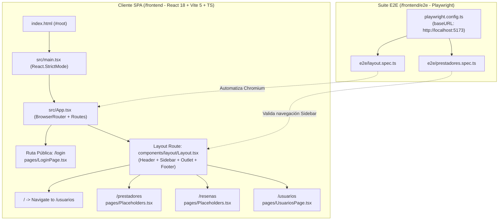

# Documento Técnico de Ingeniería: Fase 1 — Base Frontend, Enrutador y Configuración E2E con Playwright

**Proyecto:** Fixer Servicios (`fixerServicios`)  
**Responsable:** Julieta Dabús — *Base Frontend, Enrutador y Playwright*  
**Estado:** Implementado / Línea Base de Frontend y Pruebas E2E (`Frontend & E2E Baseline`)

---

## 1. Resumen Ejecutivo y Objetivos de Arquitectura

El propósito de la **Fase 1** a cargo de **Julieta Dabús** consiste en establecer la arquitectura base de la Single Page Application (SPA) en **React 18 + Vite + TypeScript**, diseñar el sistema de navegación y estructura visual maestra (*Application Shell*) para desacoplar el trabajo de los tres integrantes del equipo, y configurar la infraestructura de pruebas End-to-End (E2E) de navegador con **Playwright**.

Las decisiones técnicas tomadas en esta etapa garantizan:
1. **Arquitectura de Layout Anidado (*Nested Layout Routing*):** Uso de `react-router-dom` v6 con rutas anidadas y renderizado dinámico mediante `<Outlet />`, aislando el marco global (Header, Sidebar modular y Footer) de las vistas de dominio de cada integrante (`/prestadores`, `/resenas`, `/usuarios`) y de las vistas públicas de acceso (`/login`).
2. **Desarrollo Paralelo sin Bloqueos:** Creación temprana de vistas contenedoras ([`Placeholders.tsx`](../frontend/pages/Placeholders.tsx), [`UsuariosPage.tsx`](../frontend/pages/UsuariosPage.tsx) y [`LoginPage.tsx`](../frontend/pages/LoginPage.tsx)) conectadas al menú lateral para habilitar la navegación y las pruebas de integración visual desde el primer día.
3. **Automatización E2E Determinista con Playwright:** Configuración de [`playwright.config.ts`](../frontend/playwright.config.ts) con levantamiento automático del servidor de desarrollo (`webServer`), ejecución paralela sobre Chromium y captura de trazas en reintentos (`trace: 'on-first-retry'`).

---

## 2. Arquitectura del Cliente Frontend y Árbol de Navegación

El cliente SPA se estructura dentro del directorio [`/frontend`](../frontend) separando el punto de montaje, el enrutador principal, los componentes de layout, las páginas de dominio y la suite de pruebas E2E:



### 2.1. Responsabilidades de los Archivos Implementados en Fase 1

| Archivo / Directorio | Responsabilidad Arquitectónica |
| :--- | :--- |
| [`frontend/src/main.tsx`](../frontend/src/main.tsx) | Punto de entrada de React 18 (`ReactDOM.createRoot`) montado sobre `#root` bajo `React.StrictMode`. |
| [`frontend/src/App.tsx`](../frontend/src/App.tsx) | Declaración del árbol de rutas con `BrowserRouter`, `Routes`, `Route` y redirección por defecto con `Navigate`. |
| [`frontend/components/layout/Layout.tsx`](../frontend/components/layout/Layout.tsx) | Componente estructural maestro: renderiza el Header global, el Sidebar con enlaces a los 3 módulos, el contenedor `<Outlet />` y el Footer institucional. |
| [`frontend/components/layout/Layout.css`](../frontend/components/layout/Layout.css) | Sistema de estilos base con Flexbox (`min-height: 100vh`), paleta corporativa Fixer (`#3B82F6` azul y `#F97316` naranja) y diseño de barra lateral fija (`260px`). |
| [`frontend/pages/LoginPage.tsx`](../frontend/pages/LoginPage.tsx) | Vista de autenticación y recuperación de contraseña mediante pregunta secreta basada en el DER. |
| [`frontend/pages/UsuariosPage.tsx`](../frontend/pages/UsuariosPage.tsx) | Vista base del Módulo 3 (Administración de Usuarios). |
| [`frontend/pages/Placeholders.tsx`](../frontend/pages/Placeholders.tsx) | Componentes marcadores de posición (`PrestadoresPlaceholder`, `ResenasPlaceholder`) para desacoplar el enrutamiento inicial de los Módulos 1 y 2. |
| [`frontend/playwright.config.ts`](../frontend/playwright.config.ts) | Configuración del motor Playwright E2E, perfiles de navegador y orquestación del `webServer` local. |
| [`frontend/e2e/layout.spec.ts`](../frontend/e2e/layout.spec.ts) & [`prestadores.spec.ts`](../frontend/e2e/prestadores.spec.ts) | Especificaciones E2E iniciales que verifican el montaje del layout y el flujo de navegación por el menú lateral. |

---

## 3. Diseño del Layout Base y Enrutamiento Declarativo (`react-router-dom`)

### 3.1. Configuración del Router General ([`frontend/src/App.tsx`](../frontend/src/App.tsx))

El enrutador divide la aplicación en dos contextos visuales claramente diferenciados:
1. **Contexto de Autenticación (`/login`):** Renderiza [`LoginPage`](../frontend/pages/LoginPage.tsx) a pantalla completa sin barra lateral ni cabeceras de navegación interna.
2. **Contexto de Aplicación Principal (`<Route element={<Layout />}>`):** Envuelve todas las rutas operativas dentro del marco [`Layout`](../frontend/components/layout/Layout.tsx). Al ingresar a la raíz `/`, el componente `<Navigate to="/usuarios" replace />` redirige de forma limpia sin ensuciar el historial de navegación del navegador.

```tsx
function App() {
  return (
    <BrowserRouter>
      <Routes>
        <Route path="/login" element={<LoginPage />} />

        <Route element={<Layout />}>
          {/* Redirección de la ruta raíz al módulo de usuarios */}
          <Route path="/" element={<Navigate to="/usuarios" replace />} />
          <Route path="/prestadores" element={<PrestadoresPlaceholder />} />
          <Route path="/resenas" element={<ResenasPlaceholder />} />
          <Route path="/usuarios" element={<UsuariosPage />} />
        </Route>
      </Routes>
    </BrowserRouter>
  );
}
```

### 3.2. Estructura del Layout Maestro ([`Layout.tsx`](../frontend/components/layout/Layout.tsx) y [`Layout.css`](../frontend/components/layout/Layout.css))

El componente [`Layout`](../frontend/components/layout/Layout.tsx) implementa el patrón *App Shell* dividido en cuatro regiones semánticas HTML5:
- **Header Global (`<header className="global-header">`):** Presenta el logotipo interactivo de **Fixer** (que invoca `navigate('/')` al hacer clic) y la barra de usuario (`.user-nav`) con el botón de acción rápida hacia `/login` (*Cerrar Sesión / Login*).
- **Sidebar con Tabs por Integrante (`<aside className="sidebar">`):** Lista de navegación vertical con componentes `<Link>` de `react-router-dom` que permiten transicionar sin recarga de página hacia:
  - `1. Prestadores` (`/prestadores`) — Integrante 1.
  - `2. Reseñas` (`/resenas`) — Integrante 2.
  - `3. Usuarios` (`/usuarios`) — Integrante 3.
- **Área de Contenido Dinámico (`<main className="content-area">`):** Aloja el componente `<Outlet />` donde React Router inyecta la vista activa correspondiente a la URL actual.
- **Footer Global (`<footer className="global-footer">`):** Pie de página institucional estandarizado (`© 2026 Fixer - Soluciones para tu hogar. UTN`).

### 3.3. Vista Inicial de Acceso y Recuperación ([`frontend/pages/LoginPage.tsx`](../frontend/pages/LoginPage.tsx))

La vista [`LoginPage`](../frontend/pages/LoginPage.tsx) implementa en una tarjeta centrada los dos flujos de acceso requeridos por el dominio:
- **Modo Inicio de Sesión (`!isRecovering`):** Formulario controlado (`email`, `password`) con validación HTML5 `required` y redirección al dashboard principal (`navigate('/')`).
- **Modo Recuperación de Contraseña (`isRecovering`):** Conmutado dinámicamente mediante estado local (`useState(false)`), solicita el correo electrónico y la respuesta a la pregunta secreta definida en el DER (`¿Cuál es el nombre de tu primera mascota?`).

---

## 4. Infraestructura de Pruebas End-to-End (`playwright.config.ts` y `e2e/`)

### 4.1. Configuración Técnica de Playwright ([`frontend/playwright.config.ts`](../frontend/playwright.config.ts))

```typescript
import { defineConfig, devices } from '@playwright/test';

export default defineConfig({
  testDir: './e2e',
  fullyParallel: true,
  forbidOnly: !!process.env.CI,
  retries: process.env.CI ? 2 : 0,
  workers: process.env.CI ? 1 : undefined,
  reporter: 'html',
  use: {
    baseURL: 'http://localhost:5173',
    trace: 'on-first-retry',
  },
  projects: [
    {
      name: 'chromium',
      use: { ...devices['Desktop Chrome'] },
    },
  ],
  webServer: {
    command: 'pnpm run dev',
    url: 'http://localhost:5173',
    reuseExistingServer: !process.env.CI,
  },
});
```

#### Decisiones Clave de Configuración:
- **Orquestación Automática del Servidor (`webServer`):** Playwright verifica si `http://localhost:5173` está activo; si no lo está, ejecuta automáticamente `pnpm run dev` antes de iniciar las pruebas y reutiliza el servidor existente en entornos locales (`reuseExistingServer: !process.env.CI`).
- **Adaptación CI vs. Local:** En integración continua (`process.env.CI`) bloquea commits accidentales con `.only` (`forbidOnly: true`), activa `2` reintentos automáticos ante *flakiness* de red y serializa los workers (`workers: 1`). En entorno local habilita paralelismo completo (`fullyParallel: true`).
- **Observabilidad (`trace: 'on-first-retry'` y `reporter: 'html'`):** Captura trazas completas de DOM, red y consola cuando un test requiere reintento y genera reportes interactivos HTML.
- **Soporte de Tipos Node en TypeScript ([`frontend/tsconfig.json`](../frontend/tsconfig.json)):** Se incorporó `"types": ["node"]` e `"include": ["src", "vite.config.ts", "playwright.config.ts"]` para que el compilador reconozca variables globales de Node como `process.env` dentro de la configuración de Playwright.

### 4.2. Especificaciones E2E Base (`frontend/e2e/`)

1. **Verificación de Carga del Layout ([`frontend/e2e/layout.spec.ts`](../frontend/e2e/layout.spec.ts)):**
   Comprueba que la aplicación responda en la ruta raíz `/` y renderice el documento principal con el título esperado (`/Vite|Fixer/i`).
2. **Verificación de Navegación por Sidebar ([`frontend/e2e/prestadores.spec.ts`](../frontend/e2e/prestadores.spec.ts)):**
   Emplea selectores semánticos de accesibilidad (`getByRole`) para simular la interacción real de un usuario navegando entre módulos:
   ```typescript
   test('permite navegar a la sección de Prestadores desde el menú lateral', async ({ page }) => {
     await page.goto('/');

     const linkPrestadores = page.getByRole('link', { name: /1\. Prestadores/i });
     await expect(linkPrestadores).toBeVisible();

     await linkPrestadores.click();

     await expect(page).toHaveURL(/\/prestadores$/);
     await expect(page.getByRole('heading', { name: /Módulo de Prestadores/i })).toBeVisible();
   });
   ```

---

## 5. Verificación y Criterios de Aceptación (Definition of Done - Fase 1)

| Entregable (Julieta Dabús) | Ubicación en el Proyecto | Estado |
| :--- | :--- | :---: |
| Inicialización de React 18 + Vite + TypeScript y Router | [`/frontend/package.json`](../frontend/package.json), [`/frontend/vite.config.ts`](../frontend/vite.config.ts) y [`/frontend/src/App.tsx`](../frontend/src/App.tsx) | Completado |
| Diseño del Layout Base (Header, Sidebar modular, Outlet, Footer) | [`/frontend/components/layout/Layout.tsx`](../frontend/components/layout/Layout.tsx) y [`/frontend/components/layout/Layout.css`](../frontend/components/layout/Layout.css) | Completado |
| Vistas iniciales de Login/Recuperación, Usuarios y Placeholders | [`/frontend/pages/LoginPage.tsx`](../frontend/pages/LoginPage.tsx), [`/frontend/pages/UsuariosPage.tsx`](../frontend/pages/UsuariosPage.tsx) y [`/frontend/pages/Placeholders.tsx`](../frontend/pages/Placeholders.tsx) | Completado |
| Configuración de Playwright y tipado Node en `tsconfig.json` | [`/frontend/playwright.config.ts`](../frontend/playwright.config.ts) y [`/frontend/tsconfig.json`](../frontend/tsconfig.json) | Completado |
| Especificaciones E2E iniciales en carpeta `e2e/` | [`/frontend/e2e/layout.spec.ts`](../frontend/e2e/layout.spec.ts) y [`/frontend/e2e/prestadores.spec.ts`](../frontend/e2e/prestadores.spec.ts) | Completado |
