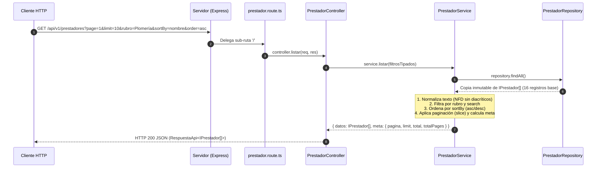
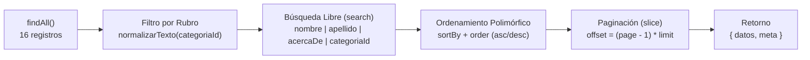

# Documento Técnico de Ingeniería: Fase 2 — Desarrollo Backend: Módulo Prestadores 

**Proyecto:** Fixer Servicios (`fixerServicios`)  
**Responsable:** Alejandro L. Baldres — *Módulo Prestadores (Capas de Dominio, Controladores y Mocks)*  
**Estado:** Implementado y Verificado (Unit, Integration & E2E Tests)

---

## 1. Resumen Ejecutivo y Diseño Arquitectónico

En la **Fase 2**, el **Alejandro L. Baldres** implementó el vertical completo del dominio **Prestadores** dentro del backend en Node.js, Express y TypeScript, respetando estrictamente el patrón de **Arquitectura en Capas (Layered Architecture)** e **Inyección Manual de Dependencias por Constructor**.

El diseño garantiza:
- **Aislamiento de Dominio:** La lógica de filtrado, búsqueda normalizada sin distinción de tildes/mayúsculas, ordenamiento polimórfico y paginación reside exclusivamente en [`PrestadorService`](../backend/src/service/prestador.service.ts), sin acoplamiento con objetos HTTP (`Request`/`Response`) de Express.
- **Inmutabilidad y Seguridad en Persistencia Mock:** [`PrestadorRepository`](../backend/src/repository/prestador.repository.ts) gestiona una semilla inicial de **16 registros en memoria** (superando el umbral mínimo de 15 registros para pruebas de paginación multi-página) y retorna copias defensivas para prevenir mutaciones accidentales de estado.
- **Contratos Estrictos de API:** Todas las respuestas HTTP se estandarizan mediante la interfaz genérica [`RespuestaApi<T>`](../backend/src/interfaces/respuestaApi.interface.ts), manteniendo consistencia estructural tanto en respuestas exitosas (`200`, `201`) como en errores controlados (`400`, `404`).



---

## 2. Capa de Contratos e Interfaces de Dominio (`src/interfaces/`)

Los modelos de datos se definieron utilizando TypeScript estricto, empleando tipos utilitarios (`Omit`, `Partial`, `keyof`) para garantizar coherencia entre las capas:

| Archivo | Interfaz Principal | Propósito y Decisiones de Diseño |
| :--- | :--- | :--- |
| [`prestador.interface.ts`](../backend/src/interfaces/prestador.interface.ts) | `IPrestador` | Modela la entidad central con identificador numérico (`id`), datos personales (`nombre`, `apellido`), credenciales opcionales (`matricula?`), perfil profesional (`aniosExperiencia`, `acercaDe`, `ofreceGarantia`, `categoriaId`), Value Object estructurado `telefono` (`codPais`, `codArea`, `nroTelefono`) y reputación (`ratingPromedio?`). |
| [`categoria.interface.ts`](../backend/src/interfaces/categoria.interface.ts) | `ICategoria` | Define el contrato de rubros profesionales (`id: string`, `nombre: string`). |
| [`filtro.prestador.interface.ts`](../backend/src/interfaces/filtro.prestador.interface.ts) | `IFiltrosPrestador` | DTO tipado para los parámetros de consulta en el listado: `page?`, `limit?`, `rubro?`, `search?`, `sortBy?: keyof IPrestador` y `order?: 'asc' \| 'desc'`. El uso de `keyof IPrestador` asegura en tiempo de compilación que solo se ordene por atributos válidos de la entidad. |
| [`respuestaApi.interface.ts`](../backend/src/interfaces/respuestaApi.interface.ts) | `RespuestaApi<T>` | Contrato envolvente (*Envelope*) genérico con `codigo: number`, `msj: string`, `datos: T` y metadatos opcionales de paginación `meta?: { pagina, limit, total, totalPages }`. |

---

## 3. Capa de Persistencia en Memoria (`src/repository/prestador.repository.ts`)

La clase [`PrestadorRepository`](../backend/src/repository/prestador.repository.ts) abstrae el origen de datos implementando un almacén en memoria pre-cargado con **16 prestadores** distribuidos en 9 rubros (*Plomería, Electricidad, Gasista, Pintura, Carpintería, Albañilería, Jardinería, Cerrajería y Refrigeración*).

### Decisiones Técnicas Clave:
1. **Aislamiento de Instancia e Inmutabilidad Defensiva:**
   - Al instanciar `PrestadorRepository`, la propiedad privada `prestadores` clona el arreglo constante (`[...MOCK_PRESTADORES]`). Esto permite que cada test unitario o de servicio instancie un repositorio limpio sin efectos colaterales entre pruebas.
   - El método `findAll()` devuelve una copia superficial (`return [...this.prestadores]`), impidiendo que las mutaciones en la capa de servicio (como `Array.prototype.sort()`) alteren el orden interno del repositorio.
2. **Generación de Identificadores Autoincrementales Seguros:**
   - En `create(datos: Omit<IPrestador, 'id'>)`, el nuevo `id` se calcula dinámicamente mediante reducción:
     ```ts
     const nuevoId: number = this.prestadores.reduce((max: number, p: IPrestador) => Math.max(max, p.id || 0), 0) + 1;
     ```
     Esto evita colisiones de IDs incluso después de eliminar registros intermedios y retorna `1` si la colección queda vacía.
3. **Actualización Parcial con Preservación de Identidad:**
   - En `update(id: number, datos: Partial<Omit<IPrestador, 'id'>>)`, se fusionan los campos existentes con los nuevos forzando la inmutabilidad de la clave primaria al final del objeto (`{ ...this.prestadores[index], ...datos, id }`), devolviendo `null` si el registro no existe.
4. **Baja Física Controlada:**
   - En `delete(id: number)`, se localiza la posición mediante `findIndex` y se remueve con `splice(index, 1)`, retornando un booleano (`true` si eliminó, `false` si no existía).

---

## 4. Capa de Servicio y Reglas de Negocio (`src/service/prestador.service.ts`)

La clase [`PrestadorService`](../backend/src/service/prestador.service.ts) recibe su dependencia en el constructor (`constructor(private readonly repository = new PrestadorRepository()) {}`), habilitando **Inversión de Control (IoC)** ligera para inyectar repositorios mockeados o espiados en pruebas.

### Pipeline de Procesamiento en `listar(filtros: IFiltrosPrestador)`



1. **Sanitización de Parámetros y Valores por Defecto:**
   - `page = Math.max(1, filtros.page || 1)` y `limit = Math.max(1, filtros.limit || 10)` previenen desplazamientos negativos o divisiones por cero cuando se reciben valores menores o iguales a `0`.
   - `order` toma `'asc'` por defecto salvo que se especifique explícitamente `'desc'`.
   - `sortBy` utiliza `'nombre'` como criterio de ordenamiento predeterminado.
2. **Normalización Unicode sin Diacríticos (`normalizarTexto`):**
   ```ts
   private normalizarTexto(texto: string): string {
       return texto.normalize('NFD').replace(/[\u0300-\u036f]/g, '').toLowerCase().trim();
   }
   ```
   Al descomponer caracteres en su forma canónica `NFD` y remover el rango Unicode de marcas diacríticas (`\u0300-\u036f`), el servicio iguala búsquedas como `"Plomería"`, `"plomeria"` o `"  PLOMERÍA  "`.
3. **Filtrado Combinable (`rubro` + `search`):**
   - **Por `rubro`:** Filtra por coincidencia exacta normalizada sobre `p.categoriaId`.
   - **Por `search`:** Evalúa coincidencia parcial (`includes`) sobre cuatro campos normalizados: `nombre`, `apellido`, `acercaDe` y `categoriaId`.
4. **Algoritmo de Ordenamiento Polimórfico:**
   - **Manejo de `undefined`:** Las propiedades opcionales ausentes (como `matricula` en prestadores no matriculados) se desplazan siempre al final de la lista (`if (valA === undefined) return 1; if (valB === undefined) return -1;`).
   - **Cadenas de texto (`string`):** Usa `valA.localeCompare(valB, 'es', { sensitivity: 'base' })` para respetar las reglas lexicográficas del español.
   - **Valores numéricos (`number`):** Opera por diferencia aritmética (`valA - valB`) para ordenar correctamente campos como `aniosExperiencia`, `id` o `ratingPromedio`.
   - **Otros tipos (`boolean`):** Convierte a `String` como fallback seguro y aplica el multiplicador de dirección (`order === 'desc' ? -comparacion : comparacion`).
5. **Cálculo de Metadatos y Ventana de Paginación:**
   - Calcula `total = resultado.length` y `totalPages = Math.ceil(total / limit) || 1` (asegurando al menos `1` página incluso cuando `total === 0`).
   - Calcula el desplazamiento `offset = (page - 1) * limit` y extrae el segmento con `resultado.slice(offset, offset + limit)`.

---

## 5. Capa de Controladores y Enrutamiento REST (`src/controller/` y `src/route/`)

### 5.1. Controlador HTTP ([`prestador.controller.ts`](../backend/src/controller/prestador.controller.ts))

[`PrestadorController`](../backend/src/controller/prestador.controller.ts) implementa sus handlers como propiedades con *arrow functions* (`public listar = (req: Request, res: Response): void => { ... }`), garantizando el enlace léxico de `this` cuando se registran directamente en el router de Express:

- **`listar` (`GET`):** Extrae y convierte los parámetros de `req.query` a sus tipos primitivos (`Number`, `String`), invoca `this.service.listar(...)` y responde con código `200`.
- **`obtenerPorId` (`GET /:id`):** Convierte `req.params.id` a número; responde `404` si el prestador no existe o `200` con la entidad encontrada.
- **`crear` (`POST`):** Valida la presencia de los campos obligatorios (`nombre`, `apellido`, `categoriaId`); si falta alguno, corta la ejecución devolviendo `400 Bad Request`. Si es válido, inicializa valores por defecto seguros (`aniosExperiencia: 0`, `acercaDe: ''`, `ofreceGarantia: false`, `telefono` base) y responde con `201 Created`.
- **`actualizar` (`PUT`) y `eliminar` (`DELETE`):** Soportan resolución dual del identificador (`const id = Number(req.params.id || req.body.id)`). Retornan `400` si no se proporciona un `id` válido, `404` si el ID no existe en el repositorio, y `200` al completar la operación.

### 5.2. Especificación de Endpoints en [`prestador.route.ts`](../backend/src/route/prestador.route.ts)

El router se monta en [`Servidor.ts`](../backend/src/core/Servidor.ts) bajo el prefijo `/api/v1/prestadores`:

| Método HTTP | Ruta Completa | Query Params / Body | Códigos de Estado | Descripción |
| :--- | :--- | :--- | :---: | :--- |
| `GET` | `/api/v1/prestadores` | `?page=1&limit=10&rubro=Plomería&search=...&sortBy=nombre&order=asc` | `200` | Lista prestadores con filtrado por rubro, búsqueda textual, ordenamiento y paginación. |
| `GET` | `/api/v1/prestadores/:id` | Parámetro URL `:id` | `200`, `404` | Obtiene el detalle de un prestador específico por su ID. |
| `POST` | `/api/v1/prestadores` | Body JSON (`nombre`, `apellido`, `categoriaId`, etc.) | `201`, `400` | Da de alta un nuevo prestador asignándole ID autoincremental. |
| `PUT` | `/api/v1/prestadores/:id` o `/api/v1/prestadores` | Parámetro `:id` o `body.id` + campos parciales a modificar | `200`, `400`, `404` | Actualiza parcial o totalmente los datos de un prestador existente. |
| `DELETE` | `/api/v1/prestadores/:id` o `/api/v1/prestadores` | Parámetro `:id` o `body.id` | `200`, `400`, `404` | Elimina un prestador de la persistencia en memoria. |

---

## 6. Verificación de Calidad y Cobertura de Pruebas (`src/__test__/`)

El módulo cuenta con una estrategia de pruebas en pirámide ejecutada con **Vitest** y **Supertest**:

1. **Pruebas Unitarias ([`prestador.unit.test.ts`](../backend/src/__test__/prestador.unit.test.ts)):**
   - Valida contratos y factorías de fixtures ([`prestadores.fixtures.ts`](../backend/src/__test__/fixtures/prestadores.fixtures.ts)).
   - Prueba aisladamente `PrestadorRepository` (semilla de 16 registros `>= 15`, inmutabilidad de `findAll`, autoincremento en `create`, preservación de `id` en `update`, baja en `delete`).
   - Prueba exhaustivamente `PrestadorService` (valores por defecto, normalización de tildes/mayúsculas en `rubro` y `search`, ordenamiento numérico/alfabético/booleano, envío de `undefined` al final, y paginación).
   - Prueba `PrestadorController` con objetos `req`/`res` simulados (`vi.fn()`) verificando códigos de estado `200`, `201`, `400` y `404`.
2. **Pruebas de Integración ([`prestador.integration.test.ts`](../backend/src/__test__/prestador.integration.test.ts)):**
   - Verifica el acoplamiento real entre `Servidor`, `prestador.route`, `PrestadorController`, `PrestadorService` y `PrestadorRepository` mediante peticiones HTTP en memoria con `supertest`, incluyendo la consulta exacta requerida en la especificación (`GET /api/v1/prestadores?page=1&limit=10&rubro=Plomería&sortBy=nombre&order=asc`).
3. **Pruebas End-to-End ([`prestador.e2e.test.ts`](../backend/src/__test__/prestador.e2e.test.ts)):**
   - Levanta el servidor HTTP en un puerto efímero real (`app.listen(0)`) y ejecuta con `fetch` nativo el flujo de ciclo de vida completo: listado inicial paginado -> alta (`POST`) -> filtrado y ordenamiento (`GET` con query params) -> búsqueda sin tildes -> detalle (`GET /:id`) -> actualización (`PUT /:id`) -> eliminación (`DELETE /:id`) y verificación de consistencia entre páginas.
