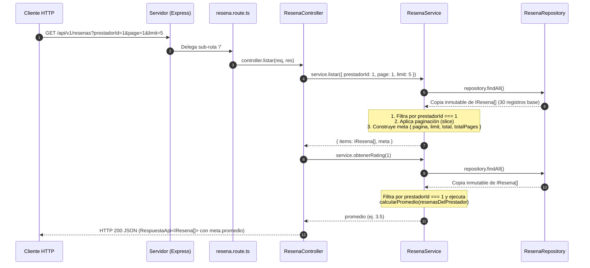
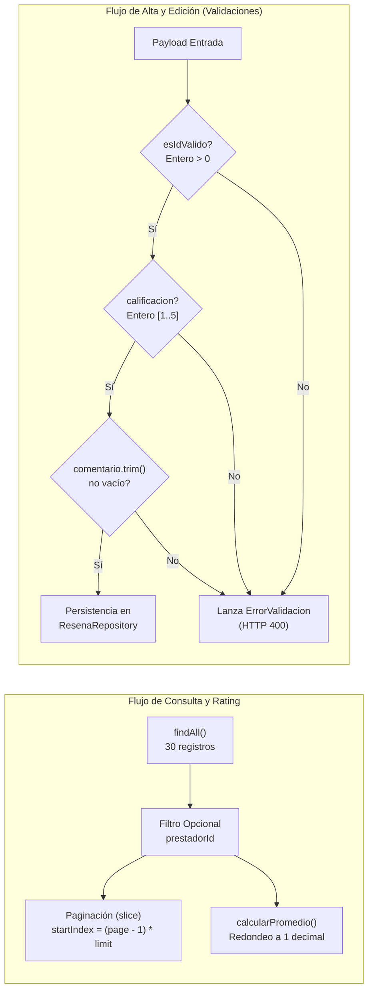

# Documento Técnico de Ingeniería: Fase 2 — Desarrollo Backend: Módulo Reseñas y Calificaciones

**Proyecto:** Fixer Servicios (`fixerServicios`)  
**Responsable:** Marianela Belardinelli — *Módulo Reseñas (Capas de Dominio, Controladores, Cálculo de Rating y Mocks)*  
**Estado:** Implementado y Verificado (Unit & Integration Tests)

---

## 1. Resumen Ejecutivo y Diseño Arquitectónico

En la **Fase 2**, **Marianela Belardinelli** implementó el vertical completo del dominio **Reseñas y Calificaciones** en el backend sobre Node.js, Express y TypeScript, siguiendo el patrón de **Arquitectura en Capas (Layered Architecture)** e **Inyección Manual de Dependencias por Constructor**.

El diseño técnico del módulo garantiza:
- **Aislamiento de Lógica de Negocio y Cálculo Matemático:** El filtrado por prestador, la paginación, el cálculo automático del promedio de estrellas redondeado a un decimal (`obtenerRating` / `calcularPromedio`) y la validación estricta de invariantes de negocio mediante la excepción de dominio [`ErrorValidacion`](../backend/src/service/resena.service.ts) están encapsulados en [`ResenaService`](../backend/src/service/resena.service.ts), sin acoplamiento con la capa HTTP de Express.
- **Persistencia en Memoria Determinista e Inmutable:** [`ResenaRepository`](../backend/src/repository/resena.repository.ts) inicializa su estado a partir de una semilla determinista de **30 reseñas** ([`resena.mock.ts`](../backend/src/repository/resena.mock.ts)) asociadas a los 16 prestadores del sistema y retorna copias superficiales para evitar mutaciones colaterales desde capas superiores.
- **Contratos Estandarizados y Enriquecimiento de Metadatos:** Todas las respuestas se emiten bajo la estructura genérica [`RespuestaApi<T>`](../backend/src/interfaces/respuestaApi.interface.ts), incorporando dinámicamente el atributo `promedio` en los metadatos (`meta`) cuando se consulta el listado filtrado por `prestadorId`.



---

## 2. Capa de Contratos e Interfaces de Dominio (`src/interfaces/`)

El modelo de dominio y las respuestas HTTP se estructuran con tipado estático estricto y tipos utilitarios de TypeScript (`Omit`, `Partial`, `Pick`) que restringen qué propiedades pueden manipularse en cada operación:

| Archivo / Tipo | Interfaz / Contrato | Propósito y Decisiones de Diseño |
| :--- | :--- | :--- |
| [`resena.interface.ts`](../backend/src/interfaces/resena.interface.ts) | `IResena` | Modela la entidad de reseña con clave primaria numérica (`id: number`), claves foráneas (`prestadorId: number`, `usuarioId: number`), puntuación entera (`calificacion: number` de `1` a `5`), texto de opinión (`comentario: string`) y marca temporal ISO-8601 (`createdAt: string`). |
| [`respuestaApi.interface.ts`](../backend/src/interfaces/respuestaApi.interface.ts) | `RespuestaApi<T>` | Contrato envolvente unificado con `codigo: number`, `msj: string`, `datos: T` y metadatos opcionales `meta?: { pagina, limit, total, totalPages, promedio? }`. La extensión `promedio?: number` permite transportar el rating calculado del prestador en la misma petición de listado. |
| DTO de Creación | `Omit<IResena, 'id' \| 'createdAt'>` | Utilizado en `ResenaRepository.create()` para asegurar que el cliente no pueda forzar el identificador ni la fecha de creación, los cuales son generados por el repositorio. |
| DTO de Actualización | `Pick<IResena, 'calificacion' \| 'comentario'>` | Utilizado en `ResenaService.actualizar()` y `ResenaRepository.update()` para garantizar que una edición sólo pueda modificar el puntaje y el comentario, preservando inmutables `id`, `prestadorId`, `usuarioId` y `createdAt`. |

---

## 3. Capa de Persistencia en Memoria y Semilla de Datos (`src/repository/`)

### 3.1. Generación Determinista del Mock ([`src/repository/resena.mock.ts`](../backend/src/repository/resena.mock.ts))

El archivo [`resena.mock.ts`](../backend/src/repository/resena.mock.ts) construye de forma programática **30 reseñas iniciales** mediante `Array.from({ length: 30 }, (_, i) => ...)`:

```typescript
export const resenasMock: IResena[] = Array.from({ length: 30 }, (_, i) => ({
    id: i + 1,
    prestadorId: (i % 16) + 1,
    usuarioId: (i % 5) + 1,
    calificacion: calificaciones[i % calificaciones.length],
    comentario: comentarios[i % comentarios.length],
    createdAt: new Date(2026, 0, i + 1).toISOString(),
}));
```

- **Asociación Multientidad Coherente:** La expresión `(i % 16) + 1` distribuye las 30 reseñas entre los IDs `1` al `16` (correspondientes a los 16 prestadores del catálogo mock), mientras que `(i % 5) + 1` las asigna rotativamente entre 5 usuarios.
- **Varianza de Puntuaciones para Pruebas de Rating:** El vector cíclico `calificaciones = [5, 4, 3, 5, 2, 4]` asigna distintos puntajes a un mismo prestador (por ejemplo, para `prestadorId = 1` convergen los índices `i = 0` con calificación `5` e `i = 16` con calificación `2`, arrojando un promedio exacto de `3.5`).

### 3.2. Repositorio en Memoria ([`src/repository/resena.repository.ts`](../backend/src/repository/resena.repository.ts))

La clase [`ResenaRepository`](../backend/src/repository/resena.repository.ts) encapsula las operaciones CRUD sobre la colección en memoria:

1. **Aislamiento de Estado e Inmutabilidad:**
   - La propiedad privada `private resenas: IResena[] = [...resenasMock]` clona la semilla al instanciar la clase, permitiendo que cada instancia de servicio/servidor posea su propio almacén independiente.
   - `findAll()` retorna una copia superficial (`[...this.resenas]`) para proteger la colección interna.
2. **Generación de Clave Primaria (`siguienteId`) y Timestamp en `create`:**
   - Calcula el siguiente identificador disponible mediante reducción (`this.resenas.reduce((max, r) => Math.max(max, r.id), 0) + 1`), evitando colisiones tras eliminaciones intermedias, y asigna `createdAt: new Date().toISOString()`.
3. **Actualización Acotada (`update`):**
   - Busca la reseña por `id`; si no existe retorna `undefined`. Si existe, actualiza exclusivamente `calificacion` y `comentario` y devuelve una copia desacoplada `{ ...resena }`.
4. **Baja Física (`delete`):**
   - Localiza el índice mediante `findIndex`; retorna `false` si es `-1` o extrae el registro con `splice(index, 1)` devolviendo `true`.

---

## 4. Capa de Servicio, Validaciones y Cálculo de Rating (`src/service/resena.service.ts`)

La clase [`ResenaService`](../backend/src/service/resena.service.ts) recibe [`ResenaRepository`](../backend/src/repository/resena.repository.ts) por constructor (`constructor(private repository: ResenaRepository = new ResenaRepository()) {}`) y centraliza las reglas de negocio del módulo.



### 4.1. Cálculo Automático del Rating Medio (`calcularPromedio` y `obtenerRating`)

El servicio expone tanto el método de dominio `calcularPromedio(resenas: IResena[]): number` como el método fachada `obtenerRating(prestadorId: number): number`:

```typescript
obtenerRating(prestadorId: number): number {
    const reseñasDelPrestador = this.repository
        .findAll()
        .filter((r) => r.prestadorId === prestadorId);
    return this.calcularPromedio(reseñasDelPrestador);
}

calcularPromedio(resenas: IResena[]): number {
    if (resenas.length === 0) return 0;
    const suma = resenas.reduce((acc, r) => acc + r.calificacion, 0);
    return Math.round((suma / resenas.length) * 10) / 10;
}
```

- **Protección contra División por Cero:** Si un prestador aún no posee reseñas (`resenas.length === 0`), retorna inmediatamente `0` en lugar de `NaN`.
- **Precisión Decimal Controlada:** Aplica la fórmula matemática:
  $$\text{Promedio} = \frac{\text{round}\left(\left(\frac{1}{N}\sum_{i=1}^{N} \text{calificacion}_i\right) \times 10\right)}{10}$$
  garantizando un resultado numérico limpio con a lo sumo un decimal (ej. `4.3`, `3.5`), ideal para su representación visual en componentes de estrellas.

### 4.2. Filtrado, Paginación y Manejo de Excepciones de Dominio

1. **Listado Paginado y Filtrado por Prestador (`listar`):**
   - Aplica valores por defecto seguros (`page = Number(params.page) || 1`, `limit = Number(params.limit) || 10`).
   - Si `params.prestadorId !== undefined`, filtra las reseñas pertenecientes a dicho prestador antes de calcular `total` y `totalPages = Math.ceil(total / limit)`.
   - Extrae el segmento correspondiente a la página solicitada mediante `filtradas.slice(startIndex, startIndex + limit)`.
2. **Excepción de Dominio [`ErrorValidacion`](../backend/src/service/resena.service.ts) y Predicado `esIdValido`:**
   - El predicado de tipo `esIdValido = (valor: unknown): valor is number => typeof valor === 'number' && Number.isInteger(valor) && valor > 0` valida que todo identificador sea un entero positivo estricto.
   - Tanto en `crear()` como en `actualizar()`, cualquier violación de invariantes lanza `ErrorValidacion`:
     - `prestadorId` o `usuarioId` ausentes o inválidos (`crear`) o `id` de reseña inválido (`actualizar`).
     - `calificacion` no numérica, decimal (ej. `3.5`) o fuera del intervalo cerrado $[1, 5]$.
     - `comentario` no textual o compuesto únicamente por espacios en blanco (`comentario.trim() === ''`).
   - Antes de persistir en el repositorio, el servicio normaliza el comentario aplicando `comentario.trim()`.

---

## 5. Capa de Controladores y Enrutamiento REST (`src/controller/` y `src/route/`)

### 5.1. Controlador HTTP ([`src/controller/resena.controller.ts`](../backend/src/controller/resena.controller.ts))

[`ResenaController`](../backend/src/controller/resena.controller.ts) traduce las peticiones de Express hacia invocaciones de [`ResenaService`](../backend/src/service/resena.service.ts) y formatea la salida bajo [`RespuestaApi<T>`](../backend/src/interfaces/respuestaApi.interface.ts):

- **`listar` (`GET /`):** Convierte los query params `prestadorId`, `page` y `limit` a tipo numérico. Cuando `idPrestador` está presente, calcula además `this.service.obtenerRating(idPrestador)` y lo adjunta dinámicamente en `meta.promedio`, respondiendo con estado `200`.
- **`obtenerPorId` (`GET /:id`):** Busca la reseña por su ID numérico; devuelve `404 Not Found` (`datos: null`) si no existe o `200 OK` con la entidad encontrada.
- **`crear` (`POST /`):** Ejecuta `this.service.crear(req.body ?? {})` dentro de un bloque `try/catch`. Responde `201 Created` en caso de éxito, o intercepta instancias de `ErrorValidacion` para responder `400 Bad Request` con el mensaje descriptivo del error y `datos: null`.
- **`actualizar` (`PUT /:id`):** Ejecuta `this.service.actualizar(id, req.body ?? {})`. Si el servicio lanza `ErrorValidacion` (por ID inválido como `/abc`, calificación fuera de rango o comentario vacío), responde `400 Bad Request`. Si el repositorio devuelve `undefined`, responde `404 Not Found`; en caso exitoso, retorna `200 OK` con la reseña actualizada.
- **`eliminar` (`DELETE /:id`):** Verifica que `Number(req.params.id)` sea válido (`400` en caso contrario), invoca `this.service.eliminar(id)` y responde `404` si no existía o `200 OK` tras confirmar la baja.

### 5.2. Especificación de Endpoints en [`src/route/resena.route.ts`](../backend/src/route/resena.route.ts)

El enrutador se registra en [`Servidor.ts`](../backend/src/core/Servidor.ts) bajo el prefijo `/api/v1/resenas`:

| Método HTTP | Ruta Completa | Query Params / Body | Códigos de Estado | Descripción |
| :--- | :--- | :--- | :---: | :--- |
| `GET` | `/api/v1/resenas` | `?prestadorId=1&page=1&limit=5` | `200` | Lista reseñas paginadas; si incluye `prestadorId`, filtra por prestador y calcula `meta.promedio`. |
| `GET` | `/api/v1/resenas/:id` | Parámetro URL `:id` | `200`, `404` | Obtiene el detalle de una reseña específica por su ID. |
| `POST` | `/api/v1/resenas` | Body JSON (`prestadorId`, `usuarioId`, `calificacion`, `comentario`) | `201`, `400` | Crea una nueva reseña validando rango entero `[1..5]` y comentario obligatorio. |
| `PUT` | `/api/v1/resenas/:id` | Parámetro `:id` + Body JSON (`calificacion`, `comentario`) | `200`, `400`, `404` | Actualiza la calificación y el comentario de una reseña existente aplicando `.trim()`. |
| `DELETE` | `/api/v1/resenas/:id` | Parámetro URL `:id` | `200`, `400`, `404` | Elimina una reseña de la colección en memoria. |

---

## 6. Verificación de Calidad y Cobertura de Pruebas (`src/__test__/`)

El módulo de reseñas está respaldado por pruebas automatizadas ejecutadas con **Vitest** y **Supertest**:

1. **Pruebas Unitarias de Fixtures ([`fixtures.unit.test.ts`](../backend/src/__test__/fixtures.unit.test.ts)):**
   - Verifica la factoría `crearResena` y las invariantes de dominio sobre `resenasFixture`.
2. **Pruebas de Integración de Consultas, Alta, Baja y Edición ([`resena.integration.test.ts`](../backend/src/__test__/resena.integration.test.ts)):**
   - **Consultas (`GET`):** Comprueba el filtrado por `prestadorId=1` con paginación (`page=1&limit=5`) verificando que todos los ítems correspondan al prestador `1` y que `meta` incluya `{ pagina: 1, limit: 5, total: 2, totalPages: 1, promedio: 3.5 }`; valida la paginación global sobre las 30 reseñas (`page=2&limit=5` -> `totalPages: 6`) y las respuestas `200` y `404` en `GET /api/v1/resenas/:id`.
   - **Alta y Validaciones Parametrizadas (`POST`):** Verifica la creación exitosa (`201`) y su persistencia inmediata en memoria al consultarla con `GET /:id`. Utiliza `it.each` para probar exhaustivamente los rechazos `400 Bad Request` ante calificación fuera de rango (`6`), calificación decimal (`3.5`), comentario con solo espacios (`'   '`) y `prestadorId` faltante.
   - **Edición y Sanitización (`PUT`):** Comprueba la actualización de `calificacion` y `comentario` (`200`), la preservación inmutable de `prestadorId`, `usuarioId` y `createdAt`, el recorte de espacios laterales (`trim`), el rechazo `404` para IDs inexistentes (`9999`), el rechazo `400` para IDs alfanuméricos (`/abc`) y 6 escenarios inválidos parametrizados con `it.each`.
   - **Baja (`DELETE`):** Verifica el ciclo completo de creación (`201`) -> eliminación (`200`) -> comprobación de inexistencia posterior (`404` en `GET /:id`) y el retorno de `404` al intentar eliminar un ID inexistente.
