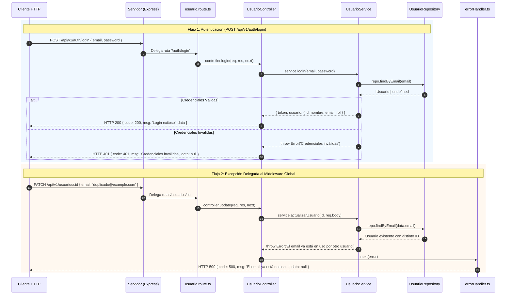
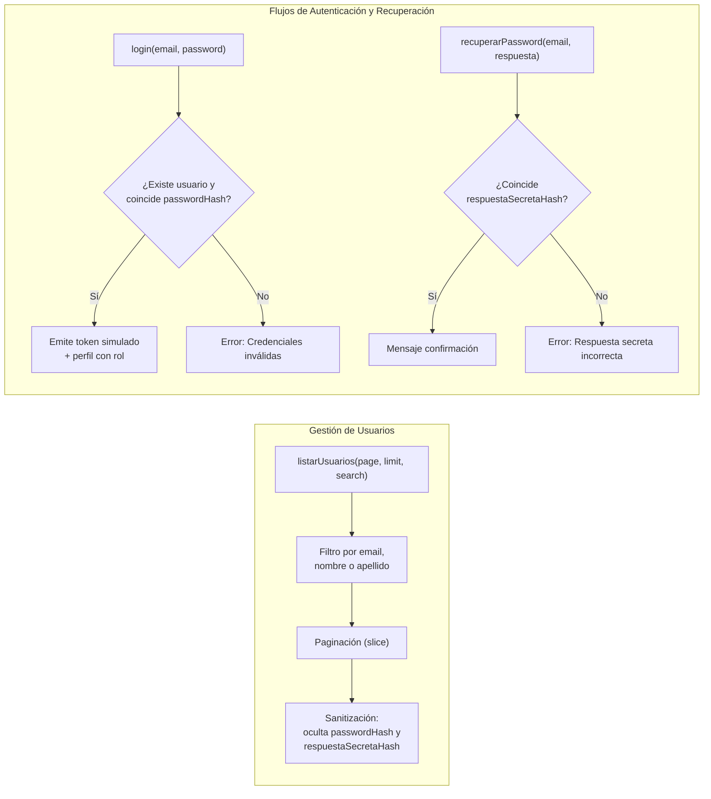

# Documento Técnico de Ingeniería: Fase 2 — Desarrollo Backend: Módulo Usuarios, Autenticación y Middleware Global

**Proyecto:** Fixer Servicios (`fixerServicios`)  
**Responsable:** Julieta Dabús — *Módulo Usuarios, Acceso, Ubicación y Middleware Global de Errores*  
**Estado:** Implementado y Verificado (Capas de Dominio, Auth, Mocks y Manejo de Errores)

---

## 1. Resumen Ejecutivo y Diseño Arquitectónico

En la **Fase 2**, **Julieta Dabús** implementó el vertical backend correspondiente al dominio de **Usuarios, Autenticación y Ubicación**, además del **Middleware Global de Manejo de Errores** transversal a toda la API en Node.js, Express y TypeScript, bajo el patrón de **Arquitectura en Capas (Layered Architecture)**.

El diseño implementado asegura:
- **Manejo Centralizado de Excepciones (`errorHandler`):** Un interceptor global registrado al final del pipeline de [`Servidor.ts`](../backend/src/core/Servidor.ts) captura cualquier error síncrono o asíncrono propagado mediante `next(error)`, garantizando que el cliente siempre reciba un contrato JSON estandarizado (`{ code, msg, data: null }`) y evitando caídas del proceso Node.js.
- **Seguridad de Datos Sensibles y Control de Acceso:** [`UsuarioService`](../backend/src/service/usuario.service.ts) suprime las propiedades confidenciales (`passwordHash` y `respuestaSecretaHash`) al proyectar listados de usuarios, valida la unicidad de correo electrónico en modificaciones parciales (`PATCH`) y resuelve los flujos de inicio de sesión (`login`) y recuperación de cuenta mediante pregunta secreta (`obtenerPreguntaSecreta` y `recuperarPassword`).
- **Persistencia Asíncrona en Memoria con Roles y Cobertura Geográfica:** [`UsuarioRepository`](../backend/src/repository/usuario.repository.ts) modela métodos basados en promesas (`async/await`) sobre colecciones semilla de usuarios (`ADMIN`, `PRESTADOR`, `USUARIO`) y ubicaciones con código postal y radio de cobertura en kilómetros.



---

## 2. Middleware Global de Manejo de Errores (`src/middlewares/errorHandler.ts`)

Para unificar el tratamiento de fallos no controlados y excepciones de negocio delegadas por los controladores mediante `next(error)`, se implementó el middleware [`errorHandler`](../backend/src/middlewares/errorHandler.ts) y se conectó en el método `manejoErrores()` de [`Servidor.ts`](../backend/src/core/Servidor.ts) inmediatamente después del montaje de todas las rutas:

```typescript
import { Request, Response, NextFunction } from 'express';

interface AppError extends Error {
  statusCode?: number;
}

export const errorHandler = (
  err: AppError,
  req: Request,
  res: Response,
  next: NextFunction
) => {
  console.error(`[Error] ${err.message}`);

  if (res.headersSent) {
    return next(err);
  }

  const statusCode = err.statusCode || 500;
  const message = err.message || 'Error interno del servidor';

  res.status(statusCode).json({
    code: statusCode,
    msg: message,
    data: null,
  });
};
```

### Decisiones Técnicas del Interceptor:
1. **Firma de 4 Parámetros de Express (`err, req, res, next`):** Permite que Express identifique la función exclusivamente como un *Error-Handling Middleware*.
2. **Extensión Tipada `AppError`:** Extiende la interfaz nativa `Error` con la propiedad opcional `statusCode?: number`, permitiendo propagar códigos de estado HTTP personalizados o aplicar el fallback seguro `500 Internal Server Error`.
3. **Guarda de Encabezados Enviados (`res.headersSent`):** Si el fallo ocurre cuando la transmisión de cabeceras HTTP ya inició, delega inmediatamente al manejador por defecto de Express (`return next(err)`) para evitar corromper el flujo de respuesta.

---

## 3. Capa de Contratos e Interfaces de Dominio (`src/interfaces/`)

Los contratos TypeScript reflejan las entidades **Usuario** y **Ubicación** especificadas en el Diagrama Entidad-Relación (DER) de Fixer:

| Archivo | Interfaz Principal | Propósito y Decisiones de Diseño |
| :--- | :--- | :--- |
| [`usuario.interface.ts`](../backend/src/interfaces/usuario.interface.ts) | `IUsuario` | Define la entidad de usuario con identificador (`id: string`), datos filiatorios (`nombre`, `apellido`, `email`), credenciales y recuperación (`passwordHash`, `preguntaSecreta?`, `respuestaSecretaHash?`), control de acceso basado en roles mediante tipo unión literal (`rol: 'USUARIO' \| 'PRESTADOR' \| 'ADMIN'`), clave foránea geográfica opcional (`ubicacionId?`) y auditoría (`createdAt: string`). |
| [`ubicacion.interface.ts`](../backend/src/interfaces/ubicacion.interface.ts) | `IUbicacion` | Modela la localización geográfica y área de acción: `id: string`, división político-administrativa (`pais`, `provincia`, `ciudad`), `codigoPostal: string` y `radio: number` (radio de cobertura expresado en kilómetros). |

---

## 4. Capa de Persistencia en Memoria (`src/repository/usuario.repository.ts`)

El archivo [`usuario.repository.ts`](../backend/src/repository/usuario.repository.ts) define tanto las semillas de datos iniciales como la clase [`UsuarioRepository`](../backend/src/repository/usuario.repository.ts):

### 4.1. Semillas de Datos (`ubicacionesMock` y `usuariosMock`)
- **Ubicaciones (`ubicacionesMock`):** Incluye 3 localidades representativas de Argentina con distintos radios de cobertura:
  - ID `'1'`: Córdoba Capital, Córdoba (`CP 5000`, radio `10 km`).
  - ID `'2'`: La Plata, Buenos Aires (`CP 1900`, radio `15 km`).
  - ID `'3'`: Rosario, Santa Fe (`CP 2000`, radio `20 km`).
- **Usuarios (`usuariosMock`):** Contiene 3 cuentas preconfiguradas que cubren los tres perfiles de autorización del sistema para facilitar las pruebas funcionales y de login:
  - **Bruna Ramírez (`bruna@example.com`):** Rol `'ADMIN'`, vinculada a `ubicacionId: '1'`, pregunta secreta `'¿Nombre de tu primera mascota?'` (`'Firulais'`).
  - **Carlos González (`carlos@example.com`):** Rol `'PRESTADOR'`, vinculado a `ubicacionId: '2'`, pregunta secreta `'¿Ciudad de nacimiento?'` (`'Cordoba'`).
  - **Berta Martínez (`berta@example.com`):** Rol `'USUARIO'`, vinculada a `ubicacionId: '3'`, pregunta secreta `'¿Nombre de tu primera mascota?'` (`'Luna'`).

### 4.2. Métodos Asíncronos de `UsuarioRepository`
A diferencia de un acceso síncrono rígido, todos los métodos de [`UsuarioRepository`](../backend/src/repository/usuario.repository.ts) retornan `Promise<...>` (`async`), preparando el contrato de la capa de datos para una futura migración transparente hacia un ORM (Prisma/TypeORM) sin alterar las firmas del servicio ni del controlador:
- `findAll(): Promise<IUsuario[]>`: Retorna la colección de usuarios.
- `findById(id: string): Promise<IUsuario | undefined>`: Busca un usuario por su clave primaria.
- `findByEmail(email: string): Promise<IUsuario | undefined>`: Localiza un usuario por coincidencia exacta de correo electrónico (utilizado en login, recuperación de clave y validación de duplicados).
- `update(id: string, data: Partial<IUsuario>): Promise<IUsuario | null>`: Aplica una fusión parcial (`{ ...usuariosMock[index], ...data }`) sobre el registro localizado o devuelve `null` si no existe.
- `findUbicacionById(id: string): Promise<IUbicacion | undefined>`: Permite resolver la entidad de ubicación asociada a un usuario.

---

## 5. Capa de Servicio: Gestión de Usuarios y Autenticación (`src/service/usuario.service.ts`)

La clase [`UsuarioService`](../backend/src/service/usuario.service.ts) encapsula la lógica de negocio de directorio de usuarios, actualización de perfil y seguridad de acceso:



### Reglas de Negocio Implementadas:
1. **Búsqueda Textual, Paginación y Sanitización (`listarUsuarios`):**
   - Si se recibe el parámetro `search`, filtra de manera insensible a mayúsculas/minúsculas (`toLowerCase()`) evaluando coincidencias parciales en `email`, `nombre` o `apellido`.
   - Calcula los metadatos de paginación (`page`, `limit`, `total`, `totalPages: Math.ceil(total / limit)`) y extrae el subconjunto mediante `slice`.
   - **Proyección Segura:** Clona cada objeto usuario del segmento paginado y blanquea `passwordHash` y `respuestaSecretaHash` (`undefined`) para impedir que las credenciales viajen en el payload HTTP de listado.
2. **Validación de Integridad en Actualización Parcial (`actualizarUsuario`):**
   - Si el payload incluye un nuevo `email`, verifica mediante `repo.findByEmail(data.email)` que dicho correo no pertenezca ya a otro usuario distinto (`existing && existing.id !== id`), lanzando un error de negocio en caso de colisión.
3. **Autenticación Mock y Emisión de Token (`login`):**
   - Verifica la existencia del usuario por `email` y compara `user.passwordHash !== passwordPlana`. Si falla cualquiera de las dos condiciones, lanza un mensaje unificado `'Credenciales inválidas'` (evitando enumeración de usuarios en el endpoint de login).
   - Si las credenciales son válidas, retorna un token JWT simulado (`'jwt-falso-simulado-12345'`) junto con el objeto de sesión `{ id, nombre, email, rol }`.
4. **Recuperación de Contraseña en Dos Pasos (`obtenerPreguntaSecreta` y `recuperarPassword`):**
   - `obtenerPreguntaSecreta(email)` verifica que el correo exista y retorna únicamente `{ preguntaSecreta: user.preguntaSecreta }`.
   - `recuperarPassword(email, respuestaPlana)` valida que la respuesta proporcionada coincida con `user.respuestaSecretaHash`, confirmando el restablecimiento o lanzando `'Respuesta secreta incorrecta'`.

---

## 6. Capa de Controladores y Enrutamiento REST (`src/controller/` y `src/route/`)

### 6.1. Controlador HTTP ([`src/controller/usuario.controller.ts`](../backend/src/controller/usuario.controller.ts))

[`UsuarioController`](../backend/src/controller/usuario.controller.ts) define handlers asíncronos con *arrow functions* que delegan en [`UsuarioService`](../backend/src/service/usuario.service.ts) y canalizan las excepciones hacia códigos HTTP específicos o hacia el middleware global `next(error)`:

- **`getAll` (`GET /usuarios`):** Extrae `page`, `limit` y `search` desde `req.query`, invoca `listarUsuarios` y responde `200 OK` con `{ code: 200, msg: 'Ok', data: result.items, meta: result.meta }`.
- **`getById` (`GET /usuarios/:id`) y `update` (`PATCH /usuarios/:id`):** Obtienen o actualizan parcialmente el usuario indicado por `req.params.id`, respondiendo `200 OK` o delegando errores al `errorHandler` mediante `next(error)`.
- **`login` (`POST /auth/login`):** Valida que `email` y `password` estén presentes en `req.body` (retornando `400 Bad Request` si falta alguno). Si el servicio lanza `'Credenciales inválidas'`, responde `401 Unauthorized`; en caso exitoso retorna `200 OK` con el token y los datos del usuario.
- **`getPreguntaSecreta` (`POST /auth/pregunta-secreta`):** Devuelve `200 OK` con la pregunta secreta asociada al email o `404 Not Found` si el usuario no existe.
- **`recuperarPassword` (`POST /auth/recuperar-password`):** Evalúa la respuesta secreta enviada en `req.body` y responde `200 OK` al validar el desafío.

### 6.2. Especificación de Endpoints en [`src/route/usuario.route.ts`](../backend/src/route/usuario.route.ts)

El router se monta en [`Servidor.ts`](../backend/src/core/Servidor.ts) bajo el prefijo `/api/v1` (`this.app.use('/api/v1', usuarioRoutes)`), exponiendo tanto los endpoints de `/auth` como los de `/usuarios`:

| Método HTTP | Ruta Completa | Query Params / Body | Códigos de Estado | Descripción |
| :--- | :--- | :--- | :---: | :--- |
| `POST` | `/api/v1/auth/login` | Body JSON (`email`, `password`) | `200`, `400`, `401` | Autentica al usuario y retorna token simulado junto con datos de sesión y rol. |
| `POST` | `/api/v1/auth/pregunta-secreta` | Body JSON (`email`) | `200`, `404` | Obtiene la pregunta secreta configurada para el usuario. |
| `POST` | `/api/v1/auth/recuperar-password` | Body JSON (`email`, `respuesta`) | `200`, `500` | Valida la respuesta a la pregunta secreta para restablecer el acceso. |
| `GET` | `/api/v1/usuarios` | `?page=1&limit=10&search=...` | `200` | Lista usuarios paginados filtrando por nombre, apellido o email sin exponer hashes. |
| `GET` | `/api/v1/usuarios/:id` | Parámetro URL `:id` | `200`, `500` | Obtiene el detalle de un usuario por su identificador. |
| `PATCH` | `/api/v1/usuarios/:id` | Parámetro `:id` + Body JSON parcial | `200`, `500` | Actualiza parcialmente los atributos de un usuario validando unicidad de email. |

---

## 7. Verificación y Criterios de Aceptación (Definition of Done - Fase 2)

| Entregable (Julieta Dabús) | Ubicación en el Proyecto | Estado |
| :--- | :--- | :---: |
| Middleware centralizado de manejo de errores HTTP | [`/backend/src/middlewares/errorHandler.ts`](../backend/src/middlewares/errorHandler.ts) y registro en [`/backend/src/core/Servidor.ts`](../backend/src/core/Servidor.ts) | Completado |
| Contratos de dominio `IUsuario` e `IUbicacion` | [`/backend/src/interfaces/usuario.interface.ts`](../backend/src/interfaces/usuario.interface.ts) y [`/backend/src/interfaces/ubicacion.interface.ts`](../backend/src/interfaces/ubicacion.interface.ts) | Completado |
| Repositorio en memoria con mocks de usuarios (`ADMIN`, `PRESTADOR`, `USUARIO`) y ubicaciones | [`/backend/src/repository/usuario.repository.ts`](../backend/src/repository/usuario.repository.ts) | Completado |
| Servicio de Usuarios y Autenticación (Login, Pregunta Secreta, Paginado y Sanitización) | [`/backend/src/service/usuario.service.ts`](../backend/src/service/usuario.service.ts) | Completado |
| Controlador y Rutas REST (`/api/v1/auth/*` y `/api/v1/usuarios/*`) | [`/backend/src/controller/usuario.controller.ts`](../backend/src/controller/usuario.controller.ts) y [`/backend/src/route/usuario.route.ts`](../backend/src/route/usuario.route.ts) | Completado |
