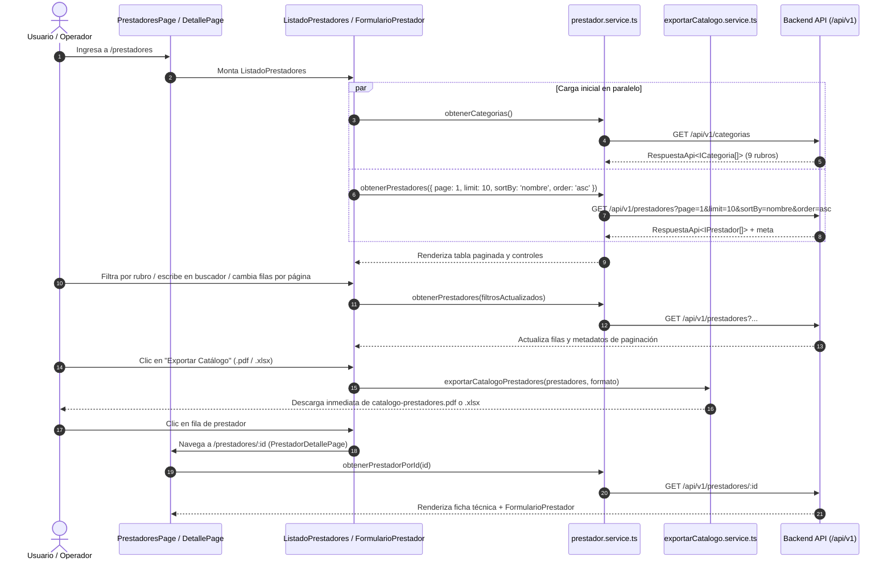
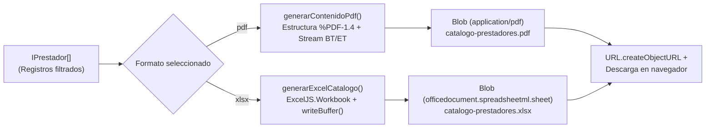

# Documento Técnico de Ingeniería: Fase 3 — Desarrollo Frontend y UI de Prototipo: Módulo Prestadores y Categorías

**Proyecto:** Fixer Servicios (`fixerServicios`)  
**Responsable:** Alejandro L. Baldres — *UI Prestadores, Catálogo Paginado, Ficha Técnica y Exportación de Reportes*  
**Estado:** Implementado y Verificado (Unit, Integration & Playwright E2E Tests)

---

## 1. Resumen Ejecutivo y Diseño Arquitectónico

En la **Fase 3**, **Alejandro L. Baldres** desarrolló el vertical completo de interfaz de usuario (**Frontend en React 18 + Vite + TypeScript**) para el módulo de **Prestadores y Categorías**, integrándolo de extremo a extremo con las capas de dominio del Backend (`/api/v1/prestadores` y `/api/v1/categorias`).

Las decisiones arquitectónicas adoptadas garantizan:
1. **Separación Estricta de Responsabilidades en el Cliente:** División modular entre contratos TypeScript ([`prestador.interface.ts`](../frontend/interfaces/prestador.interface.ts)), servicios de comunicación HTTP ([`prestador.service.ts`](../frontend/services/prestador.service.ts)), motor de generación documental ([`exportarCatalogo.service.ts`](../frontend/services/exportarCatalogo.service.ts)), componentes reutilizables ([`ListadoPrestadores.tsx`](../frontend/components/prestadores/ListadoPrestadores.tsx) y [`FormularioPrestador.tsx`](../frontend/components/prestadores/FormularioPrestador.tsx)) y vistas de enrutamiento ([`PrestadoresPage.tsx`](../frontend/pages/PrestadoresPage.tsx) y [`PrestadorDetallePage.tsx`](../frontend/pages/PrestadorDetallePage.tsx)).
2. **Reactividad y Filtrado Combinado en Tiempo Real:** El listado paginado sincroniza reactivamente la barra de búsqueda (`search`), el filtro de rubro (`rubro`), el criterio y dirección de ordenamiento (`sortBy`, `order`) y el selector de filas por página (`limit`), reiniciando automáticamente el índice de página ante cualquier cambio de filtro.
3. **Exportación de Catálogo en `.pdf` y `.xlsx` con `ExcelJS`:** Implementación de un generador de documentos **PDF 1.4 (`%PDF-1.4`)** y libros binarios OpenXML (`.xlsx`) mediante **`ExcelJS` (`exceljs`)** con hojas de detalle y resumen en memoria mediante `Blob` y `URL.createObjectURL`.
4. **Soporte CRUD de Foto de Perfil y Silueta por Defecto:** Tanto el Backend como el Frontend admiten el atributo opcional `fotoUrl?: string` en todo el ciclo CRUD (alta, lectura, listado paginado, detalle, actualización y remoción de foto). A través del componente [`AvatarPrestador.tsx`](../frontend/components/prestadores/AvatarPrestador.tsx) y el recurso vectorial [`silueta-persona.svg`](../frontend/assets/silueta-persona.svg), todo profesional sin foto cargada —o cuya imagen falle al cargar— visualiza automáticamente un avatar con la **silueta de una persona**.
5. **Vista de Catálogo de Prestadores para Usuario (`/prestadores/catalogo` y Selector de Vista):** Además de la tabla administrativa, se implementó la interfaz visual de catálogo orientada al usuario final mediante [`CatalogoPrestadoresUsuario.tsx`](../frontend/components/prestadores/CatalogoPrestadoresUsuario.tsx) y [`TarjetaCatalogoPrestador.tsx`](../frontend/components/prestadores/TarjetaCatalogoPrestador.tsx), incluyendo panel de criterio de búsqueda, píldoras de filtrado rápido (*Matriculados*, *Ofrece garantía*, *Mejor calificados 4.8+*), ordenamiento por puntuación, grilla de 3 columnas con tarjetas de profesionales (avatar con foto o silueta, matrícula, años de experiencia, métricas de reseñas/contacto, botones *Ver Perfil* y *Contactar*) y paginación numérica circular.

---

## 2. Capa de Contratos e Interfaces en Frontend (`frontend/interfaces/`)

El archivo [`prestador.interface.ts`](../frontend/interfaces/prestador.interface.ts) espeja de manera estricta los contratos de dominio del Backend, asegurando consistencia de tipos en compilación (`tsc -b`):

| Interfaz / Tipo | Propósito Técnico |
| :--- | :--- |
| `ITelefonoPrestador` | Value Object con `codPais`, `codArea` y `nroTelefono`. |
| `IPrestador` | Entidad principal con `id: number`, `nombre`, `apellido`, `matricula?`, `aniosExperiencia`, `acercaDe`, `ofreceGarantia`, `categoriaId`, `telefono`, `ratingPromedio?` y `fotoUrl?`. |
| `ICategoria` | Contrato de rubro profesional (`id: string`, `nombre: string`). |
| `IFiltrosPrestador` | Parámetros de consulta tipados: `page?`, `limit?`, `rubro?`, `search?`, `sortBy?: keyof IPrestador` y `order?: 'asc' \| 'desc'`. |
| `ICrearPrestador` / `IActualizarPrestador` | Tipos utilitarios `Omit<IPrestador, 'id'>` y `Partial<Omit<IPrestador, 'id'>>` para operaciones `POST` y `PUT`. |
| `FormatoExportacion` | Unión literal `'pdf' \| 'xlsx'` para el motor de exportación de reportes. |
| `RespuestaApi<T>` | Contrato envolvente unificado (`codigo`, `msj`, `datos: T`, `meta?: IMetaPaginacion`). |

---

## 3. Capa de Servicios HTTP y Vertical de Categorías (`frontend/services/` y `backend/src/`)

### 3.1. Cliente HTTP de Prestadores y Categorías ([`prestador.service.ts`](../frontend/services/prestador.service.ts))

El servicio encapsula todas las llamadas `fetch` hacia `/api/v1/prestadores` y `/api/v1/categorias` aprovechando el proxy reverso de Vite ([`vite.config.ts`](../frontend/vite.config.ts)) en desarrollo y permitiendo inyectar `baseUrl` en pruebas de integración:

- **`construirQueryPrestadores(filtros)`:** Serializa limpia y únicamente los parámetros definidos y no vacíos mediante `URLSearchParams`, evitando contaminar la URL con valores `undefined` o cadenas en blanco.
- **`obtenerPrestadores(filtros, baseUrl)`:** Consulta el listado paginado y lanza una excepción controlada con el mensaje de negocio (`resultado.msj`) si el código HTTP no es satisfactorio.
- **`obtenerPrestadorPorId(id, baseUrl)`:** Recupera la ficha individual de `/api/v1/prestadores/:id` para la vista de detalle.
- **`crearPrestador`, `actualizarPrestador` y `eliminarPrestador`:** Ejecutan las operaciones `POST`, `PUT` y `DELETE` manteniendo tipado estricto de entrada y salida.
- **`obtenerCategorias(search, baseUrl)` y `CATEGORIAS_POR_DEFECTO`:** Obtiene el catálogo dinámico de rubros desde `/api/v1/categorias` y conserva un respaldo local inmutable con los 9 rubros oficiales para garantizar resiliencia de la interfaz.

### 3.2. Vertical Backend de Categorías (`/api/v1/categorias`)

Para alimentar dinámicamente los selectores de rubro del Frontend, se completó el vertical de **Categorías** en el Backend siguiendo la misma arquitectura en capas:
- **Repositorio ([`categoria.repository.ts`](../backend/src/repository/categoria.repository.ts)):** Persistencia en memoria inicializada con los 9 rubros (*Plomería, Electricidad, Gasista, Pintura, Carpintería, Albañilería, Jardinería, Cerrajería y Refrigeración*), copias defensivas en `findAll()` y operaciones CRUD completas.
- **Servicio ([`categoria.service.ts`](../backend/src/service/categoria.service.ts)):** Ordenamiento alfabético lexicográfico en español (`localeCompare`) y búsqueda normalizada sin distinción de tildes ni mayúsculas (`NFD`).
- **Controlador y Rutas ([`categoria.controller.ts`](../backend/src/controller/categoria.controller.ts) y [`categoria.route.ts`](../backend/src/route/categoria.route.ts)):** Montados en [`Servidor.ts`](../backend/src/core/Servidor.ts) bajo `/api/v1/categorias`.

---

## 4. Motor de Exportación de Catálogo en `.pdf` y `.xlsx` (`exportarCatalogo.service.ts`)

El servicio [`exportarCatalogo.service.ts`](../frontend/services/exportarCatalogo.service.ts) resuelve el requerimiento del botón funcional **"Exportar Catálogo"** generando archivos válidos y descargables directamente desde el navegador:

1. **Generación de PDF (`generarContenidoPdf`):**
   - Normaliza caracteres diacríticos y escapa delimitadores PostScript/PDF (`sanitizarTextoPdf`).
   - Construye los 5 objetos estructurales del estándar **PDF 1.4** (`Catalog`, `Pages`, `Page`, `Content Stream` con operadores `BT`, `/F1 9 Tf`, `Tm`, `Tj`, `ET` y fuente base `Helvetica`) cerrando con `trailer` y `%%EOF`.
2. **Generación de Excel con `ExcelJS` (`generarExcelCatalogo`):**
   - Instancia `new ExcelJS.Workbook()` y construye dos hojas de trabajo:
     - **`Catálogo Prestadores`:** Define columnas con anchos calibrados (`ID`, `Nombre`, `Apellido`, `Rubro`, `Matrícula`, `Experiencia (años)`, `Garantía`, `Teléfono`, `Calificación`, `Acerca de`), aplica formato en negrita a la fila de encabezado (`getRow(1).font = { bold: true }`) e inserta cada registro tipado.
     - **`Resumen`:** Sintetiza métricas clave del catálogo exportado (total de prestadores exportados, cantidad con garantía escrita y calificación promedio general).
   - Exporta el archivo binario OpenXML mediante `libro.xlsx.writeBuffer()`.
3. **Disparo de Descarga (`exportarCatalogoPrestadores`):**
   - Empaqueta el contenido (`string` o `Uint8Array`) en una instancia de `Blob` con su `mimeType` oficial, genera una URL efímera con `URL.createObjectURL`, simula el clic sobre un elemento `<a download>` temporal y libera la memoria de forma diferida (`setTimeout(() => URL.revokeObjectURL(url), 1000)`).

---

## 5. Componentes UI, Vistas y Enrutamiento (`frontend/components/` y `frontend/pages/`)

| Archivo | Rol en la Interfaz de Usuario |
| :--- | :--- |
| [`AvatarPrestador.tsx`](../frontend/components/prestadores/AvatarPrestador.tsx) y [`silueta-persona.svg`](../frontend/assets/silueta-persona.svg) | Componente reutilizable de avatar (`tamano: 'sm' \| 'md' \| 'lg'`) que renderiza la fotografía del prestador cuando `fotoUrl` está presente, o la imagen con la **silueta de una persona** (`SILUETA_PERSONA_DATA_URI`) cuando no posee foto o se produce un error de carga (`onError`). Expone `data-testid="avatar-prestador"` y `data-tiene-foto="true\|false"`. |
| [`TarjetaCatalogoPrestador.tsx`](../frontend/components/prestadores/TarjetaCatalogoPrestador.tsx) | Tarjeta individual de profesional para la vista de usuario. Presenta avatar (foto o silueta por defecto), matrícula/rubro, botón de guardado (`🔖`), chips de rubro y años de experiencia, bloque de métricas (`rating`, cantidad de reseñas, teléfono y estado de garantía) y acciones **`Ver Perfil`** y **`Contactar`**. |
| [`CatalogoPrestadoresUsuario.tsx`](../frontend/components/prestadores/CatalogoPrestadoresUsuario.tsx) | Vista de catálogo para el usuario final con panel de criterio de búsqueda (`CRITERIO DE BÚSQUEDA`), buscador + botón `Actualizar`, filtros rápidos interactivos (`Matriculados`, `Ofrece garantía`, `Mejor calificados 4.8+`), selector de ordenamiento (`Mayor puntuación`, `Mayor experiencia`, `Nombre`), grilla de 6 tarjetas por página y paginación circular. |
| [`ListadoPrestadores.tsx`](../frontend/components/prestadores/ListadoPrestadores.tsx) | Tabla paginada con avatar de foto o silueta en cada fila (`AvatarPrestador`), buscador en tiempo real (`#busqueda-prestadores`), selector de rubro (`#filtro-rubro`), criterio y dirección de ordenamiento (`#ordenar-por`, `#orden-direccion`), selector de filas por página (`#filas-por-pagina`: `5`, `10`, `15`, `20`), controles de paginación (`Anterior` / `Siguiente`) y barra de exportación (`.pdf` / `.xlsx` + botón `"Exportar Catálogo"`). |
| [`FormularioPrestador.tsx`](../frontend/components/prestadores/FormularioPrestador.tsx) | Formulario reactivo reutilizable para alta (`POST`) y edición (`PUT`) con gestión CRUD de fotografía (`#prestador-foto-url` por URL, `#prestador-foto-archivo` mediante `FileReader` Data URL, vista previa en vivo con `AvatarPrestador` y botón `"Quitar foto"` para restaurar la silueta por defecto), validación de campos obligatorios (`nombre`, `apellido`, `categoriaId`), teléfono estructurado (`codPais`, `codArea`, `nroTelefono`), matrícula, años de experiencia, garantía y descripción profesional. |
| [`PrestadoresPage.tsx`](../frontend/pages/PrestadoresPage.tsx) | Vista principal montada en `/prestadores` y `/prestadores/catalogo`. Permite alternar entre la **Tabla de Gestión** ([`ListadoPrestadores`](../frontend/components/prestadores/ListadoPrestadores.tsx)) y el **Catálogo de Usuario** ([`CatalogoPrestadoresUsuario`](../frontend/components/prestadores/CatalogoPrestadoresUsuario.tsx)), además del panel desplegable de alta (`+ Nuevo Prestador`). |
| [`PrestadorDetallePage.tsx`](../frontend/pages/PrestadorDetallePage.tsx) | Vista de detalle montada en `/prestadores/:id`. Presenta la tarjeta de ficha técnica completa del profesional con su fotografía o silueta (`AvatarPrestador` en tamaño `lg`) junto al formulario pre-cargado para editar sus datos y foto en vivo o eliminar el registro. |
| [`Prestadores.css`](../frontend/components/prestadores/Prestadores.css) | Hoja de estilos modular basada en las variables globales de [`variables.css`](../frontend/styles/variables.css) con grillas adaptativas (`@media (max-width: 900px)` y `600px`). |
| [`App.tsx`](../frontend/src/App.tsx) | Registra las rutas `<Route path="/prestadores" element={<PrestadoresPage />} />` y `<Route path="/prestadores/:id" element={<PrestadorDetallePage />} />` dentro del [`Layout`](../frontend/components/layout/Layout.tsx) general. |

---

## 6. Estrategia Integral de Pruebas (Unitarias, Integración y E2E)

Se implementó la pirámide completa de pruebas tanto en Frontend como en Backend:

### 6.1. Pruebas Unitarias
- **Frontend ([`frontend/src/__test__/prestador.unit.test.ts`](../frontend/src/__test__/prestador.unit.test.ts)):**
  - Valida `construirQueryPrestadores` y todos los métodos de [`prestador.service.ts`](../frontend/services/prestador.service.ts) (`obtenerPrestadores`, `obtenerPrestadorPorId`, `crearPrestador`, `actualizarPrestador`, `eliminarPrestador`, `obtenerCategorias`) simulando `fetch` con respuestas exitosas y errores HTTP (`404`, `500`).
  - Valida todas las funciones puras y de generación documental de [`exportarCatalogo.service.ts`](../frontend/services/exportarCatalogo.service.ts) (`formatearTelefonoPrestador`, `sanitizarTextoPdf`, `generarContenidoPdf`, `generarExcelCatalogo` verificando la lectura del buffer binario con `ExcelJS.Workbook.xlsx.load`, `generarArchivoCatalogo` y `exportarCatalogoPrestadores`).
  - Verifica el renderizado de [`AvatarPrestador`](../frontend/components/prestadores/AvatarPrestador.tsx) (con `fotoUrl` y con silueta por defecto cuando no tiene foto), [`FormularioPrestador`](../frontend/components/prestadores/FormularioPrestador.tsx) (modo alta con silueta y modo edición con foto precargada y botón `"Quitar foto"`) y [`ListadoPrestadores`](../frontend/components/prestadores/ListadoPrestadores.tsx) mediante `renderToStaticMarkup`.
- **Backend Categorías ([`backend/src/__test__/categoria.unit.test.ts`](../backend/src/__test__/categoria.unit.test.ts)):**
  - 15 pruebas unitarias cubriendo `CategoriaRepository`, `CategoriaService` y `CategoriaController`.

### 6.2. Pruebas de Integración
- **Frontend <-> Backend ([`frontend/src/__test__/prestador.integration.test.ts`](../frontend/src/__test__/prestador.integration.test.ts)):**
  - Levanta una instancia efímera real de [`Servidor`](../backend/src/core/Servidor.ts) y ejecuta los servicios del Frontend contra la API Express real, verificando paginación dinámica (`limit=5`), filtrado por rubro y búsqueda sin tildes, ciclo completo CRUD (`crearPrestador` -> `obtenerPrestadorPorId` -> `actualizarPrestador` -> `eliminarPrestador`) y generación de reportes `.pdf` y `.xlsx` a partir de datos reales del servidor.
- **Backend Categorías ([`backend/src/__test__/categoria.integration.test.ts`](../backend/src/__test__/categoria.integration.test.ts)):**
  - 10 pruebas de integración con `supertest` sobre `/api/v1/categorias` evaluando códigos `200`, `201`, `400` y `404`.

### 6.3. Pruebas End-to-End (E2E)
- **Frontend UI con Playwright ([`frontend/e2e/prestadores.spec.ts`](../frontend/e2e/prestadores.spec.ts)):**
  - Configurado en [`playwright.config.ts`](../frontend/playwright.config.ts) con arranque coordinado de `webServer` (Backend en puerto `3000` + Frontend Vite).
  - Verifica en navegador Chromium real:
    1. Navegación desde el menú lateral (`1. Prestadores`) hacia `/prestadores`, carga inicial de la tabla paginada (`10` filas visibles de `16` registros) y comprobación de que los prestadores sin foto (ej. Ana López) muestran la silueta de persona por defecto (`data-tiene-foto="false"`).
    2. Cambio de filas por página (`5 filas` -> `4` páginas), filtro por rubro (`Plomería` -> `5` registros) y búsqueda en tiempo real (`Gómez` -> `Carlos Gómez`).
    3. Navegación al detalle (`/prestadores/1`) haciendo clic en la fila de la tabla, validando el encabezado `Detalle del prestador`, matrícula `MAT-1001`, teléfono `+54 11 40001001` y formulario de edición.
    4. Flujo completo de alta de un nuevo prestador (`+ Nuevo Prestador`) con foto de perfil (`#prestador-foto-url`), verificación de su foto en catálogo y vista de detalle (`data-tiene-foto="true"`), remoción de foto con el botón `"Quitar foto"` comprobando el retorno a la silueta (`data-tiene-foto="false"`), edición de años de experiencia (`Guardar cambios`) y baja (`Eliminar prestador`).
    5. Intercepción del evento nativo `download` al pulsar **"Exportar Catálogo"**, comprobando la descarga efectiva de `catalogo-prestadores.pdf` y `catalogo-prestadores.xlsx`.
    6. Visualización e interacción con la vista **Catálogo de Prestadores para Usuario** (`CatalogoPrestadoresUsuario`), comprobando las 6 tarjetas por página (`TarjetaCatalogoPrestador`), los filtros rápidos (`Mejor calificados 4.8+`, `Matriculados`), el despliegue de teléfono con `Contactar` y la navegación al detalle con `Ver Perfil`.
- **Backend Categorías E2E ([`backend/src/__test__/categoria.e2e.test.ts`](../backend/src/__test__/categoria.e2e.test.ts)):**
  - Prueba el ciclo de vida HTTP completo sobre `/api/v1/categorias`.

---

## 7. Verificación y Criterios de Aceptación (Definition of Done - Fase 3)

| Entregable (Alejandro L. Baldres) | Ubicación en el Proyecto | Estado |
| :--- | :--- | :---: |
| Contratos e interfaces de Prestadores y Categorías en Frontend (`fotoUrl?`) | [`/frontend/interfaces/prestador.interface.ts`](../frontend/interfaces/prestador.interface.ts) | Completado |
| Componente `AvatarPrestador` e imagen de silueta de persona por defecto | [`/frontend/components/prestadores/AvatarPrestador.tsx`](../frontend/components/prestadores/AvatarPrestador.tsx) y [`/frontend/assets/silueta-persona.svg`](../frontend/assets/silueta-persona.svg) | Completado |
| Servicio cliente HTTP de Prestadores y Categorías | [`/frontend/services/prestador.service.ts`](../frontend/services/prestador.service.ts) | Completado |
| Servicio de exportación de catálogo (`.pdf` y `.xlsx`) | [`/frontend/services/exportarCatalogo.service.ts`](../frontend/services/exportarCatalogo.service.ts) | Completado |
| Tabla paginada con foto/silueta, buscador, filtro de rubro y selector de filas | [`/frontend/components/prestadores/ListadoPrestadores.tsx`](../frontend/components/prestadores/ListadoPrestadores.tsx) | Completado |
| Vista de Catálogo de Usuario con tarjetas y filtros rápidos | [`/frontend/components/prestadores/CatalogoPrestadoresUsuario.tsx`](../frontend/components/prestadores/CatalogoPrestadoresUsuario.tsx) y [`/frontend/components/prestadores/TarjetaCatalogoPrestador.tsx`](../frontend/components/prestadores/TarjetaCatalogoPrestador.tsx) | Completado |
| Formulario reactivo CRUD de alta y edición con carga/remoción de foto | [`/frontend/components/prestadores/FormularioPrestador.tsx`](../frontend/components/prestadores/FormularioPrestador.tsx) | Completado |
| Vistas de Catálogo (`/prestadores`) y Detalle (`/prestadores/:id`) | [`/frontend/pages/PrestadoresPage.tsx`](../frontend/pages/PrestadoresPage.tsx) y [`/frontend/pages/PrestadorDetallePage.tsx`](../frontend/pages/PrestadorDetallePage.tsx) | Completado |
| Pruebas Unitarias y de Integración Frontend (Vitest) | [`/frontend/src/__test__/prestador.unit.test.ts`](../frontend/src/__test__/prestador.unit.test.ts) y [`/frontend/src/__test__/prestador.integration.test.ts`](../frontend/src/__test__/prestador.integration.test.ts) | Completado |
| Pruebas E2E de UI en Navegador (Playwright) | [`/frontend/e2e/prestadores.spec.ts`](../frontend/e2e/prestadores.spec.ts) | Completado |
| Vertical Backend y Suite Completa de Categorías (`unit`, `integration`, `e2e`) | [`/backend/src/controller/categoria.controller.ts`](../backend/src/controller/categoria.controller.ts) y [`/backend/src/__test__/categoria.*.test.ts`](../backend/src/__test__) | Completado |
