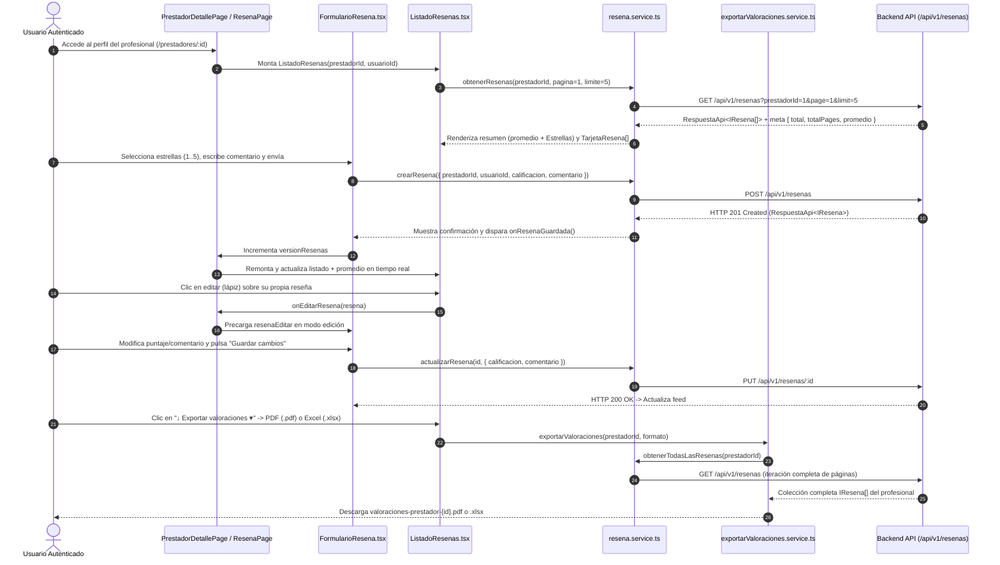
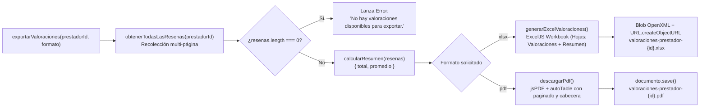

# Documento Técnico y Funcional de Ingeniería: Fase 3 — Desarrollo Frontend y UI de Prototipo: Módulo Reseñas y Calificaciones

**Proyecto:** Fixer Servicios (`fixerServicios`)  
**Responsable:** Marianela Belardinelli Beker — *UI Reseñas y Calificaciones, Visualización de Estrellas, Formulario Reactivo de Opiniones y Exportación de Valoraciones*  
**Estado:** Implementado y Verificado (Integración Backend/Frontend & Playwright E2E)

---

## 1. Resumen Ejecutivo y Diseño Funcional / Arquitectónico

En la **Fase 3**, **Marianela Belardinelli Beker** diseñó e implementó el vertical completo de interfaz de usuario (**Frontend en React 18 + Vite + TypeScript**) correspondiente al dominio de **Reseñas y Calificaciones**, integrándolo de extremo a extremo con la API REST del Backend (`/api/v1/resenas`) y acoplándolo dentro de la ficha técnica de cada profesional.

Las decisiones funcionales y arquitectónicas adoptadas garantizan:
1. **Desacoplamiento Modular en el Cliente:** Separación estricta de responsabilidades entre contratos de datos ([`resena.interface.ts`](../frontend/interfaces/resena.interface.ts)), adaptadores de comunicación HTTP ([`resena.service.ts`](../frontend/services/resena.service.ts)), motor de generación documental ([`exportarValoraciones.service.ts`](../frontend/services/exportarValoraciones.service.ts)), componentes de presentación e interacción ([`Estrellas.tsx`](../frontend/components/resenas/Estrellas.tsx), [`TarjetaResena.tsx`](../frontend/components/resenas/TarjetaResena.tsx), [`FormularioResena.tsx`](../frontend/components/resenas/FormularioResena.tsx), [`ListadoResenas.tsx`](../frontend/components/resenas/ListadoResenas.tsx)) y hoja de estilos responsive ([`Resenas.css`](../frontend/components/resenas/Resenas.css)).
2. **Visualización Precisa y Accesible de Calificaciones por Estrellas (`Estrellas.tsx`):** Componente semántico (`role="img"`, `aria-label="X de 5 estrellas"`) capaz de representar tanto puntuaciones enteras ($1 \dots 5$) en tarjetas individuales como promedios decimales (ej. `3,5` o `4,7`) en el resumen del prestador mediante relleno proporcional dinámico (`width: ${porcentaje}%`).
3. **Feed Paginado con Resumen de Reputación y Resiliencia UI (`ListadoResenas.tsx`):** Cabecera estadística que exhibe el promedio general formateado con coma decimal para la localización argentina, estrellas visuales y contador singular/plural de opiniones (`1 opinión` / `N opiniones`), listado paginado de a 5 registros por página (`LIMITE = 5`), estados de carga (`role="status"`), estado vacío informativo y manejo de errores con acción de recuperación (`Reintentar`).
4. **Formulario Reactivo Dual (Alta y Edición) con Validación de Reglas de Negocio (`FormularioResena.tsx`):** Componente controlado que unifica la publicación de nuevas reseñas (`POST /api/v1/resenas`) y la modificación de opiniones existentes (`PUT /api/v1/resenas/:id`), validando en el cliente la selección obligatoria de puntaje ($1 \dots 5$ estrellas interactivas con `aria-pressed`) y la presencia de comentario no vacío (`comentario.trim()`).
5. **Exportación Integral del Reporte de Valoraciones en `.pdf` y `.xlsx` (`exportarValoraciones.service.ts`):** Botón desplegable (`↓ Exportar valoraciones ▾`) que recolecta de forma paginada la totalidad de las reseñas del profesional (`obtenerTodasLasResenas`) y genera reportes descargables en formato **PDF (`jsPDF` + `jspdf-autotable`)** y **Excel OpenXML (`ExcelJS`)** con hojas de detalle y resumen de métricas.

---

## 2. Capa de Contratos e Interfaces en Frontend (`frontend/interfaces/`)

El archivo [`resena.interface.ts`](../frontend/interfaces/resena.interface.ts) define los contratos estáticos que sincronizan los componentes de React con la estructura de respuesta del Backend:

| Interfaz / Tipo | Propiedades | Propósito Funcional y Técnico |
| :--- | :--- | :--- |
| `IResena` | `id: number`, `prestadorId: number`, `usuarioId: number`, `calificacion: number`, `comentario: string`, `createdAt: string` | Representa una opinión persistida asociada a un profesional y a un usuario autor con fecha ISO-8601. |
| `ICrearResena` | `prestadorId: number`, `usuarioId: number`, `calificacion: number`, `comentario: string` | DTO de entrada para el alta de una nueva valoración, omitiendo `id` y `createdAt` (generados en el servidor). En la edición se acota mediante `Pick<ICrearResena, 'calificacion' \| 'comentario'>`. |
| `RespuestaApi<T>` | `codigo: number`, `msj: string`, `datos: T`, `meta?: { pagina, limit, total, totalPages, promedio? }` | Contrato envolvente unificado que transporta tanto la página actual de reseñas como el `promedio` global calculado para el prestador. |
| `FormatoExportacion` | `'xlsx' \| 'pdf'` | Unión literal definida en [`exportarValoraciones.service.ts`](../frontend/services/exportarValoraciones.service.ts) para tipar las opciones de descarga documental. |

---

## 3. Capa de Servicios HTTP y Recolección Completa (`frontend/services/resena.service.ts`)

El módulo [`resena.service.ts`](../frontend/services/resena.service.ts) encapsula la comunicación asíncrona con el endpoint base `/api/v1/resenas`, enrutado en desarrollo a través del proxy configurado en [`vite.config.ts`](../frontend/vite.config.ts) (`'/api': 'http://localhost:3000'`):

1. **`obtenerResenas(prestadorId: number, pagina = 1, limite = 5)`:**
   - Construye la query string tipada con `URLSearchParams` (`prestadorId`, `page`, `limit`).
   - Verifica `respuesta.ok` y lanza un error controlado (`'No se pudieron cargar las reseñas'`) ante fallos de red o servidor.
2. **`crearResena(datos: ICrearResena)`:**
   - Ejecuta `POST /api/v1/resenas` serializando el payload en JSON.
   - Si el servidor devuelve un error de validación (`HTTP 400`), extrae y propaga el mensaje de negocio exacto enviado por el backend (`resultado.msj || 'No se pudo crear la reseña'`).
3. **`actualizarResena(id: number, datos: Pick<ICrearResena, 'calificacion' | 'comentario'>)`:**
   - Ejecuta `PUT /api/v1/resenas/:id` enviando únicamente los campos mutables permitidos (`calificacion` y `comentario`) y propagando cualquier mensaje de error del servidor.
4. **`obtenerTodasLasResenas(prestadorId: number)`:**
   - Diseñada específicamente para abastecer al motor de exportación de reportes sin verse limitada por la ventana de paginación visual (`LIMITE = 5`).
   - Realiza una primera petición con tamaño de lote `limite = 100`, inspecciona `primeraPagina.meta?.totalPages` e itera secuencialmente desde `pagina = 2` hasta `totalPaginas`, consolidando el 100% de las reseñas del prestador en un único arreglo.

---

## 4. Motor de Exportación de Reportes de Valoraciones (`exportarValoraciones.service.ts`)

El servicio [`exportarValoraciones.service.ts`](../frontend/services/exportarValoraciones.service.ts) implementa el requerimiento funcional del botón **"Exportar Reporte de Valoraciones"** en formatos `.xlsx` y `.pdf`:

### 4.1. Procesamiento Estadístico y Formateo Localizado
- **`calcularResumen(resenas)`:** Calcula el total de valoraciones exportadas y el promedio aritmético redondeado a un decimal (`Math.round((suma / total) * 10) / 10`), retornando `0` de forma segura si la lista está vacía.
- **`formatearFecha(fecha)`:** Convierte la marca temporal ISO-8601 al formato local argentino (`toLocaleDateString('es-AR')`, `dd/mm/aaaa`), manteniendo el valor original como fallback si la cadena no es una fecha válida.

### 4.2. Exportación a Excel OpenXML (`.xlsx`) con `ExcelJS`
La función `generarExcelValoraciones(resenas)` construye un libro `ExcelJS.Workbook` compuesto por dos hojas de cálculo:
- **Hoja 1 (`Valoraciones`):** Define 6 columnas con anchos calibrados (`ID`, `Profesional ID`, `Usuario ID`, `Calificación`, `Comentario`, `Fecha`), aplica tipografía en negrita y alineación vertical centrada a la fila de encabezados, y vuelca cada reseña con su fecha formateada.
- **Hoja 2 (`Resumen`):** Presenta una tabla ejecutiva con las columnas `Métrica` y `Valor`, informando el **`Total de valoraciones`** y la **`Calificación promedio`**.
- **Descarga en Navegador (`descargarExcel`):** Serializa el libro en un buffer binario (`libro.xlsx.writeBuffer()`), construye un `Blob` con MIME type `application/vnd.openxmlformats-officedocument.spreadsheetml.sheet`, dispara la descarga como `valoraciones-prestador-${prestadorId}.xlsx` y revoca el Object URL tras 1 segundo.

### 4.3. Exportación a Documento Portátil (`.pdf`) con `jsPDF` y `jspdf-autotable`
La función `descargarPdf(resenas, prestadorId)` genera un reporte institucional listo para impresión:
- **Encabezado Corporativo:** Título `'Fixer - Reporte de valoraciones'` en color primario corporativo (`RGB 40, 96, 136`, equivalente a `--color-primary: #286088`) y ficha resumen superior indicando `Profesional ID`, `Total de valoraciones` y `Calificacion promedio`.
- **Tabla Estructurada (`autoTable`):** Renderiza las columnas `Usuario ID`, `Calificacion`, `Comentario` y `Fecha` con diseño en grilla (`theme: 'grid'`), cabecera azul corporativa con texto blanco y ajuste automático de líneas largas (`overflow: 'linebreak'`).
- **Pie de Página Multi-Hoja (`didDrawPage`):** Estampa dinámicamente el número de página (`Pagina N`) en el margen inferior izquierdo de cada hoja generada y descarga el archivo bajo el nombre `valoraciones-prestador-${prestadorId}.pdf`.

---

## 5. Especificación Funcional de Componentes UI y Vistas (`frontend/components/resenas/`)

| Componente / Archivo | Responsabilidad Funcional y de Experiencia de Usuario (UX/UI) |
| :--- | :--- |
| [`Estrellas.tsx`](../frontend/components/resenas/Estrellas.tsx) | Recibe `calificacion: number`, acota el valor al intervalo $[0, 5]$ y renderiza 5 estrellas superponiendo una estrella base gris (`.estrella__vacia`) y una estrella dorada (`.estrella__relleno`) cuyo ancho se calcula por estrella como $\text{ clamp}(0, 100, (\text{valor} - \text{indice}) \times 100)\%$. Esto permite pintar estrellas parciales precisas para promedios decimales. |
| [`TarjetaResena.tsx`](../frontend/components/resenas/TarjetaResena.tsx) | Renderiza un elemento semántico `<article className="tarjeta-resena">` con identificador del autor (`Usuario #${resena.usuarioId}`), etiqueta `<time>` formateada en español (`day: '2-digit', month: 'long', year: 'numeric', timeZone: 'UTC'`), botón opcional de edición con ícono `<Pencil size={17} />` (`lucide-react`) cuando el usuario activo es el autor, componente `<Estrellas />` y cuerpo del comentario. |
| [`FormularioResena.tsx`](../frontend/components/resenas/FormularioResena.tsx) | Formulario reactivo con soporte para modo creación y modo edición (`modoEdicion = resenaEditar !== null`). Incluye selector interactivo de 5 botones de estrella con estado visual activo (`.formulario-resena__estrella--activa`) y atributo de accesibilidad `aria-pressed`, área de texto obligatoria (`#comentario-resena`), mensajes de validación con `role="alert"`, confirmación con `role="status"` (`¡Tu reseña se publicó correctamente!`), bloqueo de controles durante el envío (`enviando`) y botón `Cancelar edición`. |
| [`ListadoResenas.tsx`](../frontend/components/resenas/ListadoResenas.tsx) | Orquesta la carga paginada (`LIMITE = 5`), el bloqueo de condiciones de carrera mediante flag de limpieza `activo = false` al desmontar o cambiar de página, el encabezado `.resumen-calificaciones`, la lista de `TarjetaResena`, el menú flotante de exportación (`Excel (.xlsx)` y `PDF (.pdf)`), la barra de paginación (`Anterior` / `Página X de Y` / `Siguiente`) y la restricción de autoría (`usuarioId !== undefined && usuarioId === resena.usuarioId`) para habilitar la edición. |
| [`Resenas.css`](../frontend/components/resenas/Resenas.css) | Implementa la identidad visual del módulo consumiendo los *Design Tokens* de [`variables.css`](../frontend/styles/variables.css) (`--color-primary`, `--color-rating`, `--color-surface`, `--radius-md`), animaciones de hover en estrellas y reglas `@media` para adaptación móvil. |
| [`ResenaPage.tsx`](../frontend/pages/ResenaPage.tsx) & [`PrestadorDetallePage.tsx`](../frontend/pages/PrestadorDetallePage.tsx) | Inicialmente expuesta como vista autónoma en [`ResenaPage.tsx`](../frontend/pages/ResenaPage.tsx) y posteriormente integrada de forma nativa dentro del perfil de cada profesional en [`PrestadorDetallePage.tsx`](../frontend/pages/PrestadorDetallePage.tsx) (`FX-78`), sincronizando el alta y la edición mediante la clave reactiva `versionResenas`. |

---

## 6. Verificación y Criterios de Aceptación (Definition of Done - Fase 3)

| Entregable Funcional (Marianela Belardinelli Beker) | Ubicación en el Proyecto | Estado |
| :--- | :--- | :---: |
| Contratos e interfaces de Reseñas en Frontend (`IResena`, `ICrearResena`, `RespuestaApi`) | [`/frontend/interfaces/resena.interface.ts`](../frontend/interfaces/resena.interface.ts) | Completado |
| Servicio HTTP de Reseñas (listado paginado, alta, edición y recolección completa) | [`/frontend/services/resena.service.ts`](../frontend/services/resena.service.ts) | Completado |
| Componente de visualización de puntuación por estrellas (`1` a `5` y decimales) | [`/frontend/components/resenas/Estrellas.tsx`](../frontend/components/resenas/Estrellas.tsx) | Completado |
| Tarjeta individual de opinión con fecha localizada y acción de edición | [`/frontend/components/resenas/TarjetaResena.tsx`](../frontend/components/resenas/TarjetaResena.tsx) | Completado |
| Listado paginado de opiniones por prestador y resumen de calificación promedio | [`/frontend/components/resenas/ListadoResenas.tsx`](../frontend/components/resenas/ListadoResenas.tsx) | Completado |
| Formulario reactivo para alta y edición con validación de puntaje y comentario obligatorio | [`/frontend/components/resenas/FormularioResena.tsx`](../frontend/components/resenas/FormularioResena.tsx) | Completado |
| Motor funcional de exportación de valoraciones en `.pdf` (`jsPDF`) y `.xlsx` (`ExcelJS`) | [`/frontend/services/exportarValoraciones.service.ts`](../frontend/services/exportarValoraciones.service.ts) | Completado |
| Sistema de estilos responsive y variables globales CSS | [`/frontend/components/resenas/Resenas.css`](../frontend/components/resenas/Resenas.css) y [`/frontend/styles/variables.css`](../frontend/styles/variables.css) | Completado |
