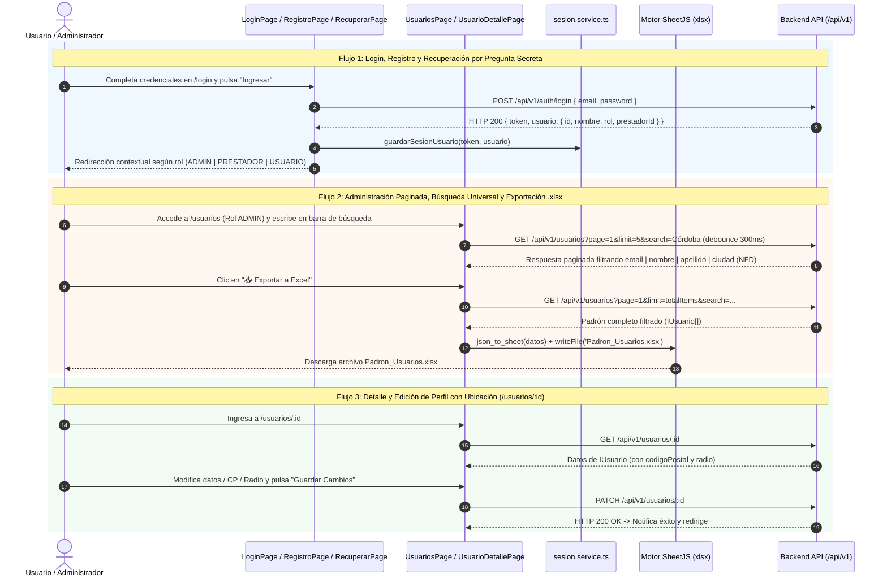
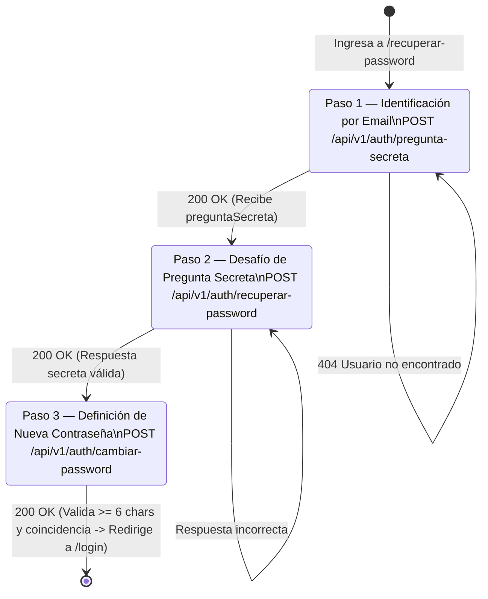

# Documento Técnico y Funcional de Ingeniería: Fase 3 — Desarrollo Frontend y UI de Prototipo: Módulo Usuarios, Autenticación y Ubicación

**Proyecto:** Fixer Servicios (`fixerServicios`)  
**Responsable:** Julieta Dabús — *UI Global, Autenticación, Recuperación de Clave, Directorio Paginado de Usuarios, Perfil con Cobertura y Exportación en Excel*  
**Estado:** Implementado y Verificado (Integración Backend/Frontend & Playwright E2E)

---

## 1. Resumen Ejecutivo y Diseño Funcional / Arquitectónico

En la **Fase 3**, **Julieta Dabús** diseñó e implementó el vertical completo de interfaz de usuario (**Frontend en React 18 + Vite + TypeScript**) para el dominio de **Usuarios, Autenticación y Ubicación**, integrándolo con los servicios REST del Backend (`/api/v1/auth/*` y `/api/v1/usuarios/*`).

Las decisiones funcionales y arquitectónicas adoptadas en esta etapa garantizan:
1. **Ecosistema Completo de Acceso y Seguridad (`LoginPage.tsx`, `RegistroPage.tsx`, `RecuperarPasswordPage.tsx`):** Pantallas reactivas conectadas al backend con retroalimentación visual de estados de carga y error, controles accesibles para alternar la visibilidad de contraseñas (`Eye` / `EyeOff` de `lucide-react`) y un asistente secuencial de **3 pasos** para la recuperación de clave mediante la pregunta secreta del DER.
2. **Directorio Administrativo Paginado con Búsqueda Universal sin Tildes (`UsuariosPage.tsx`):** Vista de administración protegida para el rol `ADMIN` con tabla paginada, buscador con *debounce* de `300 ms` que filtra simultáneamente por **email, nombre, apellido, localidad o provincia** ignorando diacríticos y mayúsculas (`NFD`), y badges semánticos por rol (`ADMIN`, `PRESTADOR`, `USUARIO`).
3. **Gestión de Perfil, Código Postal y Radio de Cobertura (`UsuarioDetallePage.tsx`):** Formulario de detalle y edición en `/usuarios/:id` conectado mediante `GET` y `PATCH /api/v1/usuarios/:id`, que valida permisos de pertenencia, permite asignar código postal y exhibe condicionalmente el atributo **`Radio de Cobertura (km)`** para los usuarios con rol `PRESTADOR`.
4. **Exportación Funcional del Padrón de Usuarios en `.xlsx` (`SheetJS / xlsx`):** Incorporación del botón **`📥 Exportar a Excel`** en [`UsuariosPage.tsx`](../frontend/pages/UsuariosPage.tsx) que genera y descarga en el navegador el libro binario `Padron_Usuarios.xlsx` con la totalidad de los registros filtrados.
5. **Centralización de Contratos y Sistema de Estilos de Autenticación (`usuario.interface.ts` y `Auth.css`):** Unificación de los tipos de dominio en [`frontend/interfaces/usuario.interface.ts`](../frontend/interfaces/usuario.interface.ts) alineados 1:1 con `IUsuarioPublico` del Backend, y diseño responsive unificado en [`frontend/pages/Auth.css`](../frontend/pages/Auth.css).



---

## 2. Capa de Contratos e Interfaces en Frontend (`frontend/interfaces/usuario.interface.ts`)

En [`frontend/interfaces/usuario.interface.ts`](../frontend/interfaces/usuario.interface.ts) se centralizaron los contratos de datos del Módulo 3 para eliminar definiciones duplicadas entre páginas y asegurar correspondencia estricta con el Backend:

| Interfaz / Tipo | Propiedades Principales | Propósito Funcional y de Seguridad |
| :--- | :--- | :--- |
| `RolUsuario` | `'ADMIN' \| 'PRESTADOR' \| 'USUARIO'` | Tipo unión literal que gobierna los permisos de navegación, vistas administrativas y campos condicionales. |
| `IUbicacion` | `id: number`, `pais`, `provincia`, `localidad`, `codigoPostal: string`, `radio: number` | Modela la entidad geográfica normalizada asociada al usuario. |
| `IUsuario` | `id: number`, `nombre`, `apellido`, `email`, `rol`, `ubicacionId?`, `ubicacion?`, `codigoPostal?`, `radio?`, `preguntaSecreta?`, `bloqueadoHasta?`, `debeCambiarPassword?`, `prestadorId?` | Espeja `IUsuarioPublico` del Backend, garantizando que `passwordHash` y `respuestaSecretaHash` nunca viajen ni se tipen en el cliente. |
| `ICrearUsuario` / `IActualizarUsuario` | `Omit<IUsuario, 'id' \| 'createdAt' \| 'updatedAt' \| 'ubicacion'>` (y `Partial<...>`) | DTOs utilitarios para las operaciones de alta (`POST /usuarios`) y edición parcial (`PATCH /usuarios/:id`). |
| `IFiltrosUsuario` | `page?`, `limit?`, `search?`, `rol?`, `sortBy?`, `order?` | Contrato para parametrizar consultas paginadas y filtradas al directorio de usuarios. |

---

## 3. Especificación Funcional de Pantallas de Autenticación y Recuperación (`frontend/pages/`)

### 3.1. Pantalla de Inicio de Sesión ([`frontend/pages/LoginPage.tsx`](../frontend/pages/LoginPage.tsx))
- **Conexión y Manejo de Estado:** Envía las credenciales mediante `POST /api/v1/auth/login`, deshabilita el botón de envío durante la petición (`loading ? 'Ingresando...' : 'Ingresar'`) y exhibe alertas descriptivas (`.error-message`) ante credenciales inválidas (`401`), cuentas bloqueadas (`423`) o errores de red.
- **Control de Visibilidad de Contraseña:** Integra un botón conmutador con íconos `<Eye />` y `<EyeOff />` (`lucide-react`) y atributos de accesibilidad `aria-label` y `aria-pressed` que alterna el input entre `type="password"` y `type="text"`.
- **Almacenamiento de Sesión y Enrutamiento Contextual:** Al recibir `code === 200`, persiste el token y el objeto de usuario mediante `guardarSesionUsuario` ([`sesion.service.ts`](../frontend/services/sesion.service.ts)) y redirige según el rol autenticado (`/prestadores/:id` para `PRESTADOR`, `/prestadores` para `ADMIN` y `/` para `USUARIO`).

### 3.2. Pantalla de Registro de Usuarios ([`frontend/pages/RegistroPage.tsx`](../frontend/pages/RegistroPage.tsx))
- **Formulario Reactivo Unificado:** Captura `nombre`, `apellido`, `email`, `password` (con visor mostrar/ocultar), selector de `preguntaSecreta` (`¿Nombre de tu primera mascota?`, `¿Ciudad de nacimiento?`, `¿Nombre de tu mejor amigo de la infancia?`) y `respuestaSecreta`.
- **Onboarding Condicional de Profesionales:** Permite marcar la opción *"Quiero ofrecer servicios profesionales"* (`esPrestador`), desplegando dinámicamente el selector obligatorio de `especialidad` y adaptando el panel informativo lateral.
- **Integración con `POST /api/v1/usuarios`:** Valida los datos en el backend; al recibir `201 Created` muestra confirmación visual (`.success-message`) y redirige automáticamente a `/login`.

### 3.3. Máquina de Estados de Recuperación de Contraseña ([`frontend/pages/RecuperarPasswordPage.tsx`](../frontend/pages/RecuperarPasswordPage.tsx))

El flujo de recuperación basado en la pregunta secreta del DER se diseñó como un asistente guiado de **3 pasos (`step: 1 | 2 | 3`)** respaldado por tres endpoints coordinados en [`usuario.route.ts`](../backend/src/route/usuario.route.ts):



1. **Paso 1 (`handleBuscarPregunta`):** Solicita el correo electrónico y consulta `POST /api/v1/auth/pregunta-secreta`. Si existe, almacena la pregunta configurada por el usuario y avanza a `step = 2`.
2. **Paso 2 (`handleValidarRespuesta`):** Exhibe en pantalla la pregunta secreta del usuario y envía la respuesta a `POST /api/v1/auth/recuperar-password`. Si coincide con `respuestaSecretaHash`, habilita `step = 3`.
3. **Paso 3 (`handleCambiarPassword`):** Solicita `nuevaPassword` y `confirmPassword` (ambos con botón independiente `Eye`/`EyeOff`), verifica en cliente que coincidan exactamente y que posean al menos 6 caracteres, e invoca `POST /api/v1/auth/cambiar-password` para persistir el nuevo `passwordHash`.

---

## 4. Administración de Usuarios, Búsqueda Universal y Exportación `.xlsx` (`UsuariosPage.tsx`)

### 4.1. Búsqueda Universal por Email, Nombre, Apellido y Ciudad Ignorando Tildes

Para cumplir con el requerimiento funcional de búsqueda por **email o ciudad** en la vista de administración, se enriqueció [`UsuarioService.listarUsuarios`](../backend/src/service/usuario.service.ts) en el Backend y se conectó con [`UsuariosPage.tsx`](../frontend/pages/UsuariosPage.tsx):

```typescript
const normalizarTexto = (texto: string): string => {
    return texto
        .toLowerCase()
        .normalize('NFD')
        .replace(/[\u0300-\u036f]/g, '');
};
```

- **Resolución Relacional con Ubicaciones:** Al recibir el término `search`, el servicio normaliza la cadena eliminando tildes (`NFD`), recupera las ubicaciones del repositorio (`findAllUbicaciones()`) y evalúa coincidencia parcial (`includes`) sobre cinco atributos normalizados: **`email`**, **`nombre`**, **`apellido`**, **`localidad`** y **`provincia`**. De este modo, escribir `"cordoba"` o `"Córdoba"` filtra instantáneamente a los usuarios radicados en Córdoba Capital.
- **Listado Paginado con *Debounce* y Control de Rol:** En [`UsuariosPage.tsx`](../frontend/pages/UsuariosPage.tsx), el efecto de búsqueda aplica un temporizador de `300 ms` (`setTimeout`) para evitar peticiones redundantes mientras el operador escribe y reinicia la paginación a `page = 1`. Además, verifica `puedeAdministrarUsuarios(usuarioActual)` mostrando una vista de **`Acceso Restringido`** (`data-testid="acceso-denegado-usuarios"`) si intenta acceder un rol no administrador.

### 4.2. Botón Funcional "Exportar Padrón de Usuarios" en `.xlsx`

El método `handleExport` en [`UsuariosPage.tsx`](../frontend/pages/UsuariosPage.tsx) utiliza la librería **SheetJS (`xlsx`)**:
1. Consulta `GET /api/v1/usuarios?page=1&limit=${Math.max(totalItems, 1)}&search=${search}` incluyendo las cabeceras de autenticación del administrador para obtener todos los registros que coinciden con la búsqueda activa.
2. Transforma la colección al esquema tabular de columnas `ID`, `Nombre`, `Apellido`, `Email`, `Rol` y `Ubicación ID`.
3. Construye la hoja de cálculo con `XLSX.utils.json_to_sheet(datos)`, la adjunta al libro bajo el nombre `'Usuarios'` (`XLSX.utils.book_append_sheet`) y dispara la descarga del archivo binario **`Padron_Usuarios.xlsx`** mediante `XLSX.writeFile(workbook, 'Padron_Usuarios.xlsx')`.

---

## 5. Detalle y Edición de Perfil con Código Postal y Radio (`UsuarioDetallePage.tsx`)

La vista [`frontend/pages/UsuarioDetallePage.tsx`](../frontend/pages/UsuarioDetallePage.tsx), montada en la ruta `/usuarios/:id` dentro de [`App.tsx`](../frontend/src/App.tsx), resuelve la gestión individual del perfil:

- **Control de Pertenencia (`tienePermisoPerfil`):** Valida que sólo el propio usuario dueño de la cuenta (`String(usuarioActual.id) === String(id)`) o un administrador (`esAdmin(usuarioActual)`) puedan visualizar y modificar el perfil.
- **Asignación de Código Postal y Radio de Cobertura:**
  - Permite editar `nombre`, `apellido`, `email` y `codigoPostal`.
  - Exhibe el campo numérico **`Radio de Cobertura (km)`** de forma condicional únicamente cuando `usuario.rol === 'PRESTADOR'`.
  - Al enviar el formulario (`PATCH /api/v1/usuarios/:id`), [`UsuarioService.actualizarUsuario`](../backend/src/service/usuario.service.ts) valida que el email no colisione con otro usuario existente y actualiza o crea la entidad geográfica normalizada en `UbicacionRepository` (`findOrCreate`), proyectando los cambios de inmediato.

---

## 6. Verificación y Criterios de Aceptación (Definition of Done - Fase 3)

| Entregable Funcional (Julieta Dabús) | Ubicación en el Proyecto | Estado |
| :--- | :--- | :---: |
| Contratos centralizados de Usuario y Ubicación en Frontend | [`/frontend/interfaces/usuario.interface.ts`](../frontend/interfaces/usuario.interface.ts) | Completado |
| Pantalla de Login conectada al Backend con manejo de errores y visor de clave | [`/frontend/pages/LoginPage.tsx`](../frontend/pages/LoginPage.tsx) y [`/frontend/pages/Auth.css`](../frontend/pages/Auth.css) | Completado |
| Pantalla de Registro de Usuario/Prestador y endpoint `POST /api/v1/usuarios` | [`/frontend/pages/RegistroPage.tsx`](../frontend/pages/RegistroPage.tsx) y [`/backend/src/controller/usuario.controller.ts`](../backend/src/controller/usuario.controller.ts) | Completado |
| Flujo de Recuperación de Clave en 3 pasos por pregunta secreta del DER | [`/frontend/pages/RecuperarPasswordPage.tsx`](../frontend/pages/RecuperarPasswordPage.tsx) y [`/backend/src/route/usuario.route.ts`](../backend/src/route/usuario.route.ts) | Completado |
| Directorio paginado de usuarios con búsqueda universal (email/nombre/ciudad sin tildes) | [`/frontend/pages/UsuariosPage.tsx`](../frontend/pages/UsuariosPage.tsx) y [`/backend/src/service/usuario.service.ts`](../backend/src/service/usuario.service.ts) | Completado |
| Formulario de detalle y edición de perfil (`/usuarios/:id`) con CP y radio de cobertura | [`/frontend/pages/UsuarioDetallePage.tsx`](../frontend/pages/UsuarioDetallePage.tsx) | Completado |
| Exportación funcional del Padrón de Usuarios en formato `.xlsx` (`Padron_Usuarios.xlsx`) | [`/frontend/pages/UsuariosPage.tsx`](../frontend/pages/UsuariosPage.tsx) | Completado |
