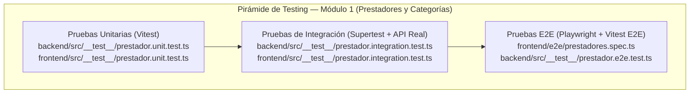

# Documento Técnico de Ingeniería: Fase 4 — Estrategia Integral de Testing (Unitario, Integración, E2E) y Colección Postman: Módulo Prestadores

**Proyecto:** Fixer Servicios (`fixerServicios`)  
**Responsable:** Alejandro L. Baldres — *Módulo 1: Prestadores y Categorías (Testing Unitario, Integración con Supertest, E2E con Playwright y Carpeta Postman)*  
**Estado:** Implementado y Verificado

---

## 1. Resumen Ejecutivo y Arquitectura de Pruebas

En la **Fase 4**, **Alejandro L. Baldres** consolidó la estrategia integral de aseguramiento de calidad (*Quality Assurance*) y contratos de API para el **Módulo 1 (Prestadores y Categorías)** abarcando los cuatro pilares de verificación exigidos por la cátedra:

1. **Pruebas Unitarias (`prestador.service.ts`):** Validación exhaustiva de la lógica de negocio de filtrado normalizado (por rubro, provincia, localidad y búsqueda textual sin distinción de tildes ni mayúsculas), ordenamiento polimórfico (`asc`/`desc`) y paginación matemática en Backend ([`backend/src/__test__/prestador.unit.test.ts`](../backend/src/__test__/prestador.unit.test.ts)) y Frontend ([`frontend/src/__test__/prestador.unit.test.ts`](../frontend/src/__test__/prestador.unit.test.ts)).
2. **Pruebas de Integración con Supertest (`prestador.integration.test.ts`):** Evaluación del pipeline HTTP completo de Express en memoria verificando los códigos de estado **`200 OK`**, **`201 Created`**, **`400 Bad Request`**, **`403 Forbidden`** y **`404 Not Found`** ([`backend/src/__test__/prestador.integration.test.ts`](../backend/src/__test__/prestador.integration.test.ts)).
3. **Pruebas End-to-End con Playwright (`e2e/prestadores.spec.ts`):** Automatización en navegador Chromium real validando navegación, búsqueda en tiempo real sobre la tabla paginada y el catálogo público, filtrado por rubro y por localidad con formato `Localidad, Provincia`, alta/edición/baja de prestadores, exportación `.pdf`/`.xlsx` y reglas de autorización por rol ([`frontend/e2e/prestadores.spec.ts`](../frontend/e2e/prestadores.spec.ts)).
4. **Colección Postman (`prestadores (alumno 1)`):** Especificación ejecutable en formato Postman Collection v2.1 ([`postman/Fixer_Coleccion.json`](../postman/Fixer_Coleccion.json) y [`postman/prestadores (alumno 1)/prestadores_alumno1.postman_collection.json`](../postman/prestadores%20(alumno%201)/prestadores_alumno1.postman_collection.json)) con peticiones `GET` (listado paginado/filtrado y detalle por ID), `POST`, `PUT` y `DELETE`, incluyendo scripts de validación automática y ejemplos de respuesta JSON.

---

## 2. Pruebas Unitarias de Filtrado y Paginado (`prestador.service.ts`)

### 2.1. Backend: [`backend/src/service/prestador.service.ts`](../backend/src/service/prestador.service.ts) y [`backend/src/__test__/prestador.unit.test.ts`](../backend/src/__test__/prestador.unit.test.ts)

La suite unitaria del Backend verifica de manera aislada el comportamiento de `PrestadorService.listar(filtros)` sobre los 16 registros iniciales del repositorio en memoria:

| Caso de Prueba Unitario | Parámetros Evaluados | Resultado Verificado |
| :--- | :--- | :--- |
| **Valores por defecto y primera página** | `listar({})` | `pagina: 1`, `limit: 10`, `total: 16`, `totalPages: 2`, orden alfabético ascendente por `nombre` (`Ana`, `Camila`, `Carlos`...). |
| **Recorrido completo de páginas sin solapamiento** | `page: 1..4, limit: 5` y `page: 99, limit: 5` | Páginas 1 a 3 retornan `5` registros, página 4 retorna `1` registro (`16` IDs únicos en total) y `page: 99` retorna `datos: []` preservando `totalPages: 4`. |
| **Sanitización de límites inválidos** | `page: -3, limit: 0` | Normaliza mediante `Math.max(1, ...)` a `pagina: 1` y `limit: 10`. |
| **Filtrado por rubro, provincia y localidad (normalización NFD)** | `rubro: 'Plomería' \| 'plomeria' \| '  PLOMERÍA  '`, `localidad: 'cordoba capital'`, `provincia: 'buenos aires', localidad: '9 de julio'` | Coincidencia insensible a mayúsculas y tildes (`NFD`), retornando los `5` plomeros, los `4` profesionales de Córdoba Capital y el profesional de `9 de Julio, Buenos Aires`. |
| **Búsqueda textual multi-campo (`search`)** | `search: 'gomez'`, `search: 'TERMOTANQUES'`, `search: 'electricidad'` | Busca simultáneamente en `nombre`, `apellido`, `acercaDe` y `categoriaId` ignorando diacríticos. |
| **Filtros combinados + ordenamiento + paginación** | `rubro: 'Plomería', search: 'instalaciones', sortBy: 'aniosExperiencia', order: 'desc', page: 1, limit: 5` | Filtra, ordena descendentemente por experiencia y pagina en una única operación determinista. |
| **Ordenamiento numérico, booleano y campos opcionales (`undefined`)** | `sortBy: 'aniosExperiencia' \| 'ofreceGarantia' \| 'matricula'` | Ordena números por diferencia aritmética y desplaza los valores `undefined` al final del listado. |

### 2.2. Frontend: [`frontend/services/prestador.service.ts`](../frontend/services/prestador.service.ts) y [`frontend/src/__test__/prestador.unit.test.ts`](../frontend/src/__test__/prestador.unit.test.ts)

En el cliente se valida:
- **`construirQueryPrestadores(filtros)`:** Serialización exacta de `page`, `limit`, `rubro`, `localidad`, `search`, `sortBy` y `order`, omitiendo cadenas vacías o espacios en blanco.
- **`obtenerLocalidadesConProfesionales(prestadores)` y `formatearLocalidadProvincia(localidad, provincia)`:** Extracción dinámica únicamente de las localidades que cuentan con profesionales registrados en la base, formateadas como `Localidad, Provincia` (ej. `9 de Julio, Buenos Aires`, `Córdoba Capital, Córdoba`, `Rosario, Santa Fe`, `CABA, Ciudad Autónoma de Buenos Aires`).
- **Cliente HTTP y manejo de errores:** Simulación con `vi.stubGlobal('fetch', ...)` verificando peticiones `GET`, `POST`, `PUT` y `DELETE` junto con el lanzamiento de excepciones descriptivas ante respuestas `404` y `500`.

---

## 3. Pruebas de Integración con Supertest (`prestador.integration.test.ts`)

El archivo [`backend/src/__test__/prestador.integration.test.ts`](../backend/src/__test__/prestador.integration.test.ts) evalúa mediante **Supertest** la integración real entre [`Servidor.ts`](../backend/src/core/Servidor.ts), [`prestador.route.ts`](../backend/src/route/prestador.route.ts), [`autorizacion.middleware.ts`](../backend/src/middlewares/autorizacion.middleware.ts), [`PrestadorController`](../backend/src/controller/prestador.controller.ts), [`PrestadorService`](../backend/src/service/prestador.service.ts) y [`PrestadorRepository`](../backend/src/repository/prestador.repository.ts):

| Código HTTP | Método y Endpoint | Escenario Verificado con Supertest |
| :---: | :--- | :--- |
| **`200 OK`** | `GET /api/v1/prestadores` | Listado paginado por defecto (`10` elementos en página 1, `meta.total: 16`, `meta.totalPages: 2`). |
| **`200 OK`** | `GET /api/v1/prestadores?page=1&limit=10&rubro=Plomería&sortBy=nombre&order=asc` | Filtrado por rubro, localidad (`Córdoba Capital`), búsqueda por texto (`search=electric`) y ordenamiento (`aniosExperiencia: desc`). |
| **`200 OK`** | `GET /api/v1/prestadores/:id` | Obtención de la ficha técnica completa de un prestador existente (`id: 1`). |
| **`200 OK`** | `PUT /api/v1/prestadores/:id` y `PUT /api/v1/prestadores` | Actualización parcial de datos y remoción de foto (`fotoUrl: ""`), además de protección de `ratingPromedio` cuando edita el rol `PRESTADOR`. |
| **`200 OK`** | `DELETE /api/v1/prestadores/:id` y `DELETE /api/v1/prestadores` | Baja física de un prestador por parámetro de ruta o por `body.id`. |
| **`201 Created`** | `POST /api/v1/prestadores` | Creación de un nuevo prestador con asignación de `id` autoincremental y normalización de `fotoUrl`. |
| **`400 Bad Request`** | `POST /api/v1/prestadores` | Rechazo cuando falta cualquiera de los campos obligatorios (`nombre`, `apellido` o `categoriaId`). |
| **`400 Bad Request`** | `PUT /api/v1/prestadores` y `DELETE /api/v1/prestadores` | Rechazo cuando no se proporciona el identificador `id` ni en la URL ni en el cuerpo de la petición. |
| **`403 Forbidden`** | `POST`, `PUT`, `DELETE /api/v1/prestadores` | Validación de permisos por rol (`ADMIN`, `PRESTADOR` sobre ficha ajena y `USUARIO`). |
| **`404 Not Found`** | `GET`, `PUT`, `DELETE /api/v1/prestadores/99999` | Respuesta controlada `{ codigo: 404, msj: 'Prestador con id ... no encontrado', datos: null }` ante IDs inexistentes. |

---

## 4. Pruebas End-to-End con Playwright (`frontend/e2e/prestadores.spec.ts`)

La especificación [`frontend/e2e/prestadores.spec.ts`](../frontend/e2e/prestadores.spec.ts) ejecuta en un navegador Chromium real los 7 flujos críticos del módulo:

1. **Navegación desde el Header y Tabla Paginada (`Prestadores`):** Ingreso desde el enlace `Prestadores` (habilitado para rol `ADMIN`), comprobación de las `10` filas iniciales sobre `Total: 16 registros` y renderizado de la silueta de persona por defecto en prestadores sin foto (`data-tiene-foto="false"`).
2. **Búsqueda y Filtrado en Tiempo Real sobre la Tabla:** Cambio del selector de filas por página (`#filas-por-pagina` a `5` -> `Página 1 de 4`), filtrado por rubro (`#filtro-rubro` -> `Plomería`, `Total: 5 registros`), escritura en tiempo real en el buscador (`Gómez` -> `Carlos Gómez`, `1` fila) y restablecimiento con el botón `Limpiar filtros`.
3. **Navegación a Vista de Detalle (`/prestadores/:id`):** Selección de un prestador desde la tabla filtrada y comprobación de su ficha técnica (`MAT-1001`, `+54 11 40001001`) y formulario de edición.
4. **Ciclo CRUD Completo en UI:** Alta de un nuevo prestador (`+ Nuevo Prestador`) seleccionando provincia (`Mendoza`) y localidad (`San Rafael`) con foto de perfil, búsqueda en la tabla, edición en `/prestadores/:id` (quitando foto y actualizando experiencia) y eliminación (`Eliminar prestador`).
5. **Exportación de Catálogo (`.pdf` y `.xlsx`):** Verificación de descarga real en navegador de `catalogo-prestadores.pdf` y `catalogo-prestadores.xlsx`.
6. **Catálogo Público de Usuario y Filtro Dinámico de Localidades (`Localidad, Provincia`):** Alternancia hacia `CatalogoPrestadoresUsuario`, comprobación de que el selector `#catalogo-filtro-localidad` lista las localidades reales con profesionales en formato `Localidad, Provincia` (`9 de Julio, Buenos Aires`, `Rosario, Santa Fe`, `CABA, Ciudad Autónoma de Buenos Aires`, `Córdoba Capital, Córdoba`), filtrado combinado por localidad + chips rápidos + texto libre, despliegue de teléfono (`Contactar`) y acceso al perfil (`Ver Perfil`).
7. **Seguridad por Roles y Reseñas en Detalle:** Verificación de que el rol `PRESTADOR` puede editar sus propios datos pero no su calificación (`#prestador-rating` oculto) ni las reseñas de los clientes, y que el rol `USUARIO` visualiza directamente la ficha del prestador (sin cartel de aviso intermedio), puede publicar reseñas y editar sus propias reseñas.

---

## 5. Colección Postman (`prestadores (alumno 1)`)

Se generaron los archivos de colección en el directorio [`postman/`](../postman):
- **Colección Unificada:** [`postman/Fixer_Coleccion.json`](../postman/Fixer_Coleccion.json)
- **Carpeta Individual Integrante 1:** [`postman/prestadores (alumno 1)/prestadores_alumno1.postman_collection.json`](../postman/prestadores%20(alumno%201)/prestadores_alumno1.postman_collection.json)

### Requests Incluidos en la Carpeta `prestadores (alumno 1)`

| Request en Postman | Método | URL / Query Params | Scripts de Test y Ejemplos Incluidos |
| :--- | :---: | :--- | :--- |
| **GET Listar Prestadores (Paginado y Filtros)** | `GET` | `{{baseUrl}}/prestadores?page=1&limit=10&rubro=Plomería&localidad=Córdoba Capital&search=Carlos&sortBy=nombre&order=asc` | Valida código `200`, arreglo `datos` y claves de `meta` (`pagina`, `limit`, `total`, `totalPages`). Incluye ejemplo `200 OK`. |
| **GET Detalle de Prestador por ID** | `GET` | `{{baseUrl}}/prestadores/{{prestadorId}}` | Valida código `200` y propiedades `id`, `nombre`, `categoriaId`. Incluye ejemplos `200 OK` y `404 Not Found`. |
| **POST Crear Prestador** | `POST` | `{{baseUrl}}/prestadores` | Envía payload JSON completo con cabecera `x-usuario-rol: ADMIN`, valida `201 Created`, guarda el ID creado en `{{prestadorId}}` e incluye ejemplos `201 Created` y `400 Bad Request`. |
| **PUT Actualizar Prestador** | `PUT` | `{{baseUrl}}/prestadores/{{prestadorId}}` | Envía actualización parcial con cabecera `x-usuario-rol: ADMIN`, valida `200 OK` e incluye ejemplos `200 OK` y `404 Not Found`. |
| **DELETE Eliminar Prestador** | `DELETE` | `{{baseUrl}}/prestadores/{{prestadorId}}` | Elimina el registro con cabecera `x-usuario-rol: ADMIN`, valida `200 OK` y `datos: null`, e incluye ejemplos `200 OK` y `404 Not Found`. |
| **GET Listar Categorías Profesionales** | `GET` | `{{baseUrl}}/categorias` | Verifica código `200 OK` y listado de los 9 rubros oficiales. |
