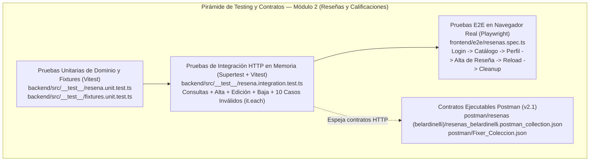
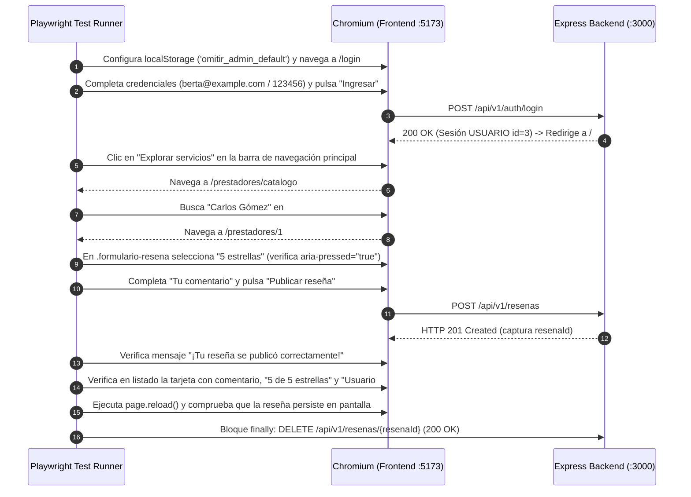

# Documento Técnico y Funcional de Ingeniería: Fase 4 — Estrategia Integral de Testing (Unitario, Integración, E2E) y Colección Postman: Módulo Reseñas

**Proyecto:** Fixer Servicios (`fixerServicios`)  
**Responsable:** Marianela Belardinelli Beker — *Módulo 2: Reseñas y Calificaciones (Testing Unitario de Rating, Integración con Supertest, E2E con Playwright y Carpeta Postman)*  
**Estado:** Implementado y Verificado

---

## 1. Resumen Ejecutivo y Arquitectura de Pruebas

En la **Fase 4**, **Marianela Belardinelli Beker** completó la estrategia de aseguramiento de calidad (*Quality Assurance*) y documentación ejecutable de contratos de API para el **Módulo 2 (Reseñas y Calificaciones)**, cubriendo las cuatro dimensiones requeridas en el plan de ingeniería:

1. **Pruebas Unitarias (`resena.unit.test.ts` y `fixtures.unit.test.ts`):** Verificación matemática aislada del algoritmo de cálculo de promedio de calificaciones (`calcularPromedio`) y de la obtención del rating filtrado por profesional (`obtenerRating`) dentro de [`ResenaService`](../backend/src/service/resena.service.ts) ([`backend/src/__test__/resena.unit.test.ts`](../backend/src/__test__/resena.unit.test.ts)).
2. **Pruebas de Integración con Supertest (`resena.integration.test.ts`):** Evaluación integral del ciclo de vida HTTP en memoria sobre `/api/v1/resenas` y `/api/v1/resenas/:id`, comprobando consultas paginadas con cálculo de `meta.promedio`, creación con persistencia temporal en memoria (`201 Created`), edición parcial con sanitización de espacios e inmutabilidad de metadatos (`200 OK`), eliminación física (`200 OK`) y manejo de errores (`400 Bad Request` y `404 Not Found`) ([`backend/src/__test__/resena.integration.test.ts`](../backend/src/__test__/resena.integration.test.ts)).
3. **Pruebas End-to-End con Playwright (`e2e/resenas.spec.ts`):** Automatización del flujo completo de usuario en navegador Chromium real: autenticación como cliente (`berta@example.com`), navegación al catálogo de servicios, búsqueda y acceso al perfil del prestador, selección interactiva de calificación de 5 estrellas, envío del formulario, verificación del renderizado inmediato en el listado de opiniones, comprobación de persistencia tras recargar la página (`page.reload()`) y limpieza final del registro creado ([`frontend/e2e/resenas.spec.ts`](../frontend/e2e/resenas.spec.ts)).
4. **Colección Postman (`resenas (alumno 2)`):** Documentación interactiva en formato Postman Collection v2.1 tanto en su archivo individual ([`postman/resenas (belardinelli)/resenas_belardinelli.postman_collection.json`](../postman/resenas%20(belardinelli)/resenas_belardinelli.postman_collection.json)) como integrada en la colección unificada del equipo ([`postman/Fixer_Coleccion.json`](../postman/Fixer_Coleccion.json)), incluyendo variables dinámicas, scripts de encadenamiento y ejemplos JSON para todos los códigos de estado.

---

## 2. Pruebas Unitarias del Cálculo de Calificaciones (`resena.unit.test.ts`)

El archivo [`backend/src/__test__/resena.unit.test.ts`](../backend/src/__test__/resena.unit.test.ts) evalúa de forma determinista y sin efectos colaterales la lógica matemática de [`ResenaService`](../backend/src/service/resena.service.ts), instanciando un repositorio limpio antes de cada caso (`beforeEach`) y utilizando las factorías de [`resenas.fixtures.ts`](../backend/src/__test__/fixtures/resenas.fixtures.ts):

### 2.1. Matriz de Casos Evaluados en `calcularPromedio(resenas)` y `obtenerRating(prestadorId)`

| Método Evaluado | Caso de Prueba / Entrada | Resultado Esperado | Regla Funcional Verificada |
| :--- | :--- | :---: | :--- |
| `calcularPromedio` | Colección vacía `[]` | `0` | Prevención de indeterminación matemática (`0 / 0 = NaN`) cuando un profesional aún no posee valoraciones. |
| `calcularPromedio` | Reseña única `[crearResena({ calificacion: 4 })]` | `4` | Identidad del promedio ante un único elemento ($N = 1$). |
| `calcularPromedio` (`it.each`) | Calificaciones `[5, 4, 3]` | `4` | Promedio entero exacto ($12 / 3 = 4$). |
| `calcularPromedio` (`it.each`) | Calificaciones `[5, 5, 5, 1]` | `4` | Ponderación de valores extremos ($16 / 4 = 4$). |
| `calcularPromedio` (`it.each`) | Calificaciones `[5, 4, 4]` | `4.3` | Redondeo hacia abajo a un decimal ($13 / 3 = 4.333\dots \rightarrow 4.3$). |
| `calcularPromedio` (`it.each`) | Calificaciones `[4, 3, 3]` | `3.3` | Redondeo periódico a un decimal ($10 / 3 = 3.333\dots \rightarrow 3.3$). |
| `calcularPromedio` (`it.each`) | Calificaciones `[5, 5, 4]` | `4.7` | Redondeo hacia arriba a un decimal ($14 / 3 = 4.666\dots \rightarrow 4.7$). |
| `calcularPromedio` (`it.each`) | Límites `[1, 1]` y `[5, 5]` | `1` y `5` | Consistencia en las cotas inferior y superior del dominio $[1, 5]$. |
| `obtenerRating` | `prestadorId = 1` (con `vi.spyOn(repository, 'findAll')` sobre `resenasFixture`) | `4.5` | Filtra exclusivamente las reseñas del prestador `1` (calificaciones `5` y `4`) ignorando las de otros prestadores. |
| `obtenerRating` | `prestadorId = 2` | `3` | Aislamiento del cálculo para un segundo prestador (calificación `3`). |
| `obtenerRating` | `prestadorId = 999` (sin reseñas asociadas) | `0` | Retorno seguro `0` cuando el filtro por `prestadorId` devuelve un subconjunto vacío. |

---

## 3. Pruebas de Integración con Supertest (`resena.integration.test.ts`)

La suite [`backend/src/__test__/resena.integration.test.ts`](../backend/src/__test__/resena.integration.test.ts) prueba el acoplamiento real de todas las capas del backend (`Servidor` -> `resena.route` -> `ResenaController` -> `ResenaService` -> `ResenaRepository`) mediante peticiones HTTP en memoria:

| Bloque Funcional | Método y Endpoint | Código HTTP | Comportamiento y Contrato Verificado |
| :--- | :--- | :---: | :--- |
| **Consultas** | `GET /api/v1/resenas?prestadorId=1&page=1&limit=5` | **`200 OK`** | Filtra únicamente reseñas con `prestadorId === 1` y verifica `meta: { pagina: 1, limit: 5, total: 2, totalPages: 1, promedio: 3.5 }`. |
| **Consultas** | `GET /api/v1/resenas?page=2&limit=5` | **`200 OK`** | Pagina el listado general de 30 semillas, devolviendo 5 elementos y `meta: { pagina: 2, limit: 5, total: 30, totalPages: 6 }`. |
| **Consultas** | `GET /api/v1/resenas/1` | **`200 OK`** | Recupera el detalle de la reseña existente con `datos.id === 1`. |
| **Consultas** | `GET /api/v1/resenas/9999` | **`404 Not Found`** | Responde `codigo: 404` y `datos: null` cuando el ID no existe. |
| **Alta y Persistencia** | `POST /api/v1/resenas` | **`201 Created`** | Crea una nueva reseña asignándole `id` numérico autoincremental y comprueba mediante un `GET /api/v1/resenas/:id` subsiguiente que quedó persistida en memoria. |
| **Validaciones de Alta (`it.each`)** | `POST /api/v1/resenas` | **`400 Bad Request`** | Evalúa 4 payloads inválidos: calificación fuera de rango (`6`), calificación decimal (`3.5`), comentario con solo espacios (`'   '`) y `prestadorId` faltante. |
| **Edición e Inmutabilidad** | `PUT /api/v1/resenas/:id` | **`200 OK`** | Actualiza `calificacion` (`5`) y `comentario` (`'Excelente servicio'`), verificando que `prestadorId`, `usuarioId` y `createdAt` permanezcan inalterados y que el cambio persista en `GET /:id`. |
| **Sanitización en Edición** | `PUT /api/v1/resenas/:id` | **`200 OK`** | Comprueba que `'  Excelente trabajo  '` se persista limpio como `'Excelente trabajo'` (`.trim()`). |
| **Validaciones de Edición (`it.each`)** | `PUT /api/v1/resenas/:id` y `/api/v1/resenas/abc` | **`400 Bad Request`** | Evalúa 6 payloads inválidos (`calificacion: 6`, `3.5`, ausente; `comentario: ''`, `'   '`, ausente) más el rechazo por parámetro `:id` no numérico (`abc`). |
| **Edición Inexistente** | `PUT /api/v1/resenas/9999` | **`404 Not Found`** | Responde `codigo: 404` y `datos: null` al intentar editar una reseña inexistente. |
| **Baja Física** | `DELETE /api/v1/resenas/:id` y `/api/v1/resenas/9999` | **`200 OK`** / **`404`** | Crea una reseña (`201`), la elimina (`200`), confirma su inexistencia posterior (`404` en `GET /:id`) y verifica `404` al eliminar un ID inexistente. |

---

## 4. Pruebas End-to-End con Playwright (`frontend/e2e/resenas.spec.ts`)

La especificación [`frontend/e2e/resenas.spec.ts`](../frontend/e2e/resenas.spec.ts) automatiza el recorrido crítico de calificación desde la perspectiva del usuario final sobre el frontend y backend reales:

### Aspectos Técnicos Destacados del Test E2E:
- **Autenticación Real de Rol `USUARIO`:** Inyecta `localStorage.setItem('omitir_admin_default', 'true')` mediante `page.addInitScript` e inicia sesión con la cuenta de cliente `berta@example.com` (`id: 3`), garantizando que la prueba valide los permisos reales de un consumidor final.
- **Selectores Accesibles y Resilientes:** Utiliza `getByRole('navigation')`, `getByRole('button', { name: '5 estrellas' })`, `getByLabel('Tu comentario')`, `getByRole('region', { name: 'Reseñas del profesional' })` y `getByRole('img', { name: '5 de 5 estrellas' })`, validando simultáneamente la funcionalidad y la accesibilidad ARIA de los componentes.
- **Sincronización con Red Real y Limpieza Garantizada (`try / finally`):** Intercepta la respuesta `POST /api/v1/resenas` con `page.waitForResponse` para extraer el `resenaId` generado y, en el bloque `finally`, ejecuta `request.delete('http://localhost:3000/api/v1/resenas/${resenaId}')` para mantener la idempotencia del servidor en ejecuciones repetidas.

---

## 5. Colección Postman (`resenas (alumno 2)`)

Se elaboró la documentación ejecutable de Postman en dos ubicaciones sincronizadas:
- **Colección Individual del Módulo 2:** [`postman/resenas (belardinelli)/resenas_belardinelli.postman_collection.json`](../postman/resenas%20(belardinelli)/resenas_belardinelli.postman_collection.json)
- **Colección General Integrada:** Carpeta `resenas (alumno 2)` dentro de [`postman/Fixer_Coleccion.json`](../postman/Fixer_Coleccion.json)

### 5.1. Variables y Automatización de la Colección
La colección define las variables `baseUrl` (`http://localhost:3000/api/v1`), `prestadorId` (`1`), `usuarioId` (`3`) y `resenaId` (`""`), e incorpora scripts automatizados:
- En **`POST Crear reseña`**: El script `prerequest` limpia `resenaId`, y el script `test` valida el estado `201` y almacena automáticamente `datos.id` en la variable de colección `{{resenaId}}`.
- En **`GET Obtener reseña por ID`**, **`PUT Actualizar reseña`** y **`DELETE Eliminar reseña`**: El script `prerequest` verifica que `{{resenaId}}` contenga un entero positivo válido (`/^[1-9]\d*$/`) —omitiendo la ejecución con `pm.execution.skipRequest()` si no se ejecutó previamente el alta—, y el `DELETE` limpia la variable tras confirmar el código `200`.

### 5.2. Catálogo de Requests y Ejemplos JSON Documentados

| Request en Carpeta `resenas (alumno 2)` | Método | Endpoint / URL | Ejemplos de Respuesta JSON Incluidos |
| :--- | :---: | :--- | :--- |
| **GET Listar reseñas paginadas** | `GET` | `{{baseUrl}}/resenas?page=1&limit=1` | `200 - Reseñas obtenidas correctamente` (estructura paginada general con `meta`). |
| **GET Listar reseñas por prestador** | `GET` | `{{baseUrl}}/resenas?page=1&limit=1&prestadorId={{prestadorId}}` | `200 - Reseñas obtenidas correctamente` (filtrada por profesional e incluyendo `meta.promedio`). |
| **POST Crear reseña** | `POST` | `{{baseUrl}}/resenas` | `201 - Reseña creada exitosamente` y `400 - La calificación debe ser un entero entre 1 y 5`. |
| **GET Obtener reseña por ID** | `GET` | `{{baseUrl}}/resenas/{{resenaId}}` | `200 - Reseña encontrada` y `404 - Reseña con id 9999 no encontrada`. |
| **PUT Actualizar reseña** | `PUT` | `{{baseUrl}}/resenas/{{resenaId}}` | `200 - Reseña actualizada exitosamente`, `400 - La calificación debe ser un entero entre 1 y 5` y `404 - Reseña con id 9999 no encontrada`. |
| **DELETE Eliminar reseña** | `DELETE` | `{{baseUrl}}/resenas/{{resenaId}}` | `200 - Reseña eliminada exitosamente`, `400 - Se requiere un id válido para eliminar la reseña` y `404 - Reseña con id 9999 no encontrada`. |
