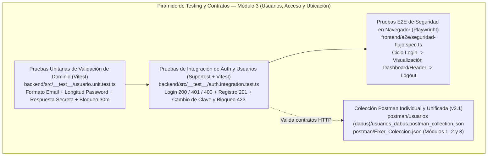
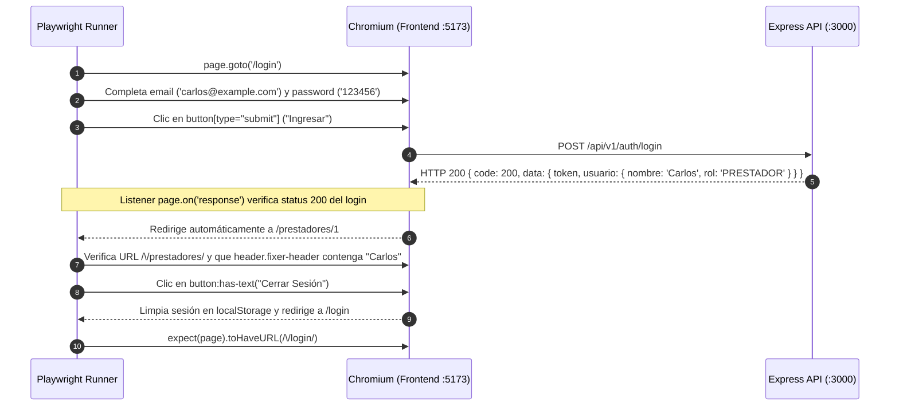

# Documento Técnico y Funcional de Ingeniería: Fase 4 — Estrategia Integral de Testing (Unitario, Integración, E2E) y Colección Postman: Módulo Usuarios y Autenticación

**Proyecto:** Fixer Servicios (`fixerServicios`)  
**Responsable:** Julieta Dabús — *Módulo 3: Usuarios, Acceso y Ubicación (Testing Unitario de Validaciones, Integración de Auth con Supertest, E2E de Seguridad con Playwright y Colección Postman)*  
**Estado:** Implementado y Verificado

---

## 1. Resumen Ejecutivo y Arquitectura de Pruebas

En la **Fase 4**, **Julieta Dabús** implementó la estrategia integral de aseguramiento de calidad (*Quality Assurance*) y la exportación unificada de contratos Postman para el **Módulo 3 (Usuarios, Autenticación y Ubicación)**, abarcando los cuatro niveles exigidos en el plan de trabajo:

1. **Pruebas Unitarias (`usuario.unit.test.ts`):** Verificación aislada de las reglas de validación de formato de correo electrónico, longitud mínima de contraseña ($\ge 6$ caracteres), obligatoriedad de respuesta secreta en [`UsuarioService`](../backend/src/service/usuario.service.ts), así como las políticas de cambio de contraseña y bloqueo temporal ([`backend/src/__test__/usuario.unit.test.ts`](../backend/src/__test__/usuario.unit.test.ts)).
2. **Pruebas de Integración de Autenticación (`auth.integration.test.ts`):** Evaluación HTTP en memoria con **Supertest** sobre `/api/v1/auth/login` y `/api/v1/usuarios`, validando inicios de sesión exitosos (`200 OK`), rechazos por credenciales inválidas (`401 Unauthorized`), rechazos por datos faltantes (`400 Bad Request`) y flujos integrales de actualización de credenciales ([`backend/src/__test__/auth.integration.test.ts`](../backend/src/__test__/auth.integration.test.ts)).
3. **Pruebas End-to-End del Flujo de Seguridad (`e2e/seguridad-flujo.spec.ts`):** Automatización en navegador Chromium real con **Playwright** comprobando el ciclo completo de autenticación: ingreso en `/login`, envío de credenciales, redirección al panel correspondiente, renderizado del nombre del usuario autenticado en el Header global y cierre de sesión (`Cerrar Sesión`) con retorno a `/login` ([`frontend/e2e/seguridad-flujo.spec.ts`](../frontend/e2e/seguridad-flujo.spec.ts)).
4. **Colección Postman (`usuarios (alumno 3)` y `Fixer_Coleccion.json`):** Creación de la colección del Módulo 3 en [`postman/usuarios (dabus)/usuarios_dabus.postman_collection.json`](../postman/usuarios%20(dabus)/usuarios_dabus.postman_collection.json) y consolidación de la colección unificada de los tres integrantes en [`postman/Fixer_Coleccion.json`](../postman/Fixer_Coleccion.json).



---

## 2. Pruebas Unitarias de Validación en `usuario.service.ts` (`usuario.unit.test.ts`)

En [`backend/src/service/usuario.service.ts`](../backend/src/service/usuario.service.ts) se implementó el método privado `validarDatosRegistro` invocado antes de persistir cualquier nuevo usuario en `crearUsuario`:

```typescript
private validarDatosRegistro(data: Omit<IUsuario, 'id' | 'createdAt'>) {
    const emailRegex = /^[^\s@]+@[^\s@]+\.[^\s@]+$/;
    if (!emailRegex.test(data.email)) {
        throw new Error('Formato de email inválido');
    }

    if (!data.passwordHash || data.passwordHash.length < 6) {
        throw new Error('La contraseña debe tener al menos 6 caracteres');
    }

    if (!data.respuestaSecretaHash || data.respuestaSecretaHash.trim() === '') {
        throw new Error('La respuesta secreta es obligatoria');
    }
}
```

La suite [`backend/src/__test__/usuario.unit.test.ts`](../backend/src/__test__/usuario.unit.test.ts) instancia un `UsuarioService` aislado (`new UsuarioService(new UsuarioRepository())`) para verificar cada invariante de negocio sin efectos colaterales:

| Caso de Prueba Unitario | Entrada Evaluada | Resultado Verificado |
| :--- | :--- | :--- |
| **Rechazo por formato de email inválido** | `crearUsuario({ ...datosBase, email: 'correo-invalido' })` | Lanza excepción `'Formato de email inválido'`. |
| **Rechazo por contraseña corta (< 6 caracteres)** | `crearUsuario({ ...datosBase, passwordHash: '123' })` | Lanza excepción `'La contraseña debe tener al menos 6 caracteres'`. |
| **Rechazo por respuesta secreta vacía** | `crearUsuario({ ...datosBase, respuestaSecretaHash: '' })` | Lanza excepción `'La respuesta secreta es obligatoria'`. |
| **Creación exitosa con payload válido** | `crearUsuario(datosBase)` (`test@example.com`, `'123456'`, `'Firulais'`) | Persiste y retorna `IUsuarioPublico` con `email: 'test@example.com'` y `rol: 'USUARIO'`. |
| **Validaciones en cambio de contraseña autenticado** | `cambiarPasswordAutenticado` con clave `< 6` chars, confirmación distinta o igual a la actual | Lanza `ErrorValidacionUsuario` (`400`) con el mensaje específico de cada regla. |
| **Política de bloqueo de 30 min tras 3 fallos** | 3 intentos fallidos consecutivos de `passwordActual` en `t0`, `t0 + 1s`, `t0 + 2s` | 1.° y 2.° intento lanzan `ErrorCredencialesInvalidas` (`intentosRestantes: 2` y `1`); 3.° intento lanza `ErrorCuentaBloqueada` (`minutosRestantes: 30`) y desbloquea al expirar `DURACION_BLOQUEO_MS`. |

---

## 3. Pruebas de Integración de Autenticación con Supertest (`auth.integration.test.ts`)

El archivo [`backend/src/__test__/auth.integration.test.ts`](../backend/src/__test__/auth.integration.test.ts) evalúa el comportamiento de los endpoints de autenticación y gestión de credenciales montados en [`Servidor.ts`](../backend/src/core/Servidor.ts):

| Código HTTP | Método y Endpoint | Escenario Verificado con Supertest |
| :---: | :--- | :--- |
| **`200 OK`** | `POST /api/v1/auth/login` | Login correcto con `bruna@example.com` y `123456`; verifica `code: 200`, presencia de `data.token` y `data.usuario.email === 'bruna@example.com'`. |
| **`401 Unauthorized`** | `POST /api/v1/auth/login` | Login fallido con contraseña incorrecta (`'contraseña-incorrecta'`); verifica `code: 401` y `msg: 'Credenciales inválidas'`. |
| **`400 Bad Request`** | `POST /api/v1/auth/login` | Petición incompleta omitiendo el campo `password`; verifica rechazo inmediato `code: 400`. |
| **`201 Created`** | `POST /api/v1/usuarios` | Registro de nuevo usuario con rol profesional (`esPrestador: true, especialidad: 'Plomería'`), verificando la creación coordinada de `usuario` y `prestador`. |
| **`200 OK`** | `PATCH /api/v1/usuarios/:id/password` | Actualización exitosa de contraseña verificando que la clave anterior deje de funcionar (`401`) y la nueva permita iniciar sesión (`200`). |
| **`403 Forbidden`** | `PATCH /api/v1/usuarios/:id/password` | Rechazo cuando un usuario no administrador intenta modificar la contraseña de otro `usuarioId` distinto al propio. |
| **`423 Locked`** | `PATCH /api/v1/usuarios/:id/password` y `POST /api/v1/auth/login` | Bloqueo efectivo de la cuenta por 30 minutos al tercer intento fallido consecutivo de contraseña actual, impidiendo tanto el login como la edición de la ficha profesional. |

---

## 4. Pruebas End-to-End del Flujo de Seguridad (`frontend/e2e/seguridad-flujo.spec.ts`)

La especificación [`frontend/e2e/seguridad-flujo.spec.ts`](../frontend/e2e/seguridad-flujo.spec.ts) valida con **Playwright** el ciclo completo de sesión de extremo a extremo entre el cliente React y el servidor Express:



### Detalles de Implementación del Test E2E:
- **Monitoreo de Red Integrado:** Registra observadores `page.on('requestfailed')` y `page.on('response')` filtrando `/auth/login` para trazar en consola el código de estado HTTP y el payload devuelto por el backend durante la ejecución E2E.
- **Verificación de Estado Visual en Header:** Comprueba que tras la redirección post-login el componente global `<header class="fixer-header">` renderice el badge de sesión con el nombre del usuario autenticado (`'Carlos'`) y el botón `'Cerrar Sesión'`.
- **Verificación de Cierre de Sesión (`Logout`):** Pulsa el botón `Cerrar Sesión` y confirma que la aplicación destruya la sesión local y retorne a la ruta `/login`.

---

## 5. Colección Postman (`usuarios (alumno 3)`) y Colección Unificada (`Fixer_Coleccion.json`)

En cumplimiento del entregable de integración final del equipo, se generaron y consolidaron dos artefactos Postman v2.1 en el directorio [`postman/`](../postman):
1. **Colección Individual del Módulo 3:** [`postman/usuarios (dabus)/usuarios_dabus.postman_collection.json`](../postman/usuarios%20(dabus)/usuarios_dabus.postman_collection.json)
2. **Colección Unificada del Proyecto Fixer:** [`postman/Fixer_Coleccion.json`](../postman/Fixer_Coleccion.json) (que integra las carpetas `prestadores (alumno 1)`, `resenas (alumno 2)` y `usuarios (alumno 3)` en un único archivo exportable).

### Catálogo de Endpoints Documentados en `usuarios (alumno 3)`

La carpeta `usuarios (alumno 3)` se organiza en dos subcarpetas lógicas con scripts de validación automática (`pm.test`) y ejemplos de respuesta JSON para caminos felices y de error:

| Subcarpeta | Nombre del Request | Método | URL / Endpoint | Scripts y Ejemplos JSON Documentados |
| :--- | :--- | :---: | :--- | :--- |
| **Autenticación y Recuperación** | **POST Login de Usuario** | `POST` | `{{baseUrl}}/auth/login` | Valida `200 OK`, estructura de `usuario` y guarda `token` en `{{authToken}}`. Incluye ejemplos `200 OK`, `400 Bad Request` y `401 Unauthorized`. |
| **Autenticación y Recuperación** | **POST Obtener Pregunta Secreta** | `POST` | `{{baseUrl}}/auth/pregunta-secreta` | Paso 1 de recuperación: valida `200 OK` y propiedad `preguntaSecreta`. Incluye ejemplos `200 OK` y `404 Not Found`. |
| **Autenticación y Recuperación** | **POST Recuperar Password (Validar Respuesta Secreta)** | `POST` | `{{baseUrl}}/auth/recuperar-password` | Paso 2 de recuperación: valida respuesta secreta (`"Luna"`). Incluye ejemplos `200 OK` y `500` (`Respuesta secreta incorrecta` vía `errorHandler`). |
| **Autenticación y Recuperación** | **POST Cambiar Contraseña** | `POST` | `{{baseUrl}}/auth/cambiar-password` | Paso 3 de recuperación: actualiza la clave del usuario. Incluye ejemplos `200 OK` y `400 Bad Request`. |
| **Gestión de Usuarios y Ubicación** | **GET Listar Usuarios (Paginado)** | `GET` | `{{baseUrl}}/usuarios?page=1&limit=10` | Incluye cabecera `x-usuario-rol: ADMIN`, verifica paginación y ausencia de `passwordHash` / `respuestaSecretaHash`. Ejemplos `200 OK` y `403 Forbidden`. |
| **Gestión de Usuarios y Ubicación** | **GET Buscar Usuarios (por Email, Nombre o Ciudad)** | `GET` | `{{baseUrl}}/usuarios?page=1&limit=10&search=Córdoba` | Verifica el filtrado cruzado con ubicaciones normalizado sin tildes (`NFD`). Incluye ejemplo `200 OK`. |
| **Gestión de Usuarios y Ubicación** | **GET Detalle de Usuario por ID** | `GET` | `{{baseUrl}}/usuarios/{{usuarioId}}` | Recupera el perfil del usuario `id = 3`. Incluye ejemplos `200 OK` y `404 / 500 Usuario no encontrado`. |
| **Gestión de Usuarios y Ubicación** | **POST Registrar Usuario** | `POST` | `{{baseUrl}}/usuarios` | Script `prerequest` genera email único (`lucia.<timestamp>@example.com`), valida `201 Created` y guarda `{{nuevoUsuarioId}}`. Ejemplos `201` y `400` (datos faltantes y email duplicado). |
| **Gestión de Usuarios y Ubicación** | **PATCH Actualizar Perfil de Usuario y Cobertura** | `PATCH` | `{{baseUrl}}/usuarios/{{usuarioId}}` | Actualiza `nombre`, `apellido`, `ubicacionId`, `codigoPostal` (`"2000"`) y `radio` (`20`). Incluye ejemplos `200 OK` y errores de email duplicado o ID inexistente. |
