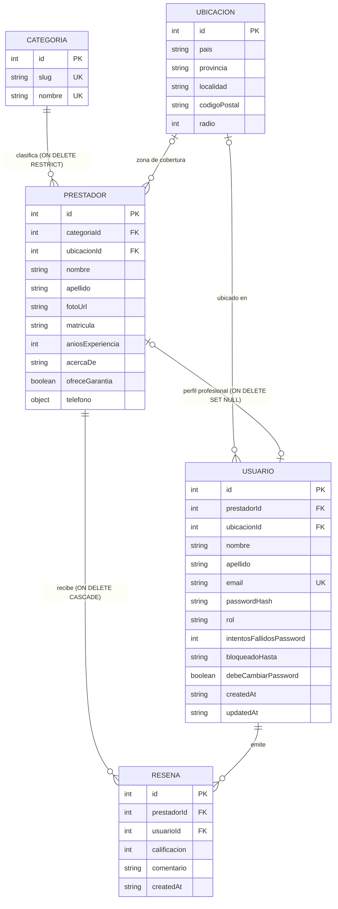
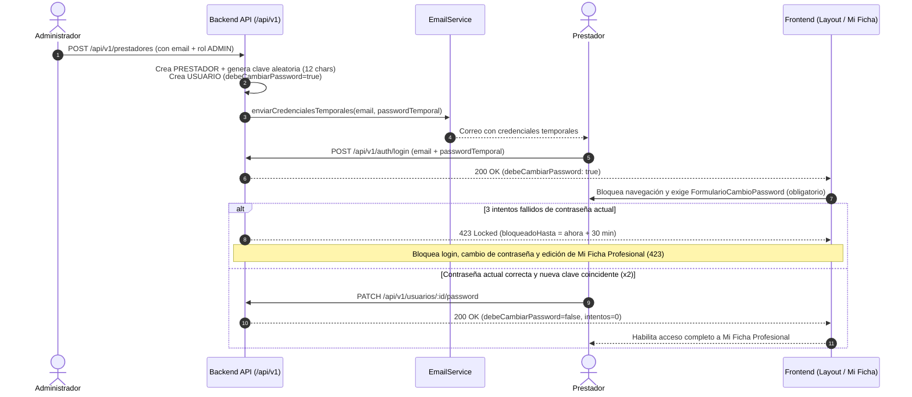

# Documento Técnico de Ingeniería: Fase 5 — Normalización 3FN, Geocodificación Resiliente y Seguridad de Cuentas

**Proyecto:** Fixer Servicios (`fixerServicios`)  
**Responsable:** Alejandro L. Baldres — *Arquitectura de Datos, Normalización, Mapa de Cobertura y Seguridad de Acceso*  
**Estado:** Implementado y Verificado (14 suites Backend / 124 tests · 4 suites Frontend / 31 tests)

---

## 1. Resumen Ejecutivo

En la **Fase 5** se realizó una auditoría arquitectónica del modelo de datos, de la integración geográfica con mapas y del ciclo de vida de credenciales de los prestadores, implementando cuatro bloques de mejora estructural en **Backend** y **Frontend**:

1. **Normalización del Modelo de Datos (3FN) e Integridad Referencial:** unificación de claves primarias/foráneas numéricas (`number`), extracción de `UbicacionRepository`, clave subrogada + `slug` único en `CATEGORIA`, eliminación de `ratingPromedio` persistido y alineación de contratos Backend ↔ Frontend.
2. **Geocodificación Resiliente para Argentina (`geocoding.service.ts` + `RadioMapa.tsx`):** normalización de capitales provinciales con sufijo `"Capital"` (como `Córdoba Capital`, CP `5000`) y `"CABA"`, cadena de *fallbacks* sobre Nominatim/OpenStreetMap y caché en memoria.
3. **Cambio de Contraseña en *"Mi Ficha Profesional"* y Bloqueo Temporal (30 min):** verificación de contraseña actual, confirmación doble de nueva clave y bloqueo de cuenta por **30 minutos (`HTTP 423 Locked`)** tras **3 intentos fallidos**, impidiendo login, nuevos intentos de cambio y edición de la ficha profesional durante el bloqueo.
4. **Onboarding Seguro de Prestadores desde el Panel `ADMIN`:** requerimiento de correo electrónico al crear un prestador, generación criptográfica de contraseña temporal aleatoria (`crypto.randomInt`), envío por correo (`EmailService`) y exigencia obligatoria de cambio de contraseña al iniciar sesión por primera vez (`debeCambiarPassword`).

---

## 2. Modelo de Datos Normalizado e Integridad Referencial

### Decisiones Arquitectónicas Aplicadas

| Hallazgo Original | Corrección Implementada | Archivos Clave |
| :--- | :--- | :--- |
| **Desajuste de tipos PK/FK** (`IUsuario.id: string` vs `IResena.usuarioId: number`) | Todas las PK/FK de entidades se unificaron a `number` y se completaron los usuarios `id: 4..7` en `usuariosMock` para respaldar las 30 reseñas iniciales. `ResenaService.crear()` valida existencia real de `prestadorId` y `usuarioId`. | [`usuario.interface.ts`](../backend/src/interfaces/usuario.interface.ts), [`usuario.repository.ts`](../backend/src/repository/usuario.repository.ts), [`resena.service.ts`](../backend/src/service/resena.service.ts) |
| **Desnormalización geográfica** (`provincia`/`localidad` sueltos en `PRESTADOR` y `codigopostal`/`radio` duplicados en `USUARIO`) | Se creó `UbicacionRepository` (`ubicacionRepositorySingleton`) compartido por `USUARIO` y `PRESTADOR` mediante `ubicacionId: number`. Los campos `provincia`, `localidad`, `codigoPostal` y `radio` se proyectan dinámicamente al consultar. | [`ubicacion.repository.ts`](../backend/src/repository/ubicacion.repository.ts), [`prestador.service.ts`](../backend/src/service/prestador.service.ts), [`usuario.service.ts`](../backend/src/service/usuario.service.ts) |
| **Clave natural mutable en `CATEGORIA`** (`id: 'Plomería'`) | `ICategoria` adopta clave subrogada `id: number` + `slug: string` (`UK`) + `nombre: string` (`UK`). `CategoriaService` impide duplicados (`409`) y aplica `ON DELETE RESTRICT` (`409`) si existen prestadores asociados. | [`categoria.interface.ts`](../backend/src/interfaces/categoria.interface.ts), [`categoria.repository.ts`](../backend/src/repository/categoria.repository.ts), [`categoria.service.ts`](../backend/src/service/categoria.service.ts) |
| **Atributo derivado persistido (`ratingPromedio`)** | `PrestadorRepository` ya no persiste `ratingPromedio`; `PrestadorService` lo calcula dinámicamente desde `resenaRepositorySingleton`. Al eliminar un prestador se ejecuta `ON DELETE CASCADE` sobre `RESENA` y `ON DELETE SET NULL` sobre `USUARIO.prestadorId`. | [`prestador.repository.ts`](../backend/src/repository/prestador.repository.ts), [`prestador.service.ts`](../backend/src/service/prestador.service.ts), [`resena.repository.ts`](../backend/src/repository/resena.repository.ts) |
| **Divergencia de contratos BE ↔ FE y fuga de campos sensibles** | Se introdujo `IUsuarioPublico` (omite `passwordHash`, `respuestaSecretaHash` e `intentosFallidosPassword`) y se unificó `codigoPostal: string` junto con `telefono`, `fechaNacimiento` y `ubicacion`. | [`backend/src/interfaces/`](../backend/src/interfaces), [`frontend/interfaces/`](../frontend/interfaces) |

---

## 3. Geocodificación Resiliente y Mapa de Cobertura

En [`geocoding.service.ts`](../frontend/services/geocoding.service.ts) y [`RadioMapa.tsx`](../frontend/components/mapa/RadioMapa.tsx) se corrigió el error de localización para **`Córdoba Capital` (CP `5000`)** y demás capitales provinciales argentinas:

1. **Normalización de localidades (`normalizarLocalidadParaGeocoding`):** remueve el sufijo `"Capital"` (por ej., `Córdoba Capital` → `Córdoba`, `Salta Capital` → `Salta`, `Santa Fe Capital` → `Santa Fe`) y mapea `CABA` / `Capital Federal` → `Buenos Aires`.
2. **Cadena ordenada de *fallbacks* (`construirConsultasNominatim`):**
   - Búsqueda estructurada: `city` normalizada + `state` + `country=Argentina` (`countrycodes=ar`).
   - Búsqueda de texto libre (`q`): resuelve barrios de CABA y localidades etiquetadas como `suburb`/`town`/`village`.
   - Fallback por código postal: `postalcode + state` y `postalcode`.
3. **Caché en memoria y recentrado de mapa:** las coordenadas resueltas se almacenan en memoria para evitar llamadas repetidas a Nominatim, y `MapContainer` utiliza `key={`${coordenadas.lat},${coordenadas.lon}`}` para recentrar automáticamente al cambiar de localidad.

---

## 4. Seguridad de Cuentas: Cambio de Contraseña, Bloqueo de 30 Minutos y Alta por Administrador

### Controles de Seguridad Implementados
- **Generación criptográfica y envío de credenciales ([`email.service.ts`](../backend/src/service/email.service.ts)):** `generarPasswordSeguraAleatoria()` utiliza `node:crypto` (`randomInt`) generando contraseñas de al menos 12 caracteres con mayúscula, minúscula, dígito y símbolo especial. `EmailService` soporta envío real vía `EMAIL_WEBHOOK_URL` o modo simulado con registro en consola/memoria.
- **Cambio de contraseña autenticado (`PATCH /api/v1/usuarios/:id/password`):**
  - Valida formato (mínimo 6 caracteres), coincidencia exacta entre `nuevaPassword` y `confirmarPassword`, y diferencia respecto de la actual (`400 Bad Request` sin consumir intentos).
  - Control de pertenencia: rechaza con `403 Forbidden` si un usuario no `ADMIN` intenta cambiar la clave de otro `id`.
  - Al 1.° y 2.° fallo de contraseña actual devuelve `401 Unauthorized` informando `intentosRestantes`.
  - Al 3.° fallo consecutivo bloquea la cuenta durante **30 minutos (`423 Locked`)** guardando `bloqueadoHasta`.
- **Bloqueo transversal en Backend y Frontend:**
  - `POST /api/v1/auth/login` rechaza el ingreso con `423 Locked` mientras dure el bloqueo.
  - `PUT /api/v1/prestadores/:id` ([`autorizacion.middleware.ts`](../backend/src/middlewares/autorizacion.middleware.ts)) rechaza la edición con `423 Locked` si la cuenta está bloqueada, o con `403 Forbidden` si `debeCambiarPassword === true`.
  - En Frontend, [`PrestadorDetallePage.tsx`](../frontend/pages/PrestadorDetallePage.tsx) sincroniza `bloqueadoHasta` al cargar y al bloquearse en vivo, deshabilitando completamente [`FormularioPrestador.tsx`](../frontend/components/prestadores/FormularioPrestador.tsx) y [`FormularioCambioPassword.tsx`](../frontend/components/prestadores/FormularioCambioPassword.tsx), mientras [`Layout.tsx`](../frontend/components/layout/Layout.tsx) bloquea toda navegación cuando `debeCambiarPassword === true` hasta completar el cambio obligatorio.

---

## 5. Cobertura de Pruebas Incorporadas

| Suite | Ubicación | Cobertura Principal |
| :--- | :--- | :--- |
| **Normalización 3FN (Integración)** | [`backend/src/__test__/normalizacion.integration.test.ts`](../backend/src/__test__/normalizacion.integration.test.ts) | PK/FK numéricas, rechazo de FKs inexistentes, normalización de `UBICACION`, `ON DELETE RESTRICT` en `CATEGORIA`, `ratingPromedio` dinámico y `ON DELETE CASCADE`. |
| **Email y Claves Seguras (Unit)** | [`backend/src/__test__/email.unit.test.ts`](../backend/src/__test__/email.unit.test.ts) | Complejidad criptográfica de contraseñas aleatorias y registro/contenido de correos temporales. |
| **Usuarios y Bloqueo 30 min (Unit + Int)** | [`backend/src/__test__/usuario.unit.test.ts`](../backend/src/__test__/usuario.unit.test.ts) y [`backend/src/__test__/auth.integration.test.ts`](../backend/src/__test__/auth.integration.test.ts) | Validaciones de cambio de clave, bloqueo al 3.° intento (`423`), bloqueo de login y de edición de ficha (`423`), desbloqueo automático a los 30 min y flujo completo de alta por `ADMIN` + cambio obligatorio. |
| **Geocodificación (Unit FE)** | [`frontend/src/__test__/geocoding.unit.test.ts`](../frontend/src/__test__/geocoding.unit.test.ts) | Normalización de `Córdoba Capital` (CP `5000`), capitales provinciales, `CABA`, cadena de fallbacks y caché. |
| **Cambio de Contraseña y Bloqueo UI (Unit FE)** | [`frontend/src/__test__/cambioPassword.unit.test.ts`](../frontend/src/__test__/cambioPassword.unit.test.ts) | Validaciones locales, cliente HTTP (`200`/`401`/`423`), renderizado del campo `#prestador-email` en alta, modo obligatorio y deshabilitación de formularios ante bloqueo. |
