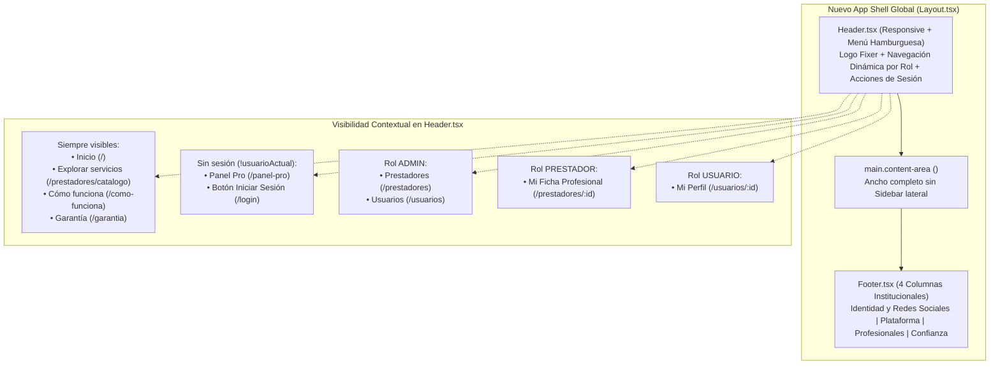
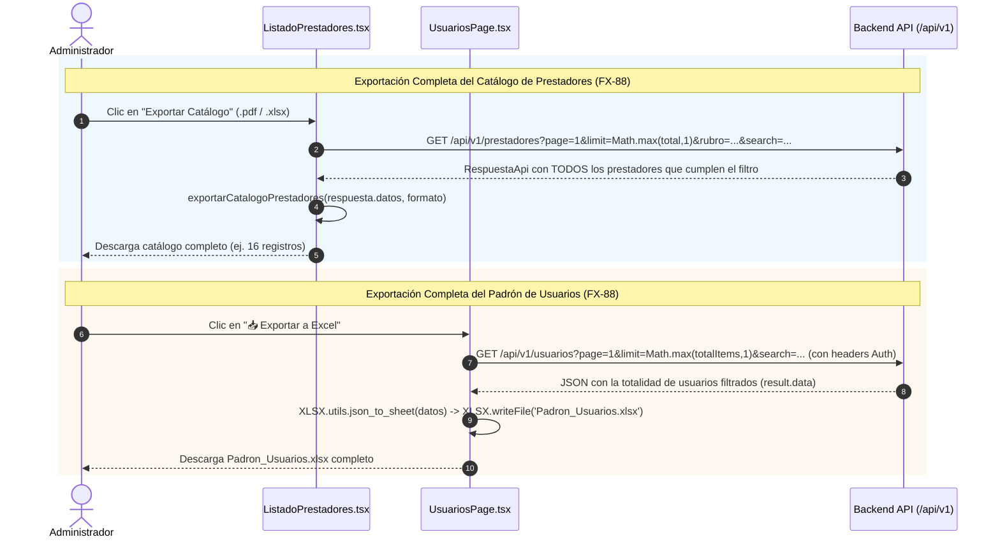

# Documento Técnico y Funcional de Ingeniería: Fase 5 — Arquitectura UX/UI Global, Navegación Responsive, Páginas Institucionales y Exportación Integral

**Proyecto:** Fixer Servicios (`fixerServicios`)  
**Responsable:** Marianela Belardinelli Beker — *Sistema de Diseño Global, Header/Footer Responsive, Páginas Informativas, Integración Contextual de Reseñas y Mejoras Transversales de Exportación*  
**Estado:** Implementado y Verificado en `develop`

---

## 1. Resumen Ejecutivo

Más allá de las tareas asignadas a su módulo vertical en las Fases 1 a 4, **Marianela Belardinelli Beker** lideró durante la evolución del proyecto un conjunto de desarrollos transversales de arquitectura Frontend, experiencia de usuario (UX/UI), navegación institucional y corrección de defectos multi-módulo que no estaban contemplados originalmente en su columna del plan de trabajo inicial.

El presente documento de **Fase 5** consolida y especifica funcional y técnicamente dichas contribuciones adicionales en el repositorio:
1. **Sistema de Diseño y Variables CSS Globales (`variables.css`) e Identidad Corporativa (`fixer-logo.png`):** Estandarización de los *Design Tokens* (paleta cromática, tipografía, radios y espaciados) utilizados por los tres módulos de la aplicación.
2. **Rediseño del Layout Maestro, Header Global Responsive y Footer Institucional (`Header.tsx`, `Footer.tsx`, `Layout.tsx`, `FX-91`, `FX-92`):** Transición desde el layout prototípico con barra lateral fija hacia una arquitectura de navegación superior e inferior moderna, adaptable a dispositivos móviles (menú hamburguesa) y sensible al rol del usuario autenticado.
3. **Páginas Institucionales y de Captación Profesional (`ComoFuncionaPage.tsx`, `GarantiaPage.tsx`, `PanelProPage.tsx`):** Diseño e implementación de tres vistas informativas y de onboarding que completan el recorrido funcional de la plataforma para clientes y prestadores.
4. **Integración Contextual de Reseñas en el Perfil Profesional y Control de Autoría (`FX-78`):** Incorporación del flujo de lectura, publicación y edición de reseñas directamente dentro de la ficha técnica de cada prestador (`/prestadores/:id`), vinculándolo con la sesión activa.
5. **Reingeniería Transversal de Exportación Completa en Prestadores y Usuarios (`FX-88`):** Corrección funcional en los módulos de los Integrantes 1 y 3 para garantizar que las exportaciones a Excel/PDF descarguen el universo completo de registros filtrados y no únicamente la página activa de la tabla.

---

## 2. Sistema de Diseño Global (`variables.css`) e Identidad Visual

Con el objetivo de unificar la estética entre los desarrollos paralelos de los tres integrantes, se creó la hoja de tokens globales [`frontend/styles/variables.css`](../frontend/styles/variables.css) importada en el punto de montaje [`frontend/src/main.tsx`](../frontend/src/main.tsx), junto con la incorporación y optimización del logotipo oficial [`frontend/assets/fixer-logo.png`](../frontend/assets/fixer-logo.png):

| Categoría de Token | Variables CSS Definidas en `:root` | Aplicación en la Interfaz |
| :--- | :--- | :--- |
| **Colores Principales** | `--color-primary: #286088`, `--color-primary-hover: #1e4969`, `--color-secondary: #8d4d33` | Botones primarios, cabeceras de reportes PDF, enlaces activos, badges e íconos destacados. |
| **Superficies y Fondos** | `--color-background: #f7f9ff`, `--color-surface: #ffffff`, `--color-surface-alt: #edf4ff` | Fondo general del layout, tarjetas de prestadores/reseñas y secciones alternas de páginas informativas. |
| **Tipografía y Textos** | `--font-family: 'Plus Jakarta Sans', sans-serif`, `--color-text: #243447`, `--color-text-secondary: #64748b` | Jerarquía tipográfica legible y contraste accesible en tablas, formularios y tarjetas. |
| **Estados y Calificaciones** | `--color-success: #4c7a4f`, `--color-error: #b3261e`, `--color-rating: #e5a23b`, `--color-rating-empty: #cbd5e1` | Alertas de validación, confirmaciones de operación y componente visual de estrellas. |
| **Geometría y Espaciado** | `--radius-sm/md/lg` (`8px`, `12px`, `16px`) y `--spacing-sm/md/lg/xl` (`8px` a `32px`) | Consistencia de márgenes, paddings y bordes redondeados en todos los contenedores. |

---

## 3. Arquitectura de Navegación Global: Header, Footer y Compactación del Layout

Se reemplazó el esquema inicial de barra lateral (`Sidebar` con enlaces numerados `1. Prestadores`, `2. Reseñas`, `3. Usuarios`) por una estructura de aplicación web productiva compuesta por [`Header.tsx`](../frontend/components/header/Header.tsx), [`Footer.tsx`](../frontend/components/footer/Footer.tsx) y un [`Layout.tsx`](../frontend/components/layout/Layout.tsx) de ancho completo:

### 3.1. Header Global Responsive ([`Header.tsx`](../frontend/components/header/Header.tsx) y [`Header.css`](../frontend/components/header/Header.css))
- **Adaptabilidad Móvil:** Incluye un botón de menú hamburguesa (`Menu` / `X` de `lucide-react`) con atributos de accesibilidad `aria-label`, `aria-expanded` y `aria-controls="fixer-navegacion"`, que despliega o repliega el panel de navegación en pantallas pequeñas y lo cierra automáticamente al seleccionar cualquier ruta (`cerrarMenu`).
- **Sincronización Reactiva con la Sesión:** Escucha tanto cambios de ubicación (`location.pathname`, `location.search`) como eventos globales (`EVENTO_CAMBIO_SESION` y `storage`) para actualizar en tiempo real los enlaces habilitados según el rol (`ADMIN`, `PRESTADOR`, `USUARIO` o visitante).
- **Depuración de Accesos Redundantes (`FX-91`):** Se eliminó el botón duplicado *"Publicar servicio"* del Header y del Footer para evitar redundancia con la sección dedicada **`Panel Pro`** (`/panel-pro`).

### 3.2. Footer Institucional ([`Footer.tsx`](../frontend/components/footer/Footer.tsx) y [`Footer.css`](../frontend/components/footer/Footer.css))
- **Columna de Identidad y Redes Sociales:** Presenta el logotipo de Fixer, la propuesta de valor y enlaces externos seguros (`target="_blank" rel="noopener noreferrer"`) a **Facebook**, **Instagram** y **LinkedIn** utilizando íconos vectoriales de `react-icons/fa` (`FaFacebookF`, `FaInstagram`, `FaLinkedinIn`).
- **Columnas de Navegación Rápida y Confianza:** Agrupa enlaces directos a *Plataforma* (`Explorar servicios`, `Cómo funciona`, `Garantía Fixer`), *Profesionales* (`Ver profesionales`, `Panel Pro`) y el badge de seguridad `<ShieldCheck /> Tu confianza es importante`.
- **Depuración de Secciones Legales (`FX-92`):** En la barra inferior (`© 2026 Fixer. Proyecto académico UTN.`) se removieron los textos estáticos no interactivos (*Privacidad*, *Términos de uso*, *Seguridad*) para mantener únicamente enlaces funcionales verificables.

---

## 4. Páginas Institucionales y de Onboarding Profesional (`frontend/pages/`)

Para brindar contexto funcional completo a los usuarios nuevos y a los profesionales interesados en ofrecer sus servicios, se diseñaron tres páginas integradas en el enrutador principal ([`App.tsx`](../frontend/src/App.tsx)) bajo la hoja de estilos compartida [`PaginasInformativas.css`](../frontend/pages/PaginasInformativas.css):

| Vista | Ruta en `App.tsx` | Propósito Funcional y Estructura de Contenidos |
| :--- | :---: | :--- |
| [`ComoFuncionaPage.tsx`](../frontend/pages/ComoFuncionaPage.tsx) | `/como-funciona` | Explica el flujo de contratación para clientes hogareños mediante un hero con CTA hacia `/prestadores/catalogo` y 3 tarjetas secuenciales: **`01 Explorá servicios`** (`Search`), **`02 Elegí un profesional`** (`MessageCircle`) y **`03 Resolvé tu necesidad`** (`CheckCircle2`). |
| [`GarantiaPage.tsx`](../frontend/pages/GarantiaPage.tsx) | `/garantia` | Comunica los tres pilares de transparencia de la plataforma (**`Información clara`**, **`Opiniones de usuarios`** y **`Una comunidad conectada`**) e incluye un bloque de aviso institucional (`Sobre la Garantía Fixer`) aclarando el carácter académico del prototipo. |
| [`PanelProPage.tsx`](../frontend/pages/PanelProPage.tsx) | `/panel-pro` | Landing page de captación para prestadores de servicios (*"FIXER PARA PROFESIONALES"*). Presenta propuesta de valor (`Mostrá tus servicios`, `Conectá con clientes`, `Construí tu reputación`), guía de alta en 3 pasos (`01 Creá tu cuenta`, `02 Completá tu perfil`, `03 Construí tu presencia`) y botones CTA (`Registrarme` / `Crear mi cuenta`) vinculados directamente con `/registro`. |

---

## 5. Integración Contextual de Reseñas en el Perfil del Prestador (`FX-78`)

Originalmente el plan de trabajo preveía una pestaña independiente `/resenas` en el menú lateral donde se ingresaba manualmente el ID numérico del profesional. Para lograr una experiencia de usuario realista y cohesiva (`FX-78`):

1. **Acoplamiento en [`PrestadorDetallePage.tsx`](../frontend/pages/PrestadorDetallePage.tsx):** Se integraron los componentes [`FormularioResena`](../frontend/components/resenas/FormularioResena.tsx) y [`ListadoResenas`](../frontend/components/resenas/ListadoResenas.tsx) al pie de la ficha técnica de cada profesional (`/prestadores/:id`), tomando automáticamente el `prestador.id` de la ruta activa.
2. **Vinculación con Usuario Autenticado y Control de Autoría:**
   - El formulario para publicar o editar una reseña se habilita cuando existe un usuario autenticado con permisos de cliente, inyectando su `usuarioId` real de sesión en lugar de un ID estático de prueba.
   - En [`ListadoResenas.tsx`](../frontend/components/resenas/ListadoResenas.tsx), el callback `onEditar` solo se pasa a [`TarjetaResena.tsx`](../frontend/components/resenas/TarjetaResena.tsx) cuando `usuarioId !== undefined && usuarioId === resena.usuarioId`, impidiendo que un usuario edite reseñas escritas por terceros.

---

## 6. Reingeniería Transversal de Exportación Completa en Prestadores y Usuarios (`FX-88`)

Durante las pruebas integrales del sistema se detectó que las funciones de exportación de los Módulos 1 (**Prestadores**) y 3 (**Usuarios**) tomaban como fuente de datos el arreglo de estado local de la página actual de la tabla (`prestadores` o `usuarios`), exportando únicamente entre 5 y 10 filas en lugar del catálogo o padrón completo.

**Marianela Belardinelli Beker** resolvió este defecto transversal (`FX-88`) interviniendo ambos módulos:

1. **En el Módulo de Prestadores ([`frontend/components/prestadores/ListadoPrestadores.tsx`](../frontend/components/prestadores/ListadoPrestadores.tsx)):**
   - Antes de invocar `exportarCatalogoPrestadores`, la función `manejarExportar()` solicita al backend la página `1` con `limit: Math.max(total, 1)`, preservando los filtros activos (`rubro`, `search`, `sortBy`, `order`), garantizando que el PDF o Excel contenga todos los profesionales encontrados sin importar en qué página de la tabla se encuentre el usuario.
2. **En el Módulo de Usuarios ([`frontend/pages/UsuariosPage.tsx`](../frontend/pages/UsuariosPage.tsx)):**
   - Se transformó `handleExport` en una operación asíncrona protegida por estados reactivos (`exportando` y `errorExportacion` con `role="alert"`), que consulta `GET /api/v1/usuarios?page=1&limit=${Math.max(totalItems, 1)}&search=${search}` adjuntando las cabeceras de autorización (`construirHeadersAutenticacion(usuarioActual)`) y genera el archivo `Padron_Usuarios.xlsx` con la totalidad de los registros.

---

## 7. Resumen de Entregables Adicionales Documentados en Fase 5

| Funcionalidad / Mejora Transversal (Marianela Belardinelli Beker) | Archivos Principales Involucrados | Ticket / Referencia |
| :--- | :--- | :---: |
| **Variables CSS Globales y Sistema de Diseño** | [`/frontend/styles/variables.css`](../frontend/styles/variables.css) y [`/frontend/src/main.tsx`](../frontend/src/main.tsx) | Base UI |
| **Identidad Visual y Logotipo Oficial Fixer** | [`/frontend/assets/fixer-logo.png`](../frontend/assets/fixer-logo.png) | Base UI |
| **Header Global Responsive con Menú Hamburguesa y Navegación por Rol** | [`/frontend/components/header/Header.tsx`](../frontend/components/header/Header.tsx) y [`/frontend/components/header/Header.css`](../frontend/components/header/Header.css) | Navegación Global / `FX-91` |
| **Footer Institucional Responsive con Redes Sociales** | [`/frontend/components/footer/Footer.tsx`](../frontend/components/footer/Footer.tsx) y [`/frontend/components/footer/Footer.css`](../frontend/components/footer/Footer.css) | Navegación Global / `FX-92` |
| **Compactación del Layout Principal (Eliminación de Sidebar antiguo)** | [`/frontend/components/layout/Layout.tsx`](../frontend/components/layout/Layout.tsx) y [`/frontend/components/layout/Layout.css`](../frontend/components/layout/Layout.css) | Layout Global |
| **Páginas Institucionales (`Cómo funciona`, `Garantía`, `Panel Pro`)** | [`/frontend/pages/ComoFuncionaPage.tsx`](../frontend/pages/ComoFuncionaPage.tsx), [`/frontend/pages/GarantiaPage.tsx`](../frontend/pages/GarantiaPage.tsx), [`/frontend/pages/PanelProPage.tsx`](../frontend/pages/PanelProPage.tsx) y [`/frontend/pages/PaginasInformativas.css`](../frontend/pages/PaginasInformativas.css) | Onboarding & Contenido |
| **Integración de Reseñas en Perfil Profesional y Control de Autoría** | [`/frontend/pages/PrestadorDetallePage.tsx`](../frontend/pages/PrestadorDetallePage.tsx) y [`/frontend/components/resenas/ListadoResenas.tsx`](../frontend/components/resenas/ListadoResenas.tsx) | `FX-78` |
| **Exportación Completa de Registros en Prestadores y Usuarios** | [`/frontend/components/prestadores/ListadoPrestadores.tsx`](../frontend/components/prestadores/ListadoPrestadores.tsx) y [`/frontend/pages/UsuariosPage.tsx`](../frontend/pages/UsuariosPage.tsx) | `FX-88` |
