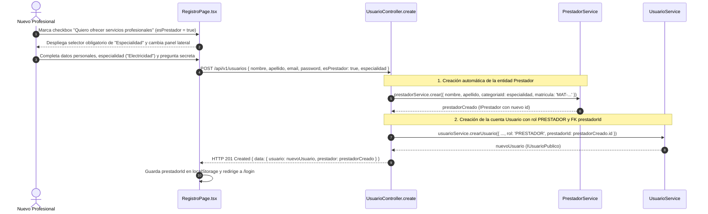
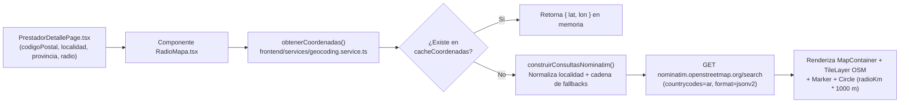

# Documento Técnico y Funcional de Ingeniería: Fase 5 — Onboarding Dual Usuario/Prestador, Mapa de Cobertura con Geocodificación Dinámica y DER Actualizado

**Proyecto:** Fixer Servicios (`fixerServicios`)  
**Responsable:** Julieta Dabús — *Vinculación Transversal Registro-Prestador, Redirección Inteligente por Rol, Mapa Cartográfico de Radio de Cobertura (Leaflet + Nominatim) y Documentación DER*  
**Estado:** Implementado y Verificado en `develop`

---

## 1. Resumen Ejecutivo

Además de los entregables previstos para el Módulo 3 en las Fases 1 a 4 del plan de trabajo original, **Julieta Dabús** diseñó e implementó en el repositorio un conjunto de funcionalidades transversales que conectan el dominio de **Usuarios y Ubicación** con el dominio de **Prestadores**, enriquecen la visualización geográfica del radio de cobertura y consolidan el diseño visual y documental del proyecto.

Este documento de **Fase 5** detalla técnica y funcionalmente dichas implementaciones adicionales:
1. **Onboarding Dual y Creación Sincronizada Usuario + Prestador en el Registro (`RegistroPage.tsx` y `UsuarioController.create`):** Extensión del flujo de alta de usuarios para permitir que un profesional se registre directamente con su especialidad, creando de forma automática y vinculada tanto su cuenta en `USUARIO` como su ficha pública en `PRESTADOR`.
2. **Enrutamiento Post-Login Sensible al Rol y Resolución Automática de Ficha Profesional (`LoginPage.tsx` y `UsuarioService.login`):** Redirección inteligente tras el inicio de sesión según el perfil (`PRESTADOR`, `ADMIN` o `USUARIO`) y vinculación automática del `prestadorId` en sesión.
3. **Mapa Interactivo de Zona y Radio de Cobertura con Geocodificación Dinámica (`RadioMapa.tsx` y `geocoding.service.ts`):** Integración cartográfica con **Leaflet / React-Leaflet** y el servicio de geocodificación abierta **Nominatim (OpenStreetMap)** dentro del perfil del profesional (`/prestadores/:id`) para representar visualmente el área geográfica de cobertura en kilómetros.
4. **Refinamiento de Privacidad de Roles, Visibilidad Condicional y Unificación Estética (`Auth.css`, `Header.tsx`, `UsuarioDetallePage.tsx`):** Adaptación de la interfaz según el rol activo (ocultamiento del campo de radio de cobertura para clientes finales y simplificación de accesos en cabecera para prestadores) y adopción de las variables globales de diseño en todas las vistas de autenticación.
5. **Actualización del Diagrama Entidad-Relación Oficial (`docs/DER-Fixer-Servicios.png`):** Relevamiento y publicación del modelo relacional definitivo del sistema en la carpeta de documentación técnica.

---

## 2. Onboarding Dual: Creación Coordinada de Usuario y Entidad Prestador

En el plan de trabajo inicial, el registro de usuarios (`POST /api/v1/usuarios`) y el alta de prestadores (`POST /api/v1/prestadores`) operaban como silos independientes. Para ofrecer un flujo funcional real a los profesionales que se suman a la plataforma desde la pantalla pública de registro (o desde la landing `/panel-pro`), se implementó una integración transversal entre los Módulos 3 y 1:

### 2.1. Experiencia de Usuario en [`frontend/pages/RegistroPage.tsx`](../frontend/pages/RegistroPage.tsx)
- **Activación Condicional (`esPrestador`):** Al tildar el checkbox `#esPrestador` (*"Quiero ofrecer servicios profesionales"*), el formulario renderiza dinámicamente el campo obligatorio **`Especialidad`** con los 9 rubros oficiales de la plataforma (*Albañilería, Carpintería, Cerrajería, Electricidad, Gasista, Jardinería, Pintura, Plomería y Refrigeración*).
- **Feedback Contextual en Panel Lateral (`.registro-imagen`) y CTA:** El mensaje motivacional del panel lateral y la etiqueta del botón de envío conmutan en tiempo real entre el perfil hogareño (*"Tu casa en manos de personas de confianza"* / **`Crear Cuenta de Cliente`**) y el perfil profesional (*"Hacé crecer tu negocio con Fixer"* / **`Crear Cuenta de Prestador`**).

### 2.2. Orquestación en Backend ([`backend/src/controller/usuario.controller.ts`](../backend/src/controller/usuario.controller.ts))
- [`UsuarioController`](../backend/src/controller/usuario.controller.ts) inyecta tanto [`UsuarioService`](../backend/src/service/usuario.service.ts) como [`PrestadorService`](../backend/src/service/prestador.service.ts).
- Cuando `esPrestador` es verdadero, determina `rol = 'PRESTADOR'`, invoca `this.prestadorService.crear(...)` generando su ficha inicial en el catálogo y pasa el identificador resultante (`prestadorCreado?.id`) a `this.service.crearUsuario(...)`, manteniendo la integridad referencial 1:1 entre la cuenta de acceso y el perfil público del profesional.

---

## 3. Redirección Inteligente por Rol al Iniciar Sesión (`LoginPage.tsx` y `UsuarioService.login`)

Para optimizar la experiencia post-autenticación según las responsabilidades de cada actor del sistema, se enriqueció la respuesta de login y la lógica de navegación en [`frontend/pages/LoginPage.tsx`](../frontend/pages/LoginPage.tsx):

| Rol Autenticado | Resolución de Contexto en `LoginPage.tsx` / `UsuarioService.login` | Ruta de Destino Automática |
| :---: | :--- | :--- |
| **`PRESTADOR`** | Resuelve el `prestadorId` vinculado a la cuenta (desde `usuario.prestadorId`, buscando coincidencia normalizada de `nombre` y `apellido` en el catálogo de prestadores o como fallback en `localStorage`), persiste `usuarioConFicha` en sesión y redirige a su perfil. | `/prestadores/${idPrestador}` (*Mi Ficha Profesional*) |
| **`ADMIN`** | Persiste la sesión administrativa y dirige al operador directamente a la tabla de gestión del catálogo. | `/prestadores` (*Panel de Gestión*) |
| **`USUARIO`** | Persiste la sesión de cliente final y dirige al buscador principal del sitio. | `/` (*Home / Buscador Principal*) |

---

## 4. Mapa Interactivo de Zona de Cobertura con Geocodificación Dinámica (`RadioMapa.tsx` y `geocoding.service.ts`)

En el modelo de dominio de Fixer, la entidad `UBICACION` define un `codigoPostal`, una `localidad`/`provincia` y un **`radio` de cobertura en kilómetros**. Para materializar visualmente este atributo en el perfil de cada profesional ([`PrestadorDetallePage.tsx`](../frontend/pages/PrestadorDetallePage.tsx)) sin requerir coordenadas estáticas pre-cargadas, **Julieta Dabús** diseñó e integró el subsistema cartográfico basado en **Leaflet (`react-leaflet`)** y **OpenStreetMap Nominatim**:

### 4.1. Servicio de Geocodificación ([`frontend/services/geocoding.service.ts`](../frontend/services/geocoding.service.ts))
- **Consulta a Nominatim OpenStreetMap:** Convierte direcciones postales argentinas (`countrycodes: 'ar'`) en coordenadas geográficas `{ lat, lon }` en tiempo de ejecución sin requerir claves de API propietarias.
- **Estrategia Multi-Consulta y Caché:** Construye una secuencia priorizada de consultas (`construirConsultasNominatim`) combinando ciudad normalizada, provincia y código postal, y almacena los resultados exitosos en un mapa en memoria (`cacheCoordenadas`) para evitar peticiones HTTP repetidas al volver a visitar una misma localidad.
- **Sincronización en Edición de Prestadores ([`FormularioPrestador.tsx`](../frontend/components/prestadores/FormularioPrestador.tsx)):** Se vinculó el cambio de provincia y localidad en el formulario del prestador para actualizar automáticamente el código postal correspondiente, garantizando que el mapa refleje siempre la zona seleccionada.

### 4.2. Componente Cartográfico ([`frontend/components/mapa/RadioMapa.tsx`](../frontend/components/mapa/RadioMapa.tsx))
- **Control de Ciclo de Vida Asíncrono:** Utiliza un flag de cancelación (`let cancelado = false`) en el cleanup de `useEffect` para descartar respuestas obsoletas si el usuario cambia rápidamente de perfil o de localidad.
- **Representación del Radio de Acción:**
  - Monta `<MapContainer>` con `key={`${coordenadas.lat},${coordenadas.lon}`}` para forzar el recentrado limpio cuando cambian las coordenadas y desactiva `scrollWheelZoom={false}` para no interferir con el scroll vertical de la página.
  - Dibuja un componente `<Circle>` centrado en `[lat, lon]` con `radius={radioKm * 1000}` (conversión de kilómetros a metros) estilizado con borde y relleno translúcido naranja (`#F97316`, `fillOpacity: 0.15`), acompañado de un `<Marker>` central cuyo `<Popup>` detalla el nombre de la zona/código postal y el radio en kilómetros.
  - Provee estados visuales dedicados para la carga (`"Cargando mapa..."`) y para casos en que la zona no pueda ser geolocalizada (`"No se pudo ubicar la zona (CP: ...). Verificá el código postal."`).

---

## 5. Refinamientos de UX por Rol, Unificación Estética y Documentación DER

### 5.1. Reglas de Visibilidad según Rol y Privacidad en Perfil
1. **Campo `Radio de Cobertura (km)` Exclusivo para Profesionales ([`UsuarioDetallePage.tsx`](../frontend/pages/UsuarioDetallePage.tsx)):**
   - Se restringió tanto el renderizado del input `radio` como su inclusión en el payload del `PATCH /api/v1/usuarios/:id` exclusivamente a los usuarios cuyo rol es `'PRESTADOR'`, evitando exponer parámetros de cobertura laboral en perfiles de clientes hogareños (`USUARIO`).
2. **Simplificación de Navegación para Rol `PRESTADOR` ([`Header.tsx`](../frontend/components/header/Header.tsx)):**
   - Se ocultó el enlace redundante a perfil de usuario cliente cuando la sesión corresponde a un `PRESTADOR`, concentrando toda la gestión de sus datos, cobertura y credenciales en **`Mi Ficha Profesional`** (`/prestadores/:id`).

### 5.2. Unificación Visual del Subsistema de Autenticación ([`frontend/pages/Auth.css`](../frontend/pages/Auth.css))
- Se migraron todos los colores, fuentes, bordes y sombras de [`Auth.css`](../frontend/pages/Auth.css) hacia las variables globales definidas en [`variables.css`](../frontend/styles/variables.css) (`--color-primary`, `--color-primary-hover`, `--color-background`, `--color-surface`, `--color-text`, `--color-border`, `--radius-sm/md/lg`).
- Se alinearon los encabezados, títulos y subtítulos entre [`LoginPage.tsx`](../frontend/pages/LoginPage.tsx) y [`RegistroPage.tsx`](../frontend/pages/RegistroPage.tsx), se fijó la proporción visual del panel lateral en escritorio y se ajustaron los puntos de quiebre responsive (`@media`) para dispositivos móviles.

### 5.3. Diagrama Entidad-Relación Actualizado ([`docs/DER-Fixer-Servicios.png`](../docs/DER-Fixer-Servicios.png))
- Se incorporó al repositorio el artefacto gráfico [`docs/DER-Fixer-Servicios.png`](../docs/DER-Fixer-Servicios.png), documentando visualmente el esquema relacional final de las entidades del sistema y sus cardinalidades.

---

## 6. Resumen de Entregables Adicionales Documentados en Fase 5

| Funcionalidad / Mejora Transversal (Julieta Dabús) | Archivos Principales Involucrados | Alcance Arquitectónico |
| :--- | :--- | :---: |
| **Registro Dual (Cliente / Prestador) con Selección de Especialidad** | [`/frontend/pages/RegistroPage.tsx`](../frontend/pages/RegistroPage.tsx) y [`/backend/src/controller/usuario.controller.ts`](../backend/src/controller/usuario.controller.ts) | Integración Módulo 3 ↔ Módulo 1 |
| **Redirección Post-Login por Rol y Vinculación Automática de Ficha** | [`/frontend/pages/LoginPage.tsx`](../frontend/pages/LoginPage.tsx) y [`/backend/src/service/usuario.service.ts`](../backend/src/service/usuario.service.ts) | Autenticación & Navegación |
| **Componente de Mapa Interactivo de Radio de Cobertura (`Leaflet`)** | [`/frontend/components/mapa/RadioMapa.tsx`](../frontend/components/mapa/RadioMapa.tsx) y [`/frontend/pages/PrestadorDetallePage.tsx`](../frontend/pages/PrestadorDetallePage.tsx) | Geolocalización UI |
| **Servicio de Geocodificación Dinámica con Nominatim (OpenStreetMap)** | [`/frontend/services/geocoding.service.ts`](../frontend/services/geocoding.service.ts) y [`/frontend/components/prestadores/FormularioPrestador.tsx`](../frontend/components/prestadores/FormularioPrestador.tsx) | Servicio Cartográfico |
| **Visibilidad Condicional por Rol en Perfil y Header** | [`/frontend/pages/UsuarioDetallePage.tsx`](../frontend/pages/UsuarioDetallePage.tsx) y [`/frontend/components/header/Header.tsx`](../frontend/components/header/Header.tsx) | UX & Control de Acceso |
| **Unificación de Estilos de Autenticación con Variables Globales** | [`/frontend/pages/Auth.css`](../frontend/pages/Auth.css), [`/frontend/pages/LoginPage.tsx`](../frontend/pages/LoginPage.tsx), [`/frontend/pages/RegistroPage.tsx`](../frontend/pages/RegistroPage.tsx) y [`/frontend/pages/RecuperarPasswordPage.tsx`](../frontend/pages/RecuperarPasswordPage.tsx) | Sistema de Diseño |
| **Diagrama Entidad-Relación Actualizado del Proyecto** | [`/docs/DER-Fixer-Servicios.png`](../docs/DER-Fixer-Servicios.png) | Documentación de Arquitectura |
